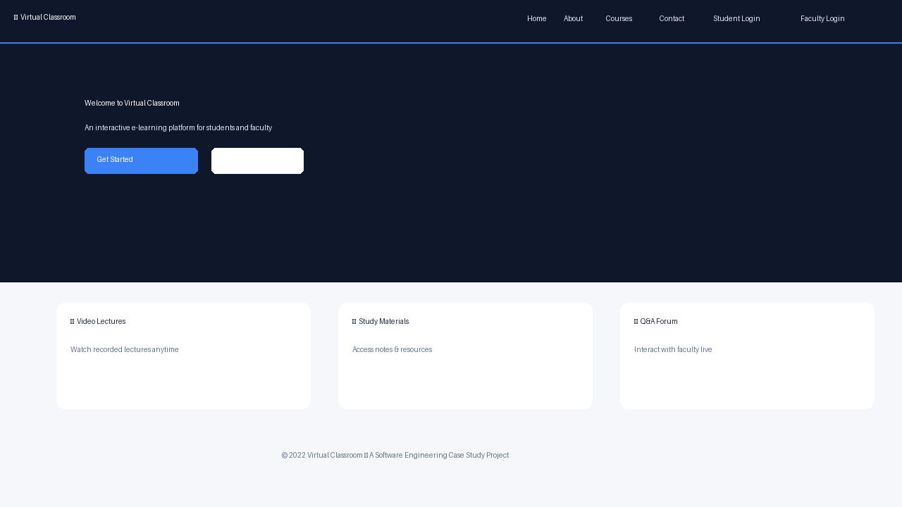
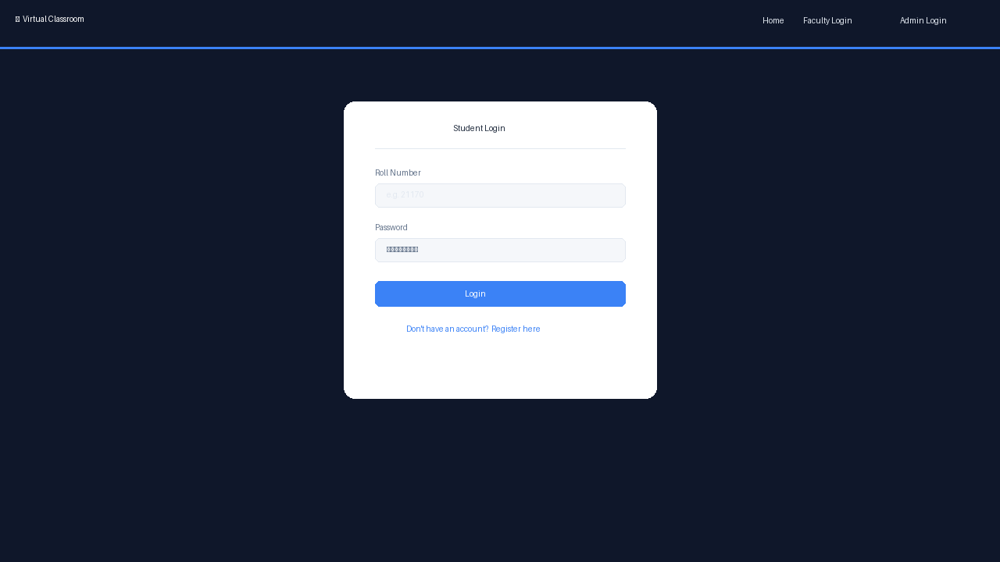
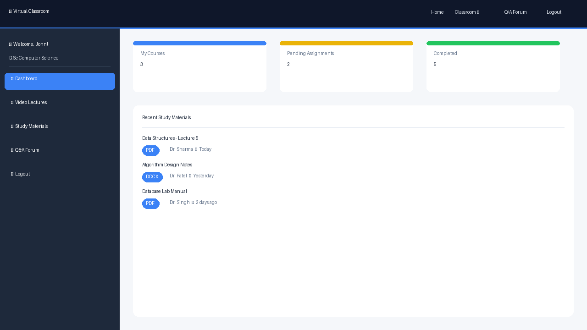
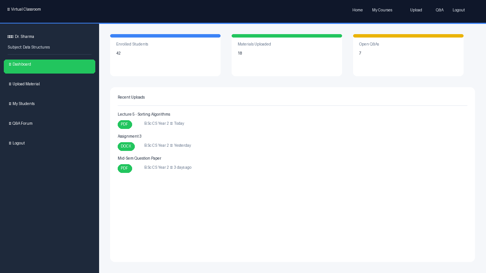
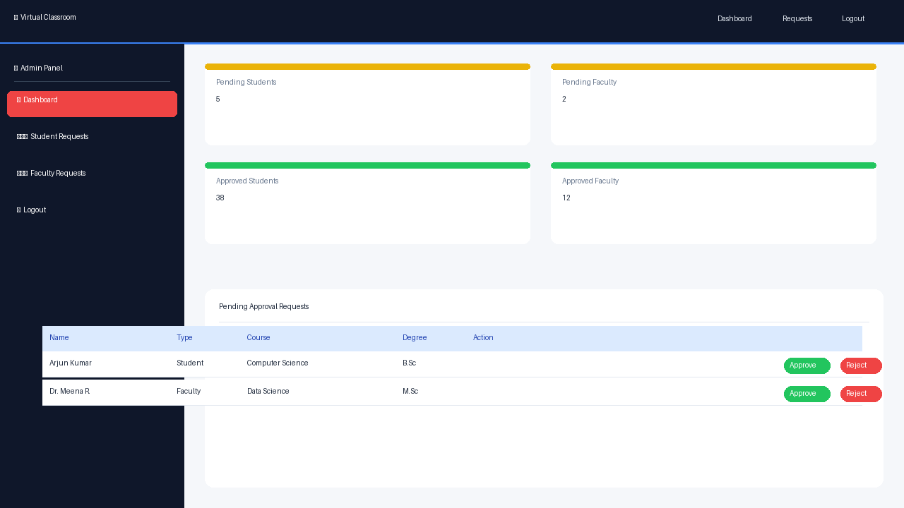
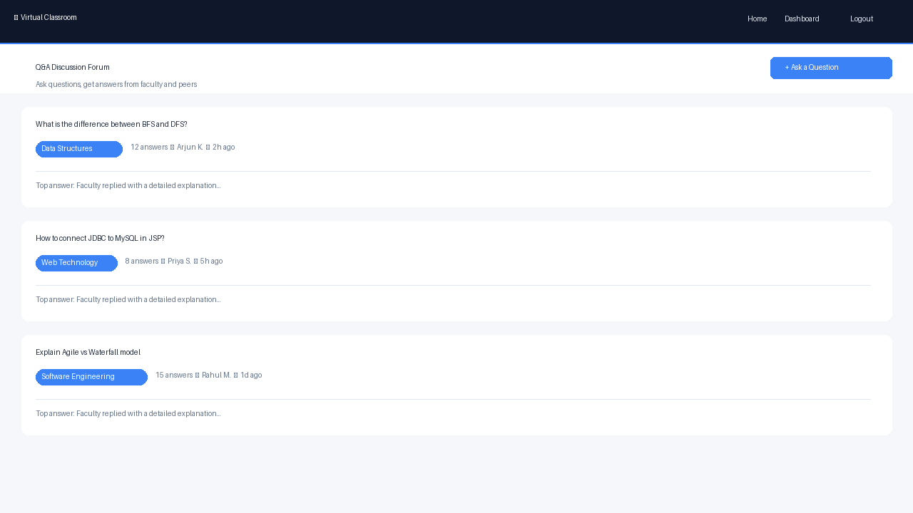
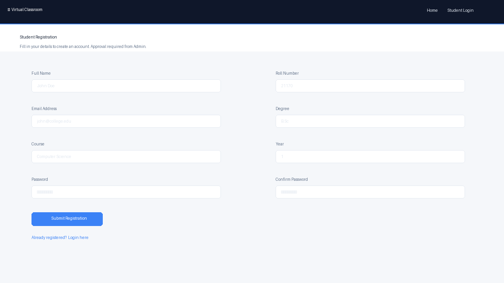
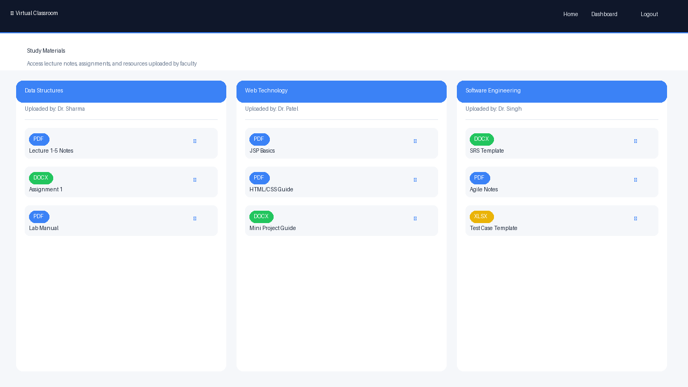

# 🎓 Virtual Classroom — A Software Engineering Case Study

> A full-stack web application that enables interactive online learning for students and faculty. Built as a Software Engineering course case study using **JSP**, **Java Servlets**, **MySQL**, and modern web technologies.

---

## 📌 Highlights
- Full-stack system with role-based access (Student / Faculty / Admin)
- Secure authentication, session handling, and database integration
- Built using JSP, Servlets, and MySQL
- Comprehensive Software Engineering artifacts and documentation

---

## 🎯 Problem Statement
Traditional classroom systems lack scalable digital interaction and centralized access to learning resources. This project provides a web-based platform for structured communication and content delivery, enabling students and faculty to collaborate effectively in a digital environment.

---

## 🏗️ System Overview
Frontend (JSP) → Backend (Servlets) → Database (MySQL) → Role-based Access Control

---

## 📸 Screenshots

| Home / Landing | Student Login | Student Dashboard |
|---|---|---|
|  |  |  |

| Faculty Dashboard | Admin Dashboard | Q&A Forum |
|---|---|---|
|  |  |  |

| Student Registration | Study Materials |
|---|---|
|  |  |

---

## 🚀 Features

### 👨‍🎓 Student Portal
- Register with personal and academic details (degree, course, year)
- Login with roll number and password (SHA1-hashed)
- Session-based access control — redirected to login if not authenticated
- Access video lectures and study materials uploaded by faculty
- Participate in the Q&A discussion forum
- Admin approval required before first login

### 👨‍🏫 Faculty Portal
- Register with subject and course details
- Upload study materials for specific courses and years
- Manage and respond to student Q&A
- Admin approval required before first login

### 🔐 Admin Panel
- Secure admin login
- Approve or reject student and faculty registration requests
- View all pending and approved users
- Full control over platform access

---

## 🗂️ Project Structure

```plaintext
virtual-classroom/
│
├── src/                            # JSP & HTML source pages
│   ├── index.jsp                   # Landing/home page
│   ├── student_login.jsp           # Student login
│   ├── student_register.jsp        # Student registration
│   ├── student_dashboard.jsp       # Student dashboard
│   ├── student_logout.jsp          # Session logout
│   ├── faculty_login.jsp           # Faculty login
│   ├── faculty_register.jsp        # Faculty registration
│   ├── faculty_dashboard.jsp       # Faculty dashboard
│   ├── faculty_logout.jsp          # Faculty logout
│   ├── admin_login.jsp             # Admin login
│   ├── admin_dashboard.jsp         # Admin control panel
│   ├── admin_student_requests.jsp  # View student requests
│   ├── admin_student_requests_action.jsp  # Approve/reject students
│   ├── admin_faculty_requests.jsp  # View faculty requests
│   ├── admin_faculty_requests_action.jsp  # Approve/reject faculty
│   ├── admin_logout.jsp            # Admin logout
│   ├── qna.html                    # Q&A forum page
│   └── study-material.html         # Study materials page
│
├── assets/
│   ├── css/                        # Bootstrap + custom stylesheets
│   ├── js/                         # jQuery, Bootstrap JS + plugins
│   ├── scss/                       # SCSS source files (modular)
│   ├── fonts/                      # Font Awesome, Flaticon, Themify
│   └── img/                        # Hero images, icons, logos
│
├── database/
│   └── project_DB.sql              # Full MySQL schema + seed data
│
├── screenshots/                    # App UI screenshots
│
├── docs/                           # Project documentation (Word doc)
│
├── se-artifacts/                   # SE course deliverables
│   ├── feasibility-report/         # Feasibility analysis documents
│   ├── srs/                        # Software Requirements Specification
│   ├── user-stories/               # Agile user stories
│   ├── scrum-notes/                # Daily standup & sprint notes
│   ├── test-cases/                 # Test case templates
│   └── material/                   # Reference guides & links
│
├── .gitignore
└── README.md
```

---

## 🛠️ Tech Stack

| Layer | Technology |
|---|---|
| **Frontend** | HTML5, CSS3, Bootstrap 4, jQuery |
| **Backend** | Java Server Pages (JSP), Java Servlets |
| **Database** | MySQL (InnoDB) |
| **Styling** | SCSS, Font Awesome, Themify Icons, Flaticon |
| **Server** | Apache Tomcat |
| **Build Tool** | Apache Maven |
| **Version Control** | Git / Bitbucket |

---

## 🗄️ Database Schema

The database (`project`) contains the following tables:

| Table | Description |
|---|---|
| `admin` | Admin credentials (SHA1-hashed password) |
| `student` | Student records with roll number, degree, course, year, approval status |
| `faculty` | Faculty records with subject, course, year, approval status |
| `enroll_for` | Valid degree-course combinations |

### Setup

```sql
-- Run the SQL script to create and seed the database
mysql -u root -p < database/project_DB.sql
```

---

## ⚙️ Getting Started

### Prerequisites

- Java JDK 8+
- Apache Tomcat 9+
- MySQL 8+
- Apache Maven

### Installation

1. **Clone the repository:**
   ```bash
   git clone https://github.com/your-username/virtual-classroom.git
   cd virtual-classroom
   ```

2. **Set up the database:**
   ```bash
   mysql -u root -p < database/project_DB.sql
   ```

3. **Configure DB connection** in your JSP files (update JDBC URL, username, password):
   ```java
   Connection con = DriverManager.getConnection(
       "jdbc:mysql://localhost:3306/project", "root", "your_password"
   );
   ```

4. **Deploy to Tomcat:**
   - Copy the project folder into Tomcat's `webapps/` directory
   - Start Tomcat: `./catalina.sh start`
   - Access in browser: `http://localhost:8080/virtual-classroom/`

---

## 🔑 Default Admin Credentials

| Role | Credential | Value |
|---|---|---|
| Admin | Password | `Mypasswordis2425` |

> Students and faculty must register first and await admin approval.

---

## 📋 Software Engineering Artifacts

This project was developed as part of a Software Engineering course following Agile methodology. All SE deliverables are in the `se-artifacts/` folder:

| Artifact | Location |
|---|---|
| Feasibility Report | `se-artifacts/feasibility-report/` |
| Software Requirements Specification (SRS) | `se-artifacts/srs/` |
| User Stories (Agile) | `se-artifacts/user-stories/` |
| Scrum / Standup Notes | `se-artifacts/scrum-notes/` |
| Test Cases | `se-artifacts/test-cases/` |
| Reference Material & Links | `se-artifacts/material/` |

---

## 🔧 SE Tools Used

- **JIRA** — Sprint planning and issue tracking
- **Apache Maven** — Build automation
- **JUnit** — Unit testing
- **Selenium** — UI/functional testing
- **Cobertura** — Code coverage
- **Coverity** — Static code analysis
- **SonarQube** — Code quality
- **Jenkins** — CI/CD pipeline
- **Bitbucket** — Version control & code review

---

## 🚀 Future Improvements

- Add real-time video conferencing (WebRTC integration)
- Implement live chat during lectures
- Add assignment submission and grading system
- Build a notification system for approvals and new materials
- Make fully responsive for mobile devices
- Deploy to cloud (AWS / Azure / GCP)

---

## 👥 Team

Developed by **Group 7** as a Software Engineering Case Study.

---

*Virtual Classroom — Empowering Education Through Technology*