# Virtual Classroom Platform — Entity-Relationship (ER) Architecture

## 1. Executive Summary

This document establishes the comprehensive Entity-Relationship (ER) model for the Virtual Classroom Platform, representing all **20 production database tables** managed via Flyway migrations (`V1__init_schema.sql` through `V4__academic_platform_expansion.sql`).

The schema supports six cohesive functional domains:
1. **Identity & Access Management (IAM)**: `users`, `student_profiles`, `faculty_profiles`, `refresh_tokens`
2. **Academic Catalog & Enrollment**: `courses`, `subjects`, `student_subject_enrollments`, `faculty_subject_assignments`
3. **Learning Resources & Delivery**: `study_materials`, `study_material_ratings`, `recorded_lectures`, `live_sessions`
4. **Coursework & Evaluation**: `assignments`, `assignment_submissions`, `examinations`, `examination_results`
5. **Collaboration & Communication**: `qa_threads`, `qa_replies`, `notifications`
6. **Observability & Auditing**: `audit_logs`

---

## 2. Complete Mermaid Entity-Relationship Diagram

```mermaid
erDiagram
    users ||--o| student_profiles : "1:1 profile"
    users ||--o| faculty_profiles : "1:1 profile"
    users ||--o{ refresh_tokens : "has tokens"
    users ||--o{ audit_logs : "initiates actions"
    users ||--o{ notifications : "receives"
    users ||--o{ qa_threads : "authors threads"
    users ||--o{ qa_replies : "authors replies"

    courses ||--o{ subjects : "contains subjects"
    courses ||--o{ student_profiles : "enrolled degree"

    subjects ||--o{ student_subject_enrollments : "has enrolled students"
    users ||--o{ student_subject_enrollments : "student enrolled in"

    subjects ||--o{ faculty_subject_assignments : "assigned faculty"
    faculty_profiles ||--o{ faculty_subject_assignments : "faculty teaching"

    subjects ||--o{ study_materials : "course materials"
    faculty_profiles ||--o{ study_materials : "uploaded by"
    study_materials ||--o{ study_material_ratings : "receives ratings"
    users ||--o{ study_material_ratings : "rated by"

    subjects ||--o{ recorded_lectures : "recorded video lectures"
    faculty_profiles ||--o{ recorded_lectures : "presented by"

    subjects ||--o{ live_sessions : "virtual meetings"
    users ||--o{ live_sessions : "hosted by faculty"

    subjects ||--o{ assignments : "coursework assignments"
    users ||--o{ assignments : "created by faculty"
    assignments ||--o{ assignment_submissions : "receives submissions"
    users ||--o{ assignment_submissions : "submitted by student"
    users ||--o| assignment_submissions : "graded by faculty"

    subjects ||--o{ examinations : "assessments/exams"
    users ||--o{ examinations : "scheduled by faculty"
    examinations ||--o{ examination_results : "evaluates students"
    users ||--o{ examination_results : "student scored"
    users ||--o| examination_results : "evaluated by faculty"

    subjects ||--o{ qa_threads : "subject discussions"
    qa_threads ||--o{ qa_replies : "thread replies"

    users {
        BIGINT id PK
        VARCHAR email UK
        VARCHAR password_hash
        VARCHAR full_name
        VARCHAR role
        VARCHAR status
        VARCHAR rejection_reason
        VARCHAR avatar_url
        VARCHAR phone_number
        TIMESTAMPTZ created_at
        TIMESTAMPTZ updated_at
    }

    student_profiles {
        BIGINT user_id PK,FK
        VARCHAR roll_number UK
        INT course_id FK
        INT current_year
        TEXT bio
        TIMESTAMPTZ created_at
        TIMESTAMPTZ updated_at
    }

    faculty_profiles {
        BIGINT user_id PK,FK
        VARCHAR employee_id UK
        VARCHAR department
        VARCHAR designation
        VARCHAR office_hours
        TEXT bio
        TIMESTAMPTZ created_at
        TIMESTAMPTZ updated_at
    }

    refresh_tokens {
        BIGINT id PK
        BIGINT user_id FK
        VARCHAR token_hash UK
        TIMESTAMPTZ expires_at
        BOOLEAN revoked
        TIMESTAMPTZ created_at
    }

    courses {
        INT id PK
        VARCHAR code UK
        VARCHAR name
        INT duration_years
        TIMESTAMPTZ created_at
    }

    subjects {
        INT id PK
        INT course_id FK
        VARCHAR code UK
        VARCHAR title
        INT year_level
        INT semester
        INT credits
        TEXT description
        TIMESTAMPTZ created_at
    }

    student_subject_enrollments {
        BIGINT id PK
        BIGINT student_id FK
        INT subject_id FK
        VARCHAR academic_term
        VARCHAR status
        TIMESTAMPTZ enrolled_at
        TIMESTAMPTZ updated_at
    }

    faculty_subject_assignments {
        BIGINT id PK
        BIGINT faculty_id FK
        INT subject_id FK
        VARCHAR academic_term
        TIMESTAMPTZ assigned_at
    }

    study_materials {
        BIGINT id PK
        INT subject_id FK
        BIGINT faculty_id FK
        VARCHAR title
        TEXT description
        VARCHAR file_name
        VARCHAR file_path
        VARCHAR content_type
        BIGINT file_size_bytes
        TIMESTAMPTZ created_at
    }

    study_material_ratings {
        BIGINT id PK
        BIGINT material_id FK
        BIGINT student_id FK
        INT rating
        TEXT review_text
        TIMESTAMPTZ created_at
    }

    recorded_lectures {
        BIGINT id PK
        INT subject_id FK
        BIGINT faculty_id FK
        VARCHAR title
        TEXT description
        VARCHAR video_url
        INT duration_seconds
        TIMESTAMPTZ created_at
    }

    live_sessions {
        BIGINT id PK
        INT subject_id FK
        BIGINT host_faculty_id FK
        VARCHAR title
        TEXT description
        VARCHAR meeting_link
        VARCHAR platform
        TIMESTAMPTZ scheduled_start
        TIMESTAMPTZ scheduled_end
        VARCHAR status
        TIMESTAMPTZ created_at
        TIMESTAMPTZ updated_at
    }

    assignments {
        BIGINT id PK
        INT subject_id FK
        BIGINT created_by FK
        VARCHAR title
        TEXT description
        TIMESTAMPTZ due_date
        INT max_points
        VARCHAR attachment_url
        TIMESTAMPTZ created_at
        TIMESTAMPTZ updated_at
    }

    assignment_submissions {
        BIGINT id PK
        BIGINT assignment_id FK
        BIGINT student_id FK
        TEXT submission_text
        VARCHAR file_url
        TIMESTAMPTZ submitted_at
        INT grade_points
        TEXT feedback
        BIGINT graded_by FK
        TIMESTAMPTZ graded_at
        VARCHAR status
    }

    examinations {
        BIGINT id PK
        INT subject_id FK
        BIGINT created_by FK
        VARCHAR title
        VARCHAR exam_type
        INT total_marks
        INT duration_minutes
        TIMESTAMPTZ scheduled_at
        TEXT instructions
        TIMESTAMPTZ created_at
    }

    examination_results {
        BIGINT id PK
        BIGINT examination_id FK
        BIGINT student_id FK
        NUMERIC marks_obtained
        VARCHAR grade
        TEXT remarks
        BIGINT graded_by FK
        TIMESTAMPTZ graded_at
        TIMESTAMPTZ created_at
    }

    qa_threads {
        BIGINT id PK
        INT subject_id FK
        BIGINT author_id FK
        VARCHAR title
        TEXT content
        INT upvotes
        TIMESTAMPTZ created_at
        TIMESTAMPTZ updated_at
    }

    qa_replies {
        BIGINT id PK
        BIGINT thread_id FK
        BIGINT author_id FK
        TEXT content
        BOOLEAN is_endorsed
        INT upvotes
        TIMESTAMPTZ created_at
        TIMESTAMPTZ updated_at
    }

    notifications {
        BIGINT id PK
        BIGINT user_id FK
        VARCHAR title
        TEXT message
        VARCHAR category
        BOOLEAN is_read
        TIMESTAMPTZ created_at
    }

    audit_logs {
        BIGINT id PK
        BIGINT user_id FK
        VARCHAR action
        VARCHAR target_entity
        VARCHAR target_id
        TEXT details
        VARCHAR ip_address
        TIMESTAMPTZ created_at
    }
```

---

## 3. Relational Cardinalities and Integrity Rules

| Parent Table | Child Table | Foreign Key Column | Cardinality | Referential Action (ON DELETE) | Business Rationale |
|:---|:---|:---|:---|:---|:---|
| `users` | `student_profiles` | `user_id` | 1 : 0..1 | `CASCADE` | Student profile is dependent on base user account identity. |
| `users` | `faculty_profiles` | `user_id` | 1 : 0..1 | `CASCADE` | Faculty profile is dependent on base user account identity. |
| `users` | `refresh_tokens` | `user_id` | 1 : 0..N | `CASCADE` | Session tokens are invalidated when the user account is purged. |
| `courses` | `subjects` | `course_id` | 1 : 0..N | `RESTRICT` | Cannot delete a course while academic curriculum subjects remain. |
| `courses` | `student_profiles` | `course_id` | 1 : 0..N | `RESTRICT` | Cannot delete an enrolled academic degree with active students. |
| `subjects` | `student_subject_enrollments` | `subject_id` | 1 : 0..N | `CASCADE` | Subject deletion removes enrollment roster records. |
| `users` | `student_subject_enrollments` | `student_id` | 1 : 0..N | `CASCADE` | Purging a student removes enrollment records. |
| `subjects` | `faculty_subject_assignments` | `subject_id` | 1 : 0..N | `CASCADE` | Subject deletion removes faculty assignment mapping. |
| `faculty_profiles` | `faculty_subject_assignments` | `faculty_id` | 1 : 0..N | `CASCADE` | Removing faculty profile cleans up subject assignments. |
| `subjects` | `study_materials` | `subject_id` | 1 : 0..N | `CASCADE` | Study materials belong directly to subject syllabus. |
| `faculty_profiles` | `study_materials` | `faculty_id` | 1 : 0..N | `RESTRICT` | Retain educational content authored by verified faculty. |
| `study_materials` | `study_material_ratings` | `material_id` | 1 : 0..N | `CASCADE` | Deleting material removes student rating scores. |
| `subjects` | `recorded_lectures` | `subject_id` | 1 : 0..N | `CASCADE` | Recorded lectures belong directly to subject curriculum. |
| `subjects` | `live_sessions` | `subject_id` | 1 : 0..N | `CASCADE` | Virtual live sessions are scheduled under a subject. |
| `users` | `live_sessions` | `host_faculty_id` | 1 : 0..N | `RESTRICT` | Retain meeting audit trail even if host faculty is modified. |
| `subjects` | `assignments` | `subject_id` | 1 : 0..N | `CASCADE` | Subject deletion removes coursework tasks. |
| `assignments` | `assignment_submissions` | `assignment_id` | 1 : 0..N | `CASCADE` | Coursework deletion cascades to student submissions. |
| `users` | `assignment_submissions` | `student_id` | 1 : 0..N | `CASCADE` | Student record purge clears submission records. |
| `users` | `assignment_submissions` | `graded_by` | 1 : 0..N | `SET NULL` | Grader account removal preserves student grade and feedback. |
| `subjects` | `examinations` | `subject_id` | 1 : 0..N | `CASCADE` | Subject deletion cascades to examination schedules. |
| `examinations` | `examination_results` | `examination_id` | 1 : 0..N | `CASCADE` | Exam deletion cascades to individual scored grades. |
| `users` | `examination_results` | `student_id` | 1 : 0..N | `CASCADE` | Student purge clears academic grading ledger. |
| `users` | `examination_results` | `graded_by` | 1 : 0..N | `SET NULL` | Evaluator purge preserves certified student grade. |
| `subjects` | `qa_threads` | `subject_id` | 1 : 0..N | `CASCADE` | Discussions are categorized by curriculum subject. |
| `qa_threads` | `qa_replies` | `thread_id` | 1 : 0..N | `CASCADE` | Discussion reply cascades from main parent thread. |
| `users` | `notifications` | `user_id` | 1 : 0..N | `CASCADE` | User-specific alert messages cascade on account deletion. |
| `users` | `audit_logs` | `user_id` | 1 : 0..N | `SET NULL` | Regulatory audit log entries remain immutable for compliance. |
