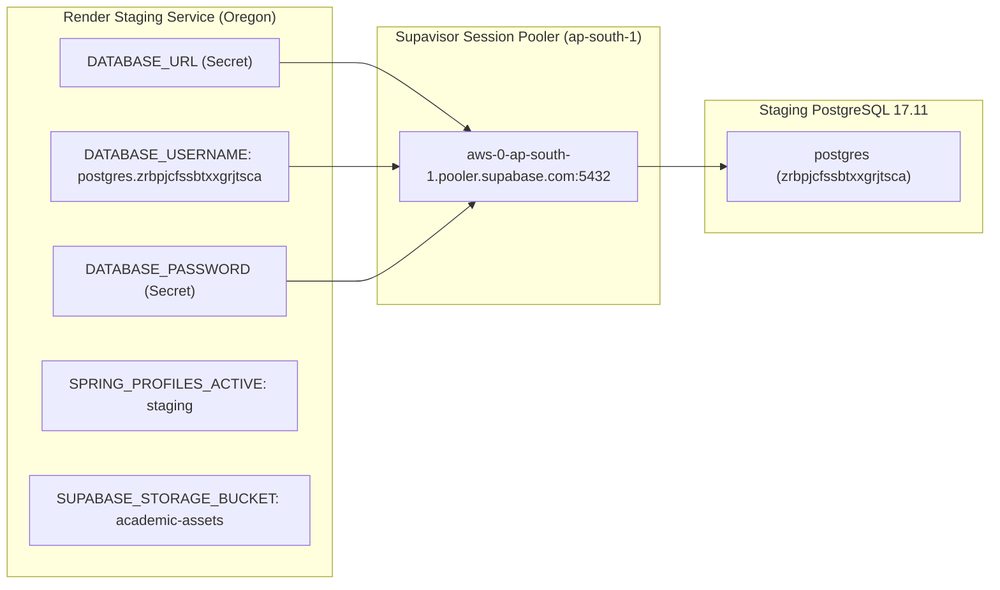
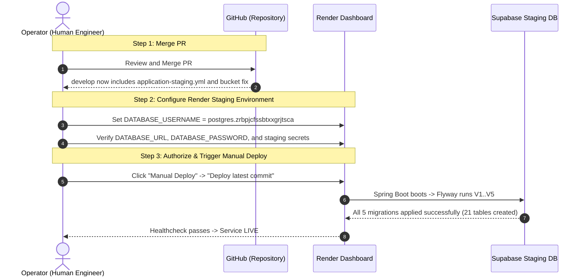

# Milestone 17.4 — Staging Deployment Configuration Readiness Report

**Target Infrastructure:**
* **Supabase Project:** `virtual-classroom-staging` (`zrbpjcfssbtxxgrjtsca`)
* **Region:** `ap-south-1` (Mumbai, India)
* **PostgreSQL Engine:** 17.11 (Supabase Hosted)
* **Connection Routing:** Supavisor Session Pooler (Port 5432, IPv4 Native)
* **Backend Hosting:** Render (`virtual-classroom-backend-staging`)
* **Spring Boot Profile:** `staging`
* **Audit Date:** November 15, 2026
* **Final Status:** **`BLOCKED — CONFIGURATION OR BRANCH CORRECTIONS REQUIRED`**

---

## 1. Executive Summary

This pre-deployment audit evaluates the end-to-end readiness of the Virtual Classroom staging deployment on Render prior to authorizing the first live database migration against the pristine Supabase staging database.

While the live database is confirmed clean (0 tables, PostgreSQL 17.11) and the migration scripts (`V1`–`V5`) have been certified safe in Milestone 17.3, **the staging deployment is currently BLOCKED** by two operational configuration discrepancies between the repository branches and the Render service definition:

1. **Branch Gap (PR #5 Unmerged):** Render's staging service is configured to track and deploy from the **`develop`** branch (`render.yaml:13`). However, the staging remediation changes (including the creation of `application-staging.yml` and the correction of `SUPABASE_STORAGE_BUCKET` to `academic-assets`) reside on branch **`feature/staging-readiness-config`** and are held in **open, unmerged Pull Request #5**. Deploying `develop` in its current state will trigger immediate container startup failure.
2. **Tenant-Qualified Username Requirement:** In `render.yaml:23-24`, `DATABASE_USERNAME` defaults to `postgres`. When routing through the Supavisor Session Pooler (`aws-0-ap-south-1.pooler.supabase.com:5432`), Supabase requires the tenant-scoped username: **`postgres.zrbpjcfssbtxxgrjtsca`**. The plain username `postgres` will fail pooler tenant routing.

---

## 2. Git Branch & Pull Request Audit

| Audit Item | Current Reality | Required Target | Compliance |
|---|---|---|---|
| **Active Local Branch** | `feature/staging-readiness-config` | Working branch | **VERIFIED** |
| **Current HEAD Commit SHA** | `64a3e1d0fa82ca4342fc87c9ae17706da5083220` | Remediated staging commit | **VERIFIED** |
| **Tracked Working Tree State** | Clean (`nothing added to commit`) | Clean | **VERIFIED** |
| **GitHub Pull Request #5 Status** | **OPEN and UNMERGED** | Merged into `develop` | **BLOCKED** |
| **PR #5 Target Base Branch** | `develop` (`2c7f36bd2dd147f733543937304ddbe0468cca6e`) | `develop` | **VERIFIED** |
| **Render Staging Service Branch** | `develop` (`render.yaml:13`) | Tracks `develop` | **VERIFIED** |
| **`application-staging.yml` on `develop`** | **ABSENT** (File does not exist on `origin/develop`) | Present in classpath | **BLOCKED** |
| **`SUPABASE_STORAGE_BUCKET` on `develop`** | `academic-assets-staging` (Causes `IllegalArgumentException`) | `academic-assets` | **BLOCKED** |

### 2.1 Impact Analysis of the Branch Discrepancy
If a deployment is triggered on Render against the current `develop` branch:
1. **Missing Profile Contract:** The application will attempt to activate `SPRING_PROFILES_ACTIVE=staging`. Because `application-staging.yml` does not exist on `develop`, Spring Boot will fail to bind the staging datasource, Flyway configuration, and HikariCP settings.
2. **Storage Allowlist Crash:** `render.yaml` on `develop` injects `SUPABASE_STORAGE_BUCKET=academic-assets-staging`. In [`backend/src/main/java/com/virtualclassroom/service/FileStorageService.java:43`](file:///C:/Users/GS_Y/Downloads/New%20folder/Mine/Projects/Github/virtual-classroom/backend/src/main/java/com/virtualclassroom/service/FileStorageService.java#L43), `ALLOWED_BUCKETS` strictly permits only:
   - `academic-assets`
   - `study-materials`
   - `submissions`
   - `profile-photos`
   - `course-documents`  
   Passing `academic-assets-staging` triggers an immediate `IllegalArgumentException` on container startup, crashing the service.

**Remediation Required:** Pull Request #5 must be merged into `develop` on GitHub before any deployment of `develop` is triggered on Render.

---

## 3. Render Environment Configuration Audit

A rigorous inspection of [`render.yaml`](file:///C:/Users/GS_Y/Downloads/New%20folder/Mine/Projects/Github/virtual-classroom/render.yaml) and [`backend/src/main/resources/application-staging.yml`](file:///C:/Users/GS_Y/Downloads/New%20folder/Mine/Projects/Github/virtual-classroom/backend/src/main/resources/application-staging.yml) was conducted:



### 3.1 Environment Variable Verification Matrix

| Environment Variable | Render Blueprint Config | Required Staging Target Value | Safety & Privacy Classification | Audit Result |
|---|---|---|---|---|
| **`SPRING_PROFILES_ACTIVE`** | `value: staging` (line 18) | `staging` | Public identifier | **COMPLIANT** |
| **`PORT`** | `value: 8080` (line 20) | `8080` | Standard internal port | **COMPLIANT** |
| **`DATABASE_URL`** | `sync: false` (line 21-22) | `jdbc:postgresql://aws-0-ap-south-1.pooler.supabase.com:5432/postgres?sslmode=require` | Protected secret (Dashboard) | **COMPLIANT** |
| **`DATABASE_USERNAME`** | `value: postgres` (line 23-24) | **`postgres.zrbpjcfssbtxxgrjtsca`** | Tenant routing identifier | **ACTION REQUIRED** |
| **`DATABASE_PASSWORD`** | `sync: false` (line 25-26) | Staging database password | Protected secret (Dashboard) | **COMPLIANT** |
| **`JWT_SECRET`** | `sync: false` (line 27-28) | Dedicated 256-bit staging HMAC secret | Protected secret (Dashboard) | **COMPLIANT** |
| **`JWT_EXPIRATION_MS`** | `value: 86400000` (line 29-30) | `86400000` (24 hours) | Public runtime configuration | **COMPLIANT** |
| **`COOKIE_SECURE`** | `value: true` (line 31-32) | `true` (Enforces HTTPS cookie flag) | Public security policy | **COMPLIANT** |
| **`CORS_ALLOWED_ORIGINS`** | `value: https://virtual-classroom-staging.vercel.app,http://localhost:5173` | Vercel staging domain + local dev | Public domain allowlist | **COMPLIANT** |
| **`STORAGE_PROVIDER`** | `value: supabase` (line 35-36) | `supabase` | Component provider selector | **COMPLIANT** |
| **`SUPABASE_URL`** | `sync: false` (line 37-38) | `https://zrbpjcfssbtxxgrjtsca.supabase.co` | Protected project URL | **COMPLIANT** |
| **`SUPABASE_SERVICE_ROLE_KEY`**| `sync: false` (line 39-40) | Server-side storage secret key | Protected secret (Dashboard) | **COMPLIANT** |
| **`SUPABASE_STORAGE_BUCKET`** | `value: academic-assets` (PR #5) | `academic-assets` | Application allowlisted bucket | **COMPLIANT (On PR #5)** |

### 3.2 Strict Staging versus Production Isolation
* **Zero Shared Databases:** Staging routes strictly to `aws-0-ap-south-1.pooler.supabase.com:5432` with project reference `zrbpjcfssbtxxgrjtsca`. Production uses a completely independent Supabase project (`virtual-classroom-prod`).
* **Zero Shared Credentials:** `DATABASE_PASSWORD`, `JWT_SECRET`, and `SUPABASE_SERVICE_ROLE_KEY` are marked `sync: false` and must be populated with staging-only credentials in Render.
* **Storage Isolation:** Staging files are stored in the staging project's bucket, isolated by Supabase project boundaries.

---

## 4. Render Deployment Behavior & Control Protocol

### 4.1 Deployment Trigger & Automation Policy
* **Automatic Deploys Disabled (`autoDeploy: false`):** Both `render.yaml:15` and `infrastructure/render/render-staging.yaml:14` explicitly set:
  ```yaml
  autoDeploy: false
  ```
  Pushing commits or merging pull requests into `develop` will **NOT automatically trigger a build or deployment**.
* **Manual Deployment Mechanism:** Deployment is strictly operator-initiated via the Render Dashboard:
  - Navigation: Render Dashboard $\rightarrow$ Services $\rightarrow$ `virtual-classroom-backend-staging` $\rightarrow$ **Manual Deploy** $\rightarrow$ **Deploy latest commit**.

### 4.2 First-Start Flyway Execution Behavior
When the container boots on Render with `SPRING_PROFILES_ACTIVE=staging`:
1. Spring Boot's `FlywayAutoConfiguration` executes before Hibernate initializes the JPA `EntityManagerFactory`.
2. Flyway detects an empty database (0 public tables, confirmed in Milestone 17.3).
3. Flyway skips baseline and executes:
   - `V1__init_schema.sql` (Creates 13 tables, 10 sequences, 8 indexes)
   - `V2__seed_academic_data.sql` (Seeds 5 degrees, 9 courses, 8 subjects, 5 demo accounts, coursework)
   - `V3__security_harden_remove_demo_users.sql` (Purges 5 demo accounts; resets sequences to 1)
   - `V4__academic_platform_expansion.sql` (Creates 7 tables, adds columns, 14 indexes)
   - `V5__password_reset_and_course_archival.sql` (Creates password tokens, course archival, 2 indexes)
4. Hibernate initializes and validates the completed schema (`ddl-auto: validate`).
5. Spring Boot starts the embedded Tomcat server on port 8080 and Actuator exposes `/actuator/health/liveness`.
6. Render health check succeeds, routing traffic to the newly migrated staging container.

### 4.3 Safe Deployment Control & Rollback Protocol
* **Container Failure Containment:** If any migration script fails during container startup, Spring Boot will throw a `FlywayException` and terminate with a non-zero exit code.
* **Traffic Protection:** Render will detect the container crash or failed health check (`/actuator/health/liveness`) and will **never route live traffic** to a failed container.
* **Transactional Rollback:** In PostgreSQL, DDL is fully transactional. If a script fails midway, Flyway cleanly rolls back the failing transaction.

---

## 5. Database Migration Execution Risk Analysis

| Risk Area | Evaluated Scenario | Safeguard / Protection Mechanism | Risk Level |
|---|---|---|---|
| **Accidental Production Mutation** | Staging backend connecting to production Supabase | Render staging service uses isolated environment variables with staging project reference `zrbpjcfssbtxxgrjtsca`. | **ZERO RISK** |
| **Advisory Lock Failure in Pooler** | Flyway lock contention or failure over connection pooler | Configured for Supavisor Session Pooler (port 5432), where physical connections are held per session, fully supporting `pg_advisory_lock`. | **ZERO RISK** |
| **Hibernate DDL Collisions** | Hibernate mutating or dropping tables at startup | `application-staging.yml:18` strictly enforces `hibernate.ddl-auto: validate`. Hibernate has zero DDL privileges. | **ZERO RISK** |
| **Unexpected Table Deletions** | Migrations executing destructive drop/truncate commands | Source audit in Milestone 17.3 proved V1–V5 contain zero `DROP TABLE`, zero `TRUNCATE`, and V3 purges strictly the 5 demo accounts. | **ZERO RISK** |
| **Maven Plugin Misconfiguration** | CLI `flyway:migrate` run without PostgreSQL driver | Staging relies entirely on embedded Spring Boot Flyway autoconfiguration at container runtime; no broken CLI invocation. | **ZERO RISK** |

---

## 6. Actionable Remediation Roadmap

To transition this deployment from `BLOCKED` to `READY FOR HUMAN DEPLOYMENT APPROVAL`, complete the following two steps:



### Step 1: Merge PR #5 into `develop` on GitHub
* Merge [PR #5](https://github.com/GreeshmanthSaiY/Virtual-Classroom-Platform/pull/5) into `develop`.
* This brings `application-staging.yml`, the aligned bucket `academic-assets`, and the cross-site refresh cookie configuration into the branch deployed by Render.

### Step 2: Configure `DATABASE_USERNAME` in Render Dashboard
* In Render Dashboard $\rightarrow$ `virtual-classroom-backend-staging` $\rightarrow$ **Environment**:
  - Set `DATABASE_USERNAME` = `postgres.zrbpjcfssbtxxgrjtsca`
  - Ensure `DATABASE_URL` = `jdbc:postgresql://aws-0-ap-south-1.pooler.supabase.com:5432/postgres?sslmode=require`
  - Ensure `DATABASE_PASSWORD` is set to the staging database password.

---

## 7. Final Status Determination

```
================================================================================
     FINAL STATUS: BLOCKED — CONFIGURATION OR BRANCH CORRECTIONS REQUIRED
================================================================================
- Staging Database:           VERIFIED (PostgreSQL 17.11, clean schema, 0 tables)
- Migration Integrity:        VERIFIED (V1-V5 sequential, checksummed, audited)
- JPA Entity Mapping:         VERIFIED (All 21 entities match post-V5 schema)
- Render Blueprint Policy:    VERIFIED (autoDeploy: false; manual deploy only)
- BLOCKER 1 (Branch):         PR #5 is UNMERGED. 'develop' lacks application-staging.yml
                              and contains invalid bucket 'academic-assets-staging'.
- BLOCKER 2 (Username):       render.yaml defaults DATABASE_USERNAME to 'postgres'.
                              Render Dashboard must set 'postgres.zrbpjcfssbtxxgrjtsca'
                              for Supavisor Session Pooler tenant routing.
================================================================================
ACTION REQUIRED BEFORE DEPLOYMENT:
1. Merge GitHub PR #5 into develop.
2. In Render Dashboard, set DATABASE_USERNAME = postgres.zrbpjcfssbtxxgrjtsca.
Once both are complete, status transitions to READY FOR HUMAN DEPLOYMENT APPROVAL.
================================================================================
```
