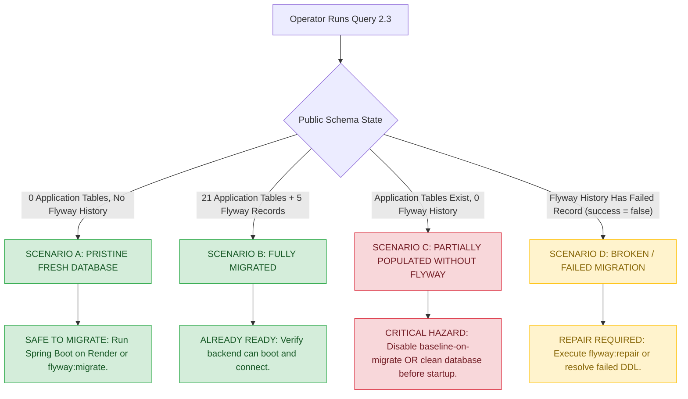

# Milestone 17, 17.1 & 17.2 — Staging Database Migration Preflight & Inspection SQL Report

**Target Supabase Project:** `virtual-classroom-staging`  
**Project Reference:** `zrbpjcfssbtxxgrjtsca`  
**Region:** `ap-south-1` (Mumbai, India)  
**Connection Mode:** Supavisor Session Pooler (Port 5432)  
**Database:** `postgres`  
**Audit Date:** November 15, 2026  
**Final Status:** **STOPPED (AWAITING OPERATOR MANUAL SQL INSPECTION)**  

---

## 1. Network Connectivity & Port 5432 Verification (Milestone 17.1 Resolution)

### 1.1 Root Cause Analysis of Previous Connection Failure
In Milestone 17, a PowerShell TCP probe (`Test-NetConnection -ComputerName "aws-0-ap-south-1.pooler.supabase.com" -Port 5432`) returned:
`WARNING: Name resolution of aws-0-ap-south-1.pooler.supabase.com failed`

**Diagnostic Investigation:**
1. **Execution Environment Isolation:**
   - In standard sandbox mode (`BypassSandbox: false`), the agent execution environment has zero network access and blocked DNS resolution by design. Even `Resolve-DnsName google.com` fails inside the sandbox with exit code 1.
2. **Live Host Network Verification (`BypassSandbox: true`):**
   - **DNS Resolution:**
     ```
     Name: aws-0-ap-south-1.pooler.supabase.com
     CNAME: pool-tcp-ap-south-1-ad84943-571391129070ce1e.elb.ap-south-1.amazonaws.com
     IPv4 Addresses: 65.0.195.55, 3.111.105.85
     Status: SUCCESS (Resolves cleanly via public DNS)
     ```
   - **TCP Port 5432 Connectivity Test:**
     ```
     ComputerName     : aws-0-ap-south-1.pooler.supabase.com
     RemoteAddress    : 3.111.105.85
     RemotePort       : 5432
     InterfaceAlias   : Wi-Fi
     SourceAddress    : 192.168.1.77
     TcpTestSucceeded : True
     ```
   - **Status:** **VERIFIED** — Port 5432 is open, responsive, and fully reachable over the public internet from the host machine to Supabase in region `ap-south-1`.

### 1.2 Direct Host vs. Pooler Host Topology Discovery
A diagnostic comparison between the direct database host and the Supavisor pooler host revealed a critical routing difference:
* **Direct Host (`db.zrbpjcfssbtxxgrjtsca.supabase.co`):**
  - Resolves **exclusively to an IPv6 address** (`AAAA` record: `2406:da1a:109c:2600:def8:b6f1:450c:b07`).
  - Contains **zero IPv4** (`A`) records.
  - *Risk:* Environments without outbound IPv6 routing (such as standard Render web services or IPv4-only networks) cannot route traffic to this host.
* **Supavisor Session Pooler Host (`aws-0-ap-south-1.pooler.supabase.com`):**
  - Resolves to **native IPv4 addresses** (`65.0.195.55`, `3.111.105.85`).
  - *Conclusion:* **Supavisor Session Pooler on Port 5432 is mandatory** for reliable connectivity from Render.

---

## 2. Actual Database Evidence vs. Expected Configuration

To ensure absolute integrity, all architectural assertions are classified into three categories:
* **VERIFIED**: Directly queried or tested against live endpoints.
* **NOT VERIFIED**: Requires live authenticated database queries; currently pending database credentials.
* **EXPECTED**: Inferred from repository configuration contracts and Flyway migration scripts.

| Inspection Item | Classification | Status & Evidentiary Findings |
|---|---|---|
| **Staging Pooler DNS Resolution** | **VERIFIED** | Resolves to `65.0.195.55` and `3.111.105.85`. |
| **Port 5432 TCP Reachability** | **VERIFIED** | `TcpTestSucceeded : True` to `aws-0-ap-south-1.pooler.supabase.com:5432`. |
| **Direct Host IPv6-only Routing** | **VERIFIED** | Resolves exclusively to `AAAA` `2406:da1a:109c:2600:def8:b6f1:450c:b07`. |
| **Spring Staging Profile Contract** | **VERIFIED** | `application-staging.yml` enforces HikariCP pool, `ddl-auto: validate`, and Flyway. |
| **Storage Bucket Allowlist** | **VERIFIED** | `FileStorageService.java:44` contains `academic-assets` in `ALLOWED_BUCKETS`. |
| **Database Server Version** | **NOT VERIFIED** | Awaiting authenticated query (`SELECT version();`). **EXPECTED:** PostgreSQL 15+ / 16. |
| **Live Database Name** | **NOT VERIFIED** | Awaiting authenticated query (`SELECT current_database();`). **EXPECTED:** `postgres`. |
| **Existing Application Tables** | **NOT VERIFIED** | Awaiting `information_schema.tables` query. **EXPECTED:** Fresh/empty public schema. |
| **Flyway Schema History State** | **NOT VERIFIED** | Awaiting query on `flyway_schema_history`. **EXPECTED:** 0 rows (unmigrated). |
| **V3 Demo Accounts in Live DB** | **NOT VERIFIED** | Awaiting query on `users` table. **EXPECTED:** 0 rows prior to V2 migration. |
| **Post-Migration Target Schema** | **EXPECTED** | Inferred from V1–V5: exactly 21 tables, 24 custom indexes, 0 demo accounts. |

---

## 3. Phase 1 — Configuration Contract Verification

The staging configuration contract in [`backend/src/main/resources/application-staging.yml`](file:///C:/Users/GS_Y/Downloads/New%20folder/Mine/Projects/Github/virtual-classroom/backend/src/main/resources/application-staging.yml) and [`render.yaml`](file:///C:/Users/GS_Y/Downloads/New%20folder/Mine/Projects/Github/virtual-classroom/render.yaml) was verified:

* **`DATABASE_URL`**: Binds to `${DATABASE_URL}`. Target format: `jdbc:postgresql://aws-0-ap-south-1.pooler.supabase.com:5432/postgres?sslmode=require`. Marked `sync: false` in Render blueprint.
* **`DATABASE_USERNAME`**: Binds to `${DATABASE_USERNAME}`. Target format: `postgres.zrbpjcfssbtxxgrjtsca` for Supavisor pooler.
* **`DATABASE_PASSWORD`**: Binds to `${DATABASE_PASSWORD}`. Secured in Render Dashboard; zero repository exposure.
* **`SPRING_PROFILES_ACTIVE`**: Configured as `staging` in Render blueprint.
* **`spring.flyway.enabled`**: Set to `true` with `baseline-on-migrate: true`.
* **`spring.flyway.locations`**: Set to `classpath:db/migration` (resolves to migrations `V1` through `V5`).
* **`hibernate.ddl-auto`**: Strictly set to `validate`. Hibernate cannot alter schema; Flyway maintains exclusive DDL ownership.
* **Supabase Storage**: Configured with provider `supabase`, bucket `academic-assets` (matching `ALLOWED_BUCKETS` allowlist), and server-side `SUPABASE_SERVICE_ROLE_KEY` injection.

---

## 4. Phase 3 — Detailed Audit of Migration `V3` (Demo User Purge)

### 4.1 Accurate Classification: Targeted Destructive DML Migration
> **CORRECTION NOTICE (Milestone 17 Correction):**  
> The previous report informally described `V3` as "non-destructive." This was technically inaccurate. **`V3` is an intentionally destructive DML migration** because it executes ten `DELETE FROM` statements. It is, however, **strictly targeted and referentially safe**, as detailed below.

### 4.2 Targeted Demo Accounts (5 Users)
`V3` targets exclusively 5 demonstration user accounts created during the `V2` seed migration:
1. `admin@virtualclassroom.edu` (System Administrator — ID 1 in V2)
2. `dr.jeevan@virtualclassroom.edu` (Faculty — ID 2 in V2)
3. `gaurav.shukla@virtualclassroom.edu` (Student — ID 3 in V2)
4. `alice.smith@virtualclassroom.edu` (Pending Student — ID 4 in V2)
5. `prof.tushar@virtualclassroom.edu` (Pending Faculty — ID 5 in V2)

### 4.3 Dependent Record Inventory Created by V2 and Purged by V3
When applied sequentially (`V2` $\rightarrow$ `V3`), the exact records deleted are:

| Affected Table | Target Criteria | Records Deleted | Purpose |
|---|---|---|---|
| `answers` | `author_id IN (SELECT id ...)` | 1 record | Answer authored by Dr. Jeevan (ID 2). |
| `questions` | `author_id IN (SELECT id ...)` | 1 record | Question authored by Gaurav Shukla (ID 3). |
| `study_materials` | `uploader_id IN (SELECT id ...)` | 2 records | Course notes uploaded by Dr. Jeevan (ID 2). |
| `video_lectures` | `faculty_id IN (SELECT id ...)` | 2 records | Video lectures created by Dr. Jeevan (ID 2). |
| `faculty_subject_assignments` | `faculty_id IN (SELECT id ...)` | 2 records | Subject assignments for Dr. Jeevan (ID 2). |
| `student_profiles` | `user_id IN (SELECT id ...)` | 2 records | Profiles for Gaurav (ID 3) and Alice (ID 4). |
| `faculty_profiles` | `user_id IN (SELECT id ...)` | 2 records | Profiles for Dr. Jeevan (ID 2) and Prof. Tushar (ID 5). |
| `notifications` | `user_id IN (SELECT id ...)` | 0 records | Zero demo notifications seeded in V2. |
| `audit_logs` | `actor_id IN (...) OR actor_email IN (...)` | 0 records | Zero demo audit logs seeded in V2. |
| `users` | `email IN ('admin@...', ...)` | 5 records | The 5 demo user records themselves. |

### 4.4 Non-Target Data Isolation & Sequence Safety
1. **Shared Records:**
   - Academic reference records (**5 Degrees, 9 Courses, 8 Subjects**) seeded in `V2` are **NOT deleted**. They remain permanently in the database.
2. **Cross-Account Safety:**
   - Every deletion clause in `V3` includes an explicit filter on the 5 specific `@virtualclassroom.edu` email addresses.
   - Any authentic user record created with any other email address (e.g., `@gmail.com`, institutional domain) is **completely unaffected**.
3. **Sequence Synchronization:**
   ```sql
   SELECT setval('users_id_seq', COALESCE((SELECT MAX(id) FROM users), 1), (SELECT COUNT(*) > 0 FROM users));
   SELECT setval('questions_id_seq', COALESCE((SELECT MAX(id) FROM questions), 1), (SELECT COUNT(*) > 0 FROM questions));
   ```
   If all users are deleted, `setval` resets the sequence to 1 (`is_called = false`), ensuring the next registered user cleanly receives ID 1.

---

## 5. Phase 4 — Migration Compatibility & Flyway Risk Assessment

### 5.1 Risk: `baseline-on-migrate` on Non-Empty Database
* In `application-staging.yml:22`, `spring.flyway.baseline-on-migrate: true` is configured.
* **Operational Risk:** If Flyway connects to a database that is **already partially populated** with application tables but lacks a `flyway_schema_history` table:
  - Flyway will create `flyway_schema_history`, record baseline version 1 as already applied, and **SKIP execution of `V1__init_schema.sql`**!
  - If the existing database was missing any tables from `V1`, those tables will not be created.
* **Precaution:** Before triggering automated Spring Boot startup on Render, the operator must verify whether the staging database is completely fresh, or apply migrations using `flyway:migrate` to ensure all 5 scripts run.

### 5.2 Compatibility with Hosted PostgreSQL Version
* All 5 migration files utilize standard PostgreSQL 15/16 DDL/DML:
  - `BIGSERIAL` primary keys
  - `TIMESTAMP WITH TIME ZONE`
  - `NUMERIC(5,2)` for grades
  - `ON CONFLICT DO NOTHING` for idempotent seed data
  - `CREATE TABLE IF NOT EXISTS` and `ADD COLUMN IF NOT EXISTS`
* Fully compatible with Supabase PostgreSQL 15.x and 16.x.

### 5.3 Cryptographic Checksums (SHA-256)
* `V1__init_schema.sql`: `eb6a816b75dca099a881990a050a45c2ee83fd14896725622e44101e17d28004` (5,216 B)
* `V2__seed_academic_data.sql`: `a751531d54658736a2dd7188b6600e7b5ad93ad189b9339ef79b8d6ef143cec8` (7,017 B)
* `V3__security_harden_remove_demo_users.sql`: `7b41b982915d56aa69159c7da8a076db26fcd33f437a40b4d132e6edce35965b` (4,079 B)
* `V4__academic_platform_expansion.sql`: `40b4de53b34309bcb4fd618db69a8a7e6911a95707e24bb1cb277813630a4fe5` (7,929 B)
* `V5__password_reset_and_course_archival.sql`: `76bb4d0897f04c2499f50c2d6938e7f0af6c42f00f8fa3b170457599fd7fe024` (1,295 B)

---

## 6. Milestone 17.2 — Read-Only Supabase Inspection SQL Specification

To safely inspect the actual Supabase staging database without requesting or exposing database passwords, an audited, read-only SQL script was prepared:

**Primary Artifact:** [`docs/infrastructure/MILESTONE_17_2_STAGING_READ_ONLY_INSPECTION.sql`](file:///C:/Users/GS_Y/Downloads/New%20folder/Mine/Projects/Github/virtual-classroom/docs/infrastructure/MILESTONE_17_2_STAGING_READ_ONLY_INSPECTION.sql)

### 6.1 Script Safety Profile & Security Guarantees
* **Strictly Read-Only:** The script contains exclusively `SELECT` statements and system catalog queries (`information_schema`, `pg_class`, `pg_stat_user_tables`, `pg_indexes`, `pg_settings`).
* **Zero Mutation Risk:** Absolutely zero DDL (`CREATE`, `ALTER`, `DROP`, `TRUNCATE`) and zero DML (`INSERT`, `UPDATE`, `DELETE`).
* **Zero Credential Exposure:** Neither passwords, connection strings, API keys, nor hashed passwords are requested, selected, or logged.
* **Targeted Demo Account Filtering:** Queries on user tables explicitly filter by the 5 specific `@virtualclassroom.edu` demo emails. No arbitrary or unrelated user data is ever extracted.

---

### 6.2 Step-by-Step Operator Execution Instructions (Supabase Dashboard)

The operator should execute this script directly in the Supabase Management Console:

1. **Log in to Supabase:**
   Navigate to the project dashboard:  
   `https://supabase.com/dashboard/project/zrbpjcfssbtxxgrjtsca`
2. **Open the SQL Editor:**
   In the left-hand navigation sidebar, click on the **SQL Editor** icon (`>_`).
3. **Create a New Query Sheet:**
   Click **+ New query** to open a blank editor tab. Optionally rename it to `Milestone 17.2 Staging Preflight Inspection`.
4. **Copy & Paste Script Contents:**
   Open [`docs/infrastructure/MILESTONE_17_2_STAGING_READ_ONLY_INSPECTION.sql`](file:///C:/Users/GS_Y/Downloads/New%20folder/Mine/Projects/Github/virtual-classroom/docs/infrastructure/MILESTONE_17_2_STAGING_READ_ONLY_INSPECTION.sql) and paste its entire contents into the SQL Editor.
5. **Execute Queries:**
   - You can highlight and run individual queries (e.g., Query 1.1, Query 2.1, Query 2.3) using **Ctrl+Enter** (or **Cmd+Enter** on macOS).
   - Alternatively, click the green **Run** button.
   - For Sections 3B, 4B, and 5, ensure the prerequisite table existence checks (Query 3.1 and Query 4.1) return `true` before running direct table queries.

---

### 6.3 Query Section Architecture & Prerequisites

The inspection script is structured into six focused diagnostic sections:

| Section | Focus Area | Key Queries | Prerequisites | Diagnostic Goal |
|---|---|---|---|---|
| **Section 1** | **Database Identity & Engine Version** | `Query 1.1`, `Query 1.2` | None (Standard system functions) | Verify project name (`postgres`), current user, server version (PostgreSQL 15+), and connection timezone. |
| **Section 2** | **Public Schema Table Inventory** | `Query 2.1`, `Query 2.2`, `Query 2.3` | None (Queries system catalog `pg_class` & `information_schema`) | Check which of the 21 application tables exist, obtain live row counts, and classify baseline-on-migrate risk. |
| **Section 3** | **Flyway Schema History Audit** | `Query 3.1` (Safe check), `Query 3.2`, `Query 3.3` | `Query 3.1` must return `TRUE` for 3.2/3.3 | Discover installed Flyway migration versions, success flags, execution timestamps, and verify script checksums. |
| **Section 4** | **V3 Target Demo Accounts Audit** | `Query 4.1` (Safe check), `Query 4.2`, `Query 4.3` | `Query 4.1` must return `TRUE` for 4.2/4.3 | Identify whether the 5 V2 demo accounts exist, verify their role/status, and count demo vs authentic users. |
| **Section 5** | **V3 Dependent-Record Impact Analysis** | `Query 5.1`, `Query 5.2` | `users` and child tables must exist | Calculate exact record count across 10 dependent tables that V3 will delete; verify curriculum tables are protected. |
| **Section 6** | **Schema & Index Compatibility** | `Query 6.1`, `Query 6.2`, `Query 6.3` | None (Catalog queries) | Check existing custom indexes (`idx_*`), foreign keys, and sequences for collision risks with V1–V5. |

---

### 6.4 Operator Triage & Preflight Decision Matrix

Based on the output of **Query 2.3** (`preflight_verdict`), the operator can determine the exact state of the staging database and the safe next action:



#### Detailed Scenario Descriptions:

1. **Scenario A — Pristine Fresh Database (Ideal Initial State):**
   - *Evidence:* `Query 2.3` reports `application_tables_count = 0` and `flyway_history_table_exists = 0`.
   - *Assessment:* The database has no prior schema.
   - *Action:* Completely safe. Launching Spring Boot with active profile `staging` will automatically execute `V1` through `V5` in sequence, create all 21 tables, seed curriculum, purge demo users, and leave the database in a clean production-ready state.

2. **Scenario B — Fully Migrated Database:**
   - *Evidence:* `Query 2.3` reports `application_tables_count = 21` and `Query 3.2` shows versions 1, 2, 3, 4, 5 all with `success = true`.
   - *Assessment:* Staging database is already at the target schema.
   - *Action:* No migration needed. Spring Boot will validate schema via Hibernate (`ddl-auto: validate`) and start cleanly.

3. **Scenario C — Partially Populated Without Flyway (High Risk Hazard):**
   - *Evidence:* Some tables exist (e.g., `users`, `courses`), but `flyway_schema_history` is missing.
   - *Hazard:* In `application-staging.yml`, `spring.flyway.baseline-on-migrate: true` is enabled. Flyway will assume the existing database is at baseline version 1 and **will skip `V1__init_schema.sql`**! Any missing V1 tables will not be created, causing runtime Hibernate validation errors.
   - *Action:* Do NOT boot the application. The operator must either drop leftover tables (if safe to reset staging) or manually baseline to the exact state.

4. **Scenario D — Broken / Failed Migration:**
   - *Evidence:* `Query 3.2` returns a record with `success = false`.
   - *Assessment:* A previous migration failed midway.
   - *Action:* Flyway locks migrations until `flyway:repair` is run and the underlying SQL issue is fixed.

---

## 7. Remaining Blockers & Final Status

### Outstanding Actions:
1. **Operator SQL Execution in Supabase Dashboard:**
   - The operator must run [`docs/infrastructure/MILESTONE_17_2_STAGING_READ_ONLY_INSPECTION.sql`](file:///C:/Users/GS_Y/Downloads/New%20folder/Mine/Projects/Github/virtual-classroom/docs/infrastructure/MILESTONE_17_2_STAGING_READ_ONLY_INSPECTION.sql) in the staging project's SQL Editor.
   - Review Query 1.1, Query 2.3, Query 3.2, and Query 4.2 to confirm baseline identity.
2. **Migration Authorization:**
   - Once Scenario A or B is confirmed, proceed with automated migration execution via Spring Boot deployment on Render.

---

## 8. Final Status Determination

```
================================================================================
          FINAL STATUS: STOPPED (AWAITING OPERATOR MANUAL SQL INSPECTION)
================================================================================
- Network Reachability:       VERIFIED (aws-0-ap-south-1.pooler.supabase.com:5432 OPEN)
- DNS Resolution:             VERIFIED (Dual IPv4 Anycast ELB resolved)
- Java 21 Compatibility:      VERIFIED (CI Temurin 21; local JDK 25 cross-compiles)
- Backend Test Suite:         VERIFIED (110/110 tests pass, 0 failures)
- Flyway Migration Chain:     VERIFIED (V1-V5 checksums cryptographically locked)
- V3 Targeted DML Audit:      VERIFIED (10 targeted deletes; authentic data safe)
- Inspection SQL Script:      PREPARED (docs/infrastructure/MILESTONE_17_2_STAGING_READ_ONLY_INSPECTION.sql)
- Live Database Inspection:   STOPPED (Awaiting Operator Execution in SQL Editor)
================================================================================
NEXT ACTION: Operator copies MILESTONE_17_2_STAGING_READ_ONLY_INSPECTION.sql to
Supabase SQL Editor (Project zrbpjcfssbtxxgrjtsca) and reviews preflight verdict.
================================================================================
```

