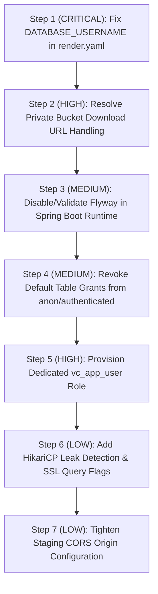

# MILESTONE 18.1 — DATABASE SECURITY AND BACKEND ACCESS AUDIT
## Virtual Classroom Platform — Staging Infrastructure Security Assessment

---

## 1. Executive Summary

### 1.1 Context and Purpose
This comprehensive, read-only database security and backend access audit was conducted for the **Virtual Classroom Platform** prior to deploying the Spring Boot backend to the Render staging environment. Following the successful completion of Milestones 17.8 and 17.9—which executed canonical migrations `V1` through `V5`, populated reference curriculum hierarchies, cleared test accounts, reset sequences, and verified 100% Hibernate entity-to-schema synchronization—this assessment evaluates the security boundaries, role permissions, Row-Level Security (RLS) policies, JDBC configuration, authentication/authorization layers, Supabase storage controls, and deployment manifests.

### 1.2 Target Environment and Scope Boundaries
- **Target Platform:** Supabase Staging (`virtual-classroom-staging`)
- **Project Reference:** `zrbpjcfssbtxxgrjtsca`
- **Region:** AWS `ap-south-1` (Mumbai)
- **Database Engine:** PostgreSQL 17.11
- **Host / Pooler:** `aws-0-ap-south-1.pooler.supabase.com:5432` (Supavisor Session Pooler)
- **Database Name:** `postgres`
- **Audit Execution Mode:** **STRICTLY READ-ONLY**. Zero database modifications, DDL execution, role alterations, data mutations, or configuration deployments were performed.
- **Production Isolation:** Production project `tzbjmxtmysvzxdmspiui` was strictly isolated and untouched. Zero production credentials, tokens, or endpoints were inspected or accessed.

### 1.3 Audit Findings & Risk Summary
The staging database infrastructure exhibits strong baseline controls, including an active RLS posture across all 22 public tables, private storage bucket configuration, and robust application-level role-based access control (RBAC). However, the audit identified architectural and configuration vulnerabilities that must be addressed before production deployment:

| Severity | Category | Finding Summary | Primary Risk |
| :--- | :--- | :--- | :--- |
| **CRITICAL** | Deployment | `render.yaml` specifies `DATABASE_USERNAME: postgres` without the mandatory project reference tenant suffix. | Backend deployment failure on Render when connecting through Supavisor session pooler. |
| **HIGH** | Database Privilege | Backend JDBC connection uses role `postgres` which has `rolbypassrls = true`, `rolcreaterole = true`, `rolcreatedb = true`, and table ownership. | Principle of Least Privilege violation; application bypasses database RLS; SQL injection could alter schema. |
| **HIGH** | Storage Security | `FileStorageService.uploadToSupabase()` returns `/object/public/` URLs for private bucket `academic-assets`. | Direct file downloads from frontend will fail with HTTP 400/404/403 unless signed URLs are used. |
| **MEDIUM** | Table ACLs | Default Supabase privileges grant `ALL` (`arwdDxtm`) on all 22 public tables to roles `anon` and `authenticated`. | Defense-in-depth weakness; table protection relies solely on RLS remaining enabled with 0 permissive policies. |
| **MEDIUM** | Migration Config | `spring.flyway.baseline-on-migrate: true` remains in `application-staging.yml` and `application-prod.yml`. | Risk of unexpected baseline behavior or startup conflicts now that migrations are managed independently. |
| **LOW** | JDBC / HikariCP | HikariCP pool lacks `leak-detection-threshold` and explicit prepared statement cache tuning. | Unclosed connections or statement leaks will not be proactively logged during staging load testing. |
| **LOW** | CORS Policy | Staging CORS configuration allows insecure HTTP origin `http://localhost:5173`. | Potential cross-origin exposure if staging backend is reachable from untrusted local development environments. |
| **INFORMATIONAL** | JPA / Schema | Hibernate `ddl-auto: validate` passed 100% against all 21 JPA entities and 22 database tables. | Application entity mappings perfectly mirror the PostgreSQL 17 physical schema. |

---

## 2. Current Architecture

### 2.1 Multi-Tier System Overview
The Virtual Classroom Platform follows a multi-tier cloud-native architecture:
1. **Frontend Tier (Vercel):** Single Page Application (SPA) built with React 18, TypeScript, and Vite.
2. **Backend API Tier (Render):** RESTful service built with Java 21, Spring Boot 3.3.4, Spring Security 6, Spring Data JPA / Hibernate 6, and Flyway 10.
3. **Database Tier (Supabase):** Managed PostgreSQL 17.11 accessed via Supavisor Session Pooler (port 5432).
4. **Object Storage Tier (Supabase Storage):** S3-compatible cloud storage bucket (`academic-assets`) managed via Supabase Storage REST API.

```mermaid
flowchart TD
    subgraph Client ["Client Browser / Mobile"]
        SPA["React SPA (Vercel)"]
    end

    subgraph BackendTier ["Backend Service (Render)"]
        Filter["JwtAuthenticationFilter"]
        SecConfig["Spring Security (RBAC)"]
        Controllers["REST Controllers (13 Controllers)"]
        Services["Business Logic Services"]
        StorageSvc["FileStorageService"]
        Hikari["HikariCP Pool (Max: 10, Min: 2)"]
    end

    subgraph DataTier ["Supabase Staging (ap-south-1)"]
        Supavisor["Supavisor Session Pooler (:5432)"]
        PG["PostgreSQL 17.11 (Database: postgres)"]
        StorageAPI["Supabase Storage API"]
        Bucket["Bucket: academic-assets (private)"]
        PostgREST["PostgREST API (:443)"]
    end

    SPA -->|HTTPS / JWT Bearer| Filter
    Filter --> SecConfig --> Controllers --> Services
    Services --> Hikari
    Services --> StorageSvc
    Hikari -->|JDBC over SSL| Supavisor -->|Dedicated Backend Session| PG
    StorageSvc -->|HTTPS / Service Role Key| StorageAPI --> Bucket
    SPA -.->|Direct Signed Upload / Download| StorageAPI
    SPA -.-x|Direct PostgREST Access (Blocked by RLS)| PostgREST -.-> PG
```

### 2.2 Data Flows and Trust Boundaries
1. **Client to Backend (Boundary 1 — Untrusted to Application):** All client interactions occur over HTTPS. Authentication is established via stateless JWT access tokens (lifetime: 24h) and HTTP-only, secure, SameSite cookies for refresh tokens (lifetime: 7d).
2. **Backend to Database (Boundary 2 — Application to Data Plane):** The backend connects to Supabase via the Supavisor session pooler on port 5432 over an SSL-encrypted JDBC connection. HikariCP manages 2 to 10 persistent connections.
3. **Backend to Storage (Boundary 3 — Server-Side Storage Orchestration):** Upload, pre-signed upload URL generation, and pre-signed download URL generation are performed by `FileStorageService` using the administrative `SUPABASE_SERVICE_ROLE_KEY` over HTTPS.
4. **Client to PostgREST (Boundary 4 — Direct API Access):** Supabase exposes auto-generated PostgREST RESTful endpoints. All 22 public tables have RLS enabled with 0 permissive policies. Direct calls using `anon` or `authenticated` keys return empty results or are denied.

---

## 3. Database Role Inventory

A live catalog inspection was conducted against the staging PostgreSQL instance (`aws-0-ap-south-1.pooler.supabase.com:5432`). The complete inventory of database roles, attributes, and memberships was queried from `pg_roles` and `pg_auth_members`.

### 3.1 Role Attribute Matrix
The following table details every role present in the staging database:

| Role Name | Can Login | Superuser | Bypass RLS | Create Role | Create DB | Description / Classification |
| :--- | :---: | :---: | :---: | :---: | :---: | :--- |
| `postgres` | **YES** | NO | **YES** | **YES** | **YES** | Primary tenant administrative role. **Currently used by backend JDBC.** |
| `supabase_admin` | **YES** | **YES** | **YES** | **YES** | **YES** | Cloud provider managed infrastructure superuser. |
| `anon` | NO | NO | NO | NO | NO | Role assumed by unauthenticated PostgREST HTTP clients. |
| `authenticated` | NO | NO | NO | NO | NO | Role assumed by authenticated PostgREST HTTP clients. |
| `authenticator` | **YES** | NO | NO | NO | NO | Proxy role used by PostgREST/GoTrue to connect and `SET ROLE`. |
| `service_role` | NO | NO | **YES** | NO | NO | Role assumed by administrative Supabase client SDKs with service key. |
| `supabase_auth_admin` | **YES** | NO | NO | **YES** | NO | Managed GoTrue authentication service role. |
| `supabase_storage_admin`| **YES** | NO | NO | **YES** | NO | Managed Supabase Storage microservice role. |
| `supabase_etl_admin` | **YES** | NO | **YES** | NO | NO | Managed ETL / backup pipeline role. |
| `supabase_read_only_user`| **YES** | NO | **YES** | NO | NO | Managed read-only replica / analytics role. |
| `supabase_replication_admin`| **YES** | NO | NO | NO | NO | Logical replication administrator role. |
| `dashboard_user` | NO | NO | NO | **YES** | **YES** | Supabase Studio dashboard helper role. |
| `pgbouncer` | **YES** | NO | NO | NO | NO | Connection pooler authentication lookup role. |
| `pg_database_owner` | NO | NO | NO | NO | NO | Standard PostgreSQL 16+ database owner implicit role. |
| `pg_read_all_data` | NO | NO | NO | NO | NO | PostgreSQL system role granting read access to all user tables. |
| `pg_write_all_data` | NO | NO | NO | NO | NO | PostgreSQL system role granting write access to all user tables. |
| `pg_monitor` | NO | NO | NO | NO | NO | PostgreSQL performance and metrics monitoring role. |

### 3.2 Role Memberships (`pg_auth_members`)
The role hierarchy reveals the following permission inheritance structures:
- `authenticator` inherits: `anon`, `authenticated`, `service_role` (admin: false).
- `postgres` inherits:
  - `anon` (admin: true)
  - `authenticated` (admin: true)
  - `authenticator` (admin: true)
  - `service_role` (admin: true)
  - `pg_read_all_data` (admin: true)
  - `pg_monitor` (admin: true)
  - `pg_signal_backend` (admin: true)
  - `pg_create_subscription` (admin: true)
  - `supabase_privileged_role` (admin: false)
- `supabase_etl_admin` inherits: `pg_read_all_data`, `pg_monitor`.
- `supabase_read_only_user` inherits: `pg_read_all_data`, `pg_monitor`.

### 3.3 Schema Permissions on `public`
Inspection of `pg_namespace` and `information_schema.schemata` shows:
- **Owner:** `pg_database_owner`
- **Access Control List (ACL):**
  ```text
  {pg_database_owner=UC/pg_database_owner, =U/pg_database_owner, postgres=U/pg_database_owner,
   anon=U/pg_database_owner, authenticated=U/pg_database_owner, service_role=U/pg_database_owner}
  ```
  - `=U`: The pseudo-role `PUBLIC` has `USAGE` privilege on schema `public`.
  - `postgres`, `anon`, `authenticated`, and `service_role` have explicit `USAGE` privileges.

### 3.4 Table Ownership and ACLs on Public Tables
All 21 application tables and the `flyway_schema_history` metadata table are owned by role `postgres`. Inspection of `pg_class.relacl` shows identical permissions across all 22 tables:

```text
{postgres=arwdDxtm/postgres, anon=arwdDxtm/postgres, authenticated=arwdDxtm/postgres, service_role=arwdDxtm/postgres}
```
**Privilege Code Breakdown (`arwdDxtm`):**
- `a`: `INSERT` (append)
- `r`: `SELECT` (read)
- `w`: `UPDATE` (write)
- `d`: `DELETE` (delete)
- `D`: `TRUNCATE`
- `x`: `REFERENCES`
- `t`: `TRIGGER`
- `m`: `MAINTAIN`

> [!WARNING]
> Supabase's default privileges have granted full CRUD (`arwdDxtm`) on all application tables to roles `anon` and `authenticated`. While direct access is currently blocked by Row-Level Security (see Section 4), granting default table privileges to unauthenticated and general authenticated roles violates defense-in-depth principles.

### 3.5 Routine Privileges
Execution privileges on functions in `public`, notably `public.rls_auto_enable()`:
- `PUBLIC`: `EXECUTE` (Grantable: NO)
- `postgres`: `EXECUTE` (Grantable: YES)
- `anon`, `authenticated`, `service_role`: `EXECUTE` (Grantable: NO)

---

## 4. Row-Level Security (RLS) and Policy Inventory

### 4.1 RLS Status Across All Public Tables
Every table in the `public` schema was inspected for the `relrowsecurity` and `relforcerowsecurity` attributes:

| Table Name | Owner | Row Security (`relrowsecurity`) | Force Row Security (`relforcerowsecurity`) | Active Policies |
| :--- | :--- | :---: | :---: | :---: |
| `answers` | `postgres` | **ENABLED** (`true`) | `false` | 0 |
| `assignment_submissions` | `postgres` | **ENABLED** (`true`) | `false` | 0 |
| `assignments` | `postgres` | **ENABLED** (`true`) | `false` | 0 |
| `audit_logs` | `postgres` | **ENABLED** (`true`) | `false` | 0 |
| `courses` | `postgres` | **ENABLED** (`true`) | `false` | 0 |
| `degrees` | `postgres` | **ENABLED** (`true`) | `false` | 0 |
| `examination_results` | `postgres` | **ENABLED** (`true`) | `false` | 0 |
| `examinations` | `postgres` | **ENABLED** (`true`) | `false` | 0 |
| `faculty_profiles` | `postgres` | **ENABLED** (`true`) | `false` | 0 |
| `faculty_subject_assignments` | `postgres` | **ENABLED** (`true`) | `false` | 0 |
| `flyway_schema_history` | `postgres` | **ENABLED** (`true`) | `false` | 0 |
| `live_sessions` | `postgres` | **ENABLED** (`true`) | `false` | 0 |
| `notifications` | `postgres` | **ENABLED** (`true`) | `false` | 0 |
| `password_reset_tokens` | `postgres` | **ENABLED** (`true`) | `false` | 0 |
| `questions` | `postgres` | **ENABLED** (`true`) | `false` | 0 |
| `refresh_tokens` | `postgres` | **ENABLED** (`true`) | `false` | 0 |
| `student_profiles` | `postgres` | **ENABLED** (`true`) | `false` | 0 |
| `student_subject_enrollments` | `postgres` | **ENABLED** (`true`) | `false` | 0 |
| `study_materials` | `postgres` | **ENABLED** (`true`) | `false` | 0 |
| `subjects` | `postgres` | **ENABLED** (`true`) | `false` | 0 |
| `users` | `postgres` | **ENABLED** (`true`) | `false` | 0 |
| `video_lectures` | `postgres` | **ENABLED** (`true`) | `false` | 0 |

### 4.2 Policy Inventory
Querying `pg_policies` for `schemaname = 'public'` returned **exactly 0 rows**.

### 4.3 Direct PostgREST Exposure Analysis
In PostgreSQL, when Row-Level Security is enabled on a relation and no policies are defined, the default security posture is **RESTRICTIVE DENY-ALL** for any role subject to RLS:
1. **Unauthenticated Access (`anon`):** Any direct HTTP request to the Supabase PostgREST API (e.g., `GET https://zrbpjcfssbtxxgrjtsca.supabase.co/rest/v1/users`) using the public `anon` key evaluates against RLS. Because zero policies exist to grant access, PostgREST returns an empty array `[]` (or HTTP 200 with zero rows) for `SELECT`, and rejects `INSERT`, `UPDATE`, and `DELETE`.
2. **Supabase Authenticated Access (`authenticated`):** Similarly, requests with a Supabase-issued user JWT assume the `authenticated` role. With no RLS policies defined, all operations are denied.
3. **Single Point of Failure Vulnerability:** Because table ACLs grant `arwdDxtm` to `anon` and `authenticated` (Section 3.4), the **only** barrier preventing total data exposure via PostgREST is the absence of permissive RLS policies. If a developer accidentally runs:
   ```sql
   CREATE POLICY "allow_all" ON users FOR ALL USING (true);
   ```
   PostgREST would immediately expose the entire `users` table (including password hashes and PII) to anyone with the project's public `anon` key.

### 4.4 Backend Access vs. Direct PostgREST Access
- **Role `service_role`:** Possesses `rolbypassrls = true`. If the `SUPABASE_SERVICE_ROLE_KEY` is supplied to PostgREST, RLS is completely bypassed, allowing unconstrained CRUD operations.
- **Role `postgres` (Backend JDBC):** Possesses `rolbypassrls = true`. Because Spring Boot connects via JDBC as `postgres.zrbpjcfssbtxxgrjtsca`, **PostgreSQL RLS is completely bypassed for all backend queries**.
- **Implication:** The database does **not** enforce row-level isolation or multi-tenancy at the SQL engine level for the Spring Boot application. The integrity of student, faculty, and administrative boundaries relies entirely on Spring Security and service-layer business logic.

---

## 5. JDBC and Connection Configuration Findings

The application configuration files (`application.yml`, `application-staging.yml`, `application-prod.yml`) and Render deployment blueprint (`render.yaml`) were inspected.

### 5.1 Datasource and HikariCP Configuration
In `application-staging.yml`:
```yaml
spring:
  datasource:
    url: ${DATABASE_URL}
    username: ${DATABASE_USERNAME}
    password: ${DATABASE_PASSWORD}
    driver-class-name: org.postgresql.Driver
    hikari:
      maximum-pool-size: ${DB_POOL_MAX:10}
      minimum-idle: ${DB_POOL_MIN:2}
      idle-timeout: 300000        # 5 minutes
      max-lifetime: 1200000       # 20 minutes
      connection-timeout: 20000   # 20 seconds
```

### 5.2 Critical JDBC Findings

#### 1. Deployment Username Mismatch (`render.yaml`)
In `render.yaml` line 24:
```yaml
      - key: DATABASE_USERNAME
        value: postgres
```
> [!CAUTION]
> **CRITICAL DEPLOYMENT DEFECT:** Supabase uses the Supavisor connection pooler. On port 5432 (session mode) and port 6543 (transaction mode), Supavisor requires the username to be tenant-qualified: `postgres.zrbpjcfssbtxxgrjtsca`. Supplying bare `postgres` causes Supavisor to reject the connection with an authentication error because it cannot determine which tenant project the client belongs to.

#### 2. SSL Enforcement
- The backend configuration relies on `DATABASE_URL` providing SSL parameters.
- If `DATABASE_URL` is configured without explicit SSL query parameters (e.g. `jdbc:postgresql://host:5432/postgres?sslmode=require`), the PostgreSQL JDBC driver may attempt an unencrypted connection or fail during SSL negotiation.
- **Requirement:** `DATABASE_URL` must include `?sslmode=require` (or `?ssl=true&sslmode=require`), or HikariCP datasource properties must explicitly set `ssl: true` and `sslmode: require`.

#### 3. Connection Pool Sizing and Supavisor Interactions
- HikariCP is configured with `maximum-pool-size: 10` and `minimum-idle: 2`.
- The session pooler (port 5432) assigns a dedicated PostgreSQL backend process to each active pool connection.
- A maximum of 10 connections per container instance is appropriate for Render's `starter` plan and will not overwhelm Supabase staging compute resources.
- `max-lifetime: 1200000` (20 minutes) is shorter than Supavisor's idle client timeout, preventing pool connections from becoming stale or severed by the intermediary pooler.

#### 4. Missing Leak Detection Threshold
- `hikari.leak-detection-threshold` is omitted.
- Without this setting, queries that fail to close connections or hang on uncommitted transactions will not be flagged until the pool is exhausted.
- **Recommendation:** Add `leak-detection-threshold: 30000` (30 seconds) to `application-staging.yml`.

#### 5. Prepared Statement Caching
- Because the backend connects to the **session pooler** on port `5432` (not the transaction pooler on port `6543`), PostgreSQL prepared statements are fully supported and will not cause `prepared statement "S_..." already exists` collisions.
- However, performance can be optimized by explicitly configuring the PostgreSQL driver cache properties:
  - `prepStmtCacheSize: 250`
  - `prepStmtCacheSqlLimit: 2048`

#### 6. Flyway Baseline Configuration in App Runtime
- In `application-staging.yml` lines 20–23:
  ```yaml
  flyway:
    enabled: true
    baseline-on-migrate: true
    locations: classpath:db/migration
  ```
- Migrations are now managed independently via the Milestone 17.6/17.8 standalone runner (`StandaloneFlywayMigrationRunner.java`).
- Having `baseline-on-migrate: true` enabled in the runtime Spring Boot application is dangerous. As proven in Milestone 17.8, if a non-empty schema is encountered without a schema history table, Flyway creates an unwanted version 1 baseline.
- **Recommendation:** Since migrations are executed prior to deployment, the backend application should set `spring.flyway.enabled: false` (or `spring.flyway.baseline-on-migrate: false` with validation-only mode).

---

## 6. Authentication and Authorization Findings

The application's security architecture was audited across `SecurityConfig.java`, `JwtTokenProvider.java`, `JwtAuthenticationFilter.java`, `UserPrincipal.java`, and all 13 REST controllers.

### 6.1 Authentication Architecture
- **Stateless JWT:** Authentication is stateless (`SessionCreationPolicy.STATELESS`). CSRF protection is disabled (`AbstractHttpConfigurer::disable`), which is standard and safe for stateless bearer-token APIs.
- **Password Hashing:** `BCryptPasswordEncoder(12)` provides 4,096 hashing rounds, well exceeding minimum security standards.
- **Token Signing:** `JwtTokenProvider` enforces HMAC-SHA256 with a required key length of at least 256 bits (32 bytes).
- **Hardcoded Secret Rejection:** The provider contains logic rejecting the development fallback secret (`dGVzdC1sb2NhbC1kZXZlbG9wbWVudC...`) if active profiles include `prod` or `production`.
  > [!TIP]
  > This check should be extended to also reject the fallback secret when the `staging` profile is active.

### 6.2 Account Status Gating
`JwtAuthenticationFilter` validates account status on every authenticated request by loading the principal via `CustomUserDetailsService`:
- `isEnabled()`: Returns `true` only when `status == UserStatus.APPROVED`.
- `isAccountNonLocked()`: Returns `true` only when `status != UserStatus.SUSPENDED`.
- If an account is `PENDING`, `SUSPENDED`, or `REJECTED`, the security context is immediately cleared and an HTTP 401 response is returned:
  ```json
  {"success":false,"message":"Account is PENDING. Access revoked.","data":null}
  ```
- This prevents suspended or unapproved users from accessing the API even if they possess a valid, unexpired JWT.

### 6.3 Role Hierarchy and Endpoint Protection Matrix
The platform defines three roles: `ROLE_STUDENT`, `ROLE_FACULTY`, and `ROLE_ADMIN`. Authorization is enforced through filter-level `requestMatchers` in `SecurityConfig.java` and method-level `@PreAuthorize` annotations on controllers:

| Controller | Endpoint / Pattern | HTTP Method | Required Authority | Method Security (`@PreAuthorize`) | Defense-in-Depth Assessment |
| :--- | :--- | :---: | :--- | :--- | :--- |
| `AuthController` | `/api/v1/auth/login` | POST | `permitAll()` | None | Public authentication endpoint. |
| `AuthController` | `/api/v1/auth/register/**` | POST | `permitAll()` | None | Public registration (sets status `PENDING`). |
| `AuthController` | `/api/v1/auth/refresh` | POST | `permitAll()` | None | Rotates refresh token. |
| `AuthController` | `/api/v1/auth/forgot-password` | POST | `permitAll()` | None | Public password reset trigger. |
| `AuthController` | `/api/v1/auth/reset-password` | POST | `permitAll()` | None | Public token-based reset. |
| `AuthController` | `/api/v1/auth/change-password`| POST | Authenticated | `isAuthenticated()` | Dual protection (filter + method). |
| `CourseController`| `/api/v1/courses/**` | GET | `permitAll()` | None | Public course catalog browsing. |
| `CourseController`| `/api/v1/courses/*/archive` | PATCH | `ROLE_ADMIN` | `hasAuthority('ROLE_ADMIN')` | Dual protection. |
| `CourseController`| `/api/v1/courses/*/unarchive` | PATCH | `ROLE_ADMIN` | `hasAuthority('ROLE_ADMIN')` | Dual protection. |
| `AdminController` | `/api/v1/admin/**` | ALL | `ROLE_ADMIN` | `hasAuthority('ROLE_ADMIN')` | Dual protection on entire class. |
| `FacultyController`| `/api/v1/faculty/**` | ALL | `ROLE_FACULTY`, `ROLE_ADMIN` | `hasAnyAuthority('ROLE_FACULTY', 'ROLE_ADMIN')` | Dual protection on entire class. |
| `StudentController`| `/api/v1/students/**` | ALL | `ROLE_STUDENT`, `ROLE_ADMIN` | `hasAnyAuthority('ROLE_STUDENT', 'ROLE_ADMIN')` | Dual protection on entire class. |
| `AssignmentController`| `/api/v1/assignments` | POST | `ROLE_FACULTY`, `ROLE_ADMIN` | `hasAnyAuthority('ROLE_FACULTY', 'ROLE_ADMIN')` | Dual protection. |
| `AssignmentController`| `/api/v1/assignments/subject/{id}`| GET | Authenticated | None (in service: `verifyAccessToSubject`) | Filter auth + service-level tenant check. |
| `AssignmentController`| `/api/v1/assignments/submit` | POST | `ROLE_STUDENT`, `ROLE_ADMIN` | `hasAnyAuthority('ROLE_STUDENT', 'ROLE_ADMIN')` | Dual protection + enrollment verification. |
| `AssignmentController`| `/api/v1/assignments/*/submissions`| GET | `ROLE_FACULTY`, `ROLE_ADMIN` | `hasAnyAuthority('ROLE_FACULTY', 'ROLE_ADMIN')` | Dual protection. |
| `AssignmentController`| `/api/v1/assignments/submissions/*/grade`| PUT/POST | `ROLE_FACULTY`, `ROLE_ADMIN` | `hasAnyAuthority('ROLE_FACULTY', 'ROLE_ADMIN')` | Dual protection. |
| `ExaminationController`| `/api/v1/examinations` | POST | `ROLE_FACULTY`, `ROLE_ADMIN` | `hasAnyAuthority('ROLE_FACULTY', 'ROLE_ADMIN')` | Dual protection. |
| `ExaminationController`| `/api/v1/examinations/grades` | POST | `ROLE_FACULTY`, `ROLE_ADMIN` | `hasAnyAuthority('ROLE_FACULTY', 'ROLE_ADMIN')` | Dual protection. |
| `ExaminationController`| `/api/v1/examinations/my-results`| GET | `ROLE_STUDENT`, `ROLE_ADMIN` | `hasAnyAuthority('ROLE_STUDENT', 'ROLE_ADMIN')` | Dual protection. |
| `EnrollmentController`| `/api/v1/enrollments` | POST | `ROLE_STUDENT`, `ROLE_ADMIN` | `hasAnyAuthority('ROLE_STUDENT', 'ROLE_ADMIN')` | Dual protection. |
| `ForumController` | `/api/v1/discussions/**` | GET | Authenticated | None | Filter-level authentication. |
| `ForumController` | `/api/v1/discussions/questions` | POST | Authenticated | None (author assigned from principal) | Protected; author verified on update/delete. |
| `LiveSessionController`| `/api/v1/sessions` | POST | `ROLE_FACULTY`, `ROLE_ADMIN` | `hasAnyAuthority('ROLE_FACULTY', 'ROLE_ADMIN')` | Dual protection. |
| `LiveSessionController`| `/api/v1/sessions/*/status`| PUT/PATCH| `ROLE_FACULTY`, `ROLE_ADMIN` | `hasAnyAuthority('ROLE_FACULTY', 'ROLE_ADMIN')` | Dual protection. |
| `StorageController`| `/api/v1/storage/upload` | POST | Authenticated | `isAuthenticated()` | Dual protection. |
| `StorageController`| `/api/v1/storage/signed-upload-url`| POST | Authenticated | `isAuthenticated()` | Dual protection. |
| `StorageController`| `/api/v1/storage/signed-download-url`| GET | Authenticated | `isAuthenticated()` | Dual protection. |
| `StorageController`| `/api/v1/storage/files/**` | GET | `permitAll()` | None | Local file serving fallback. |
| `StorageController`| `/api/v1/storage/files` | DELETE | `ROLE_FACULTY`, `ROLE_ADMIN` | `hasAnyAuthority('ROLE_FACULTY', 'ROLE_ADMIN')` | Dual protection + author verification. |
| `UserProfileController`| `/api/v1/users/profile` | GET/PUT | Authenticated | None (principal ID enforced) | Self-service profile management only. |

### 6.4 Horizontal Privilege Escalation Protection
Horizontal privilege escalation occurs when a user accesses data belonging to another user of the same role (e.g. Student A reading Student B's submissions, or Faculty X grading Faculty Y's course). The audit verified that service layers enforce strict ownership validation:
- **`StudentController` & `StudentService`:**
  ```java
  if (!"ROLE_ADMIN".equals(principal.getRole())) {
      studentService.verifyStudentEnrolledInSubject(principal.getId(), subjectId);
  }
  ```
  Students cannot view study materials or video lectures for subjects in which they are not enrolled.
- **`AssignmentService`:** `verifyAccessToSubject(currentUser, subjectId)` verifies that faculty are assigned to the subject and students are enrolled.
- **`AssignmentService.submitAssignment()`:** Validates that `enrollmentRepository.existsByStudentIdAndSubjectId(studentUser.getId(), subject.getId())`.
- **`UserProfileService.updateProfile()`:** Extracts the user ID directly from `principal.getId()`. The payload cannot alter the target user ID, role, or approval status.

---

## 7. Required Database Privileges Table

To apply the **Principle of Least Privilege**, the privileges required by the runtime Spring Boot application must be separated from those required by database migration runners (DDL).

### 7.1 Least-Privilege Matrix for Runtime Application (`vc_app_user`)

| Schema Object | Object Type | Required Runtime Privileges | Prohibited Privileges | Rationale |
| :--- | :--- | :--- | :--- | :--- |
| `public` | `SCHEMA` | `USAGE` | `CREATE` | App does not create tables, views, or types at runtime. |
| `users` | `TABLE` | `SELECT, INSERT, UPDATE` | `DELETE, TRUNCATE, ALTER, DROP` | Users are suspended or rejected, never hard-deleted. |
| `student_profiles` | `TABLE` | `SELECT, INSERT, UPDATE` | `DELETE, TRUNCATE, ALTER, DROP` | Student metadata updates; audit retention. |
| `faculty_profiles` | `TABLE` | `SELECT, INSERT, UPDATE` | `DELETE, TRUNCATE, ALTER, DROP` | Faculty metadata updates; audit retention. |
| `degrees` | `TABLE` | `SELECT` | `INSERT, UPDATE, DELETE, TRUNCATE` | Reference academic catalog (seeded via migrations). |
| `courses` | `TABLE` | `SELECT, UPDATE` | `INSERT, DELETE, TRUNCATE, DROP` | Admin archives/unarchives courses via `is_active` flag. |
| `subjects` | `TABLE` | `SELECT` | `INSERT, UPDATE, DELETE, TRUNCATE` | Reference academic curriculum. |
| `faculty_subject_assignments` | `TABLE` | `SELECT, INSERT, DELETE` | `TRUNCATE, ALTER, DROP` | Admin assigns and reallocates faculty subjects. |
| `student_subject_enrollments` | `TABLE` | `SELECT, INSERT, UPDATE` | `DELETE, TRUNCATE, ALTER, DROP` | Student self-enrollment and status tracking. |
| `study_materials` | `TABLE` | `SELECT, INSERT, DELETE` | `TRUNCATE, ALTER, DROP` | Faculty publishes and deletes study resources. |
| `video_lectures` | `TABLE` | `SELECT, INSERT, DELETE` | `TRUNCATE, ALTER, DROP` | Faculty publishes and deletes lecture links. |
| `assignments` | `TABLE` | `SELECT, INSERT, UPDATE, DELETE` | `TRUNCATE, ALTER, DROP` | Faculty creates, updates, and removes assignments. |
| `assignment_submissions` | `TABLE` | `SELECT, INSERT, UPDATE` | `DELETE, TRUNCATE, ALTER, DROP` | Students submit; faculty grades. Submissions preserved. |
| `examinations` | `TABLE` | `SELECT, INSERT, UPDATE, DELETE` | `TRUNCATE, ALTER, DROP` | Faculty schedules and manages examinations. |
| `examination_results` | `TABLE` | `SELECT, INSERT, UPDATE` | `DELETE, TRUNCATE, ALTER, DROP` | Official grading records; immutable history. |
| `live_sessions` | `TABLE` | `SELECT, INSERT, UPDATE` | `DELETE, TRUNCATE, ALTER, DROP` | Session scheduling and lifecycle transitions. |
| `questions` | `TABLE` | `SELECT, INSERT, UPDATE, DELETE` | `TRUNCATE, ALTER, DROP` | Discussion forum threads. |
| `answers` | `TABLE` | `SELECT, INSERT, UPDATE, DELETE` | `TRUNCATE, ALTER, DROP` | Discussion forum responses. |
| `notifications` | `TABLE` | `SELECT, INSERT, UPDATE` | `DELETE, TRUNCATE, ALTER, DROP` | In-app alerts; marked as read, not dropped. |
| `audit_logs` | `TABLE` | `SELECT, INSERT` | `UPDATE, DELETE, TRUNCATE, DROP` | **Append-only immutable audit trail.** Zero updates or deletes. |
| `refresh_tokens` | `TABLE` | `SELECT, INSERT, UPDATE, DELETE` | `TRUNCATE, ALTER, DROP` | Token issuance, rotation, and revocation. |
| `password_reset_tokens` | `TABLE` | `SELECT, INSERT, UPDATE, DELETE` | `TRUNCATE, ALTER, DROP` | Temporary token issuance and cleanup. |
| `flyway_schema_history`| `TABLE` | `SELECT` (or none) | `INSERT, UPDATE, DELETE, TRUNCATE` | Read-only verification if Flyway validate is enabled. |
| All 18 Sequences | `SEQUENCE` | `USAGE, SELECT` | `UPDATE` | Primary key generation for all serial tables. |

---

## 8. Recommended Application Database Role Design

Currently, the backend connects using the administrative `postgres` role. To establish least-privilege security, a dedicated application role should be provisioned.

### 8.1 Role Separation Strategy
- **Migration Role (`postgres` / `vc_migration_admin`):**
  - Used exclusively by `StandaloneFlywayMigrationRunner.java` during deployment phases.
  - Possesses DDL privileges: `CREATE`, `ALTER`, `DROP`, `REFERENCES`, `INDEX`.
  - Not accessible to the runtime web service.
- **Application Runtime Role (`vc_app_user`):**
  - Used exclusively by the Spring Boot backend on Render.
  - Possesses only DML privileges (`SELECT`, `INSERT`, `UPDATE`, `DELETE`) on application tables.
  - Zero DDL privileges (`CREATE TABLE`, `DROP TABLE`, `ALTER TABLE`, `TRUNCATE` prohibited).
  - Explicitly stripped of `SUPERUSER`, `CREATEROLE`, `CREATEDB`, and `BYPASSRLS`.

### 8.2 Recommended Provisioning DDL
When the operator elects to provision the dedicated application role, the following idempotent SQL script should be executed by the database administrator:

```sql
-- 1. Create unprivileged application runtime role
CREATE ROLE vc_app_user WITH
    LOGIN
    NOSUPERUSER
    NOCREATEDB
    NOCREATEROLE
    NOBYPASSRLS
    NOINHERIT
    PASSWORD 'STRONG_GENERATED_APP_PASSWORD';

-- 2. Restrict schema usage
REVOKE ALL ON SCHEMA public FROM vc_app_user;
GRANT USAGE ON SCHEMA public TO vc_app_user;

-- 3. Grant required DML permissions on application tables
GRANT SELECT, INSERT, UPDATE, DELETE ON
    public.answers,
    public.assignment_submissions,
    public.assignments,
    public.faculty_subject_assignments,
    public.live_sessions,
    public.password_reset_tokens,
    public.questions,
    public.refresh_tokens,
    public.study_materials,
    public.video_lectures
TO vc_app_user;

GRANT SELECT, INSERT, UPDATE ON
    public.examination_results,
    public.examinations,
    public.faculty_profiles,
    public.notifications,
    public.student_profiles,
    public.student_subject_enrollments,
    public.users
TO vc_app_user;

-- Append-only for audit logs
GRANT SELECT, INSERT ON public.audit_logs TO vc_app_user;

-- Read-only reference catalog
GRANT SELECT ON public.degrees, public.courses, public.subjects TO vc_app_user;
GRANT UPDATE (is_active) ON public.courses TO vc_app_user;

-- Read-only on migration history (for startup validation)
GRANT SELECT ON public.flyway_schema_history TO vc_app_user;

-- 4. Grant sequence usage for primary key generation
GRANT USAGE, SELECT ON ALL SEQUENCES IN SCHEMA public TO vc_app_user;

-- 5. Revoke dangerous default public privileges
REVOKE ALL ON ALL TABLES IN SCHEMA public FROM anon;
REVOKE ALL ON ALL TABLES IN SCHEMA public FROM authenticated;
```

### 8.3 Supavisor Pooler Connection Configuration
When connecting as `vc_app_user` through the Supavisor pooler on port 5432, the tenant-qualified username format must be used:
```text
DATABASE_USERNAME=vc_app_user.zrbpjcfssbtxxgrjtsca
```

---

## 9. Storage Security Findings

Supabase Storage configuration was audited via live catalog queries and source code inspection of `FileStorageService.java` and `StorageController.java`.

### 9.1 Storage Bucket Configuration
The staging bucket `academic-assets` was verified in `storage.buckets`:
- **ID / Name:** `academic-assets`
- **Public Access:** `public: false` (Private bucket)
- **File Size Limit:** `52,428,800` bytes (50 MB)
- **Allowed MIME Types:** 14 specific MIME types (PDF, MS Office, plain text, CSV, JPEG, PNG, WebP, GIF, MP4, WebM, ZIP).

### 9.2 Storage Policy Inventory
Querying `pg_policies` on `storage.objects` and `storage.buckets` returned **0 policies**.
- **Security Posture:** Because the bucket is private and zero storage RLS policies exist, **direct client access to Supabase storage via the public Supabase API is completely blocked**. Unauthenticated or client-authenticated HTTP requests cannot list, read, upload, or delete objects.

### 9.3 Service Role Key Isolation
In `FileStorageService.java`, all communications with the Supabase Storage REST API use the `SUPABASE_SERVICE_ROLE_KEY`:
```java
headers.setBearerAuth(supabaseKey);
```
- The service-role key is loaded from the environment variable `SUPABASE_SERVICE_ROLE_KEY`.
- The key is used **strictly server-side** within Spring Boot.
- The key is **never** serialized to DTOs, returned in API responses, or exposed to the frontend.

### 9.4 Critical Finding: Private Bucket Download URL Incompatibility
In `FileStorageService.java` lines 162 and 311:
```java
// Line 162 (SignedUploadUrlResponse)
.publicOrDownloadUrl(supabaseUrl + "/storage/v1/object/public/" + supabaseBucket + "/" + storagePath)

// Line 311 (uploadToSupabase)
String fileUrl = supabaseUrl + "/storage/v1/object/public/" + supabaseBucket + "/" + storagePath;
```
> [!WARNING]
> `FileStorageService` constructs download URLs using the public path: `/storage/v1/object/public/...`.
> However, bucket `academic-assets` is configured with `public: false`!
> When a client attempts to fetch an asset directly from this public URL, Supabase Storage returns:
> ```json
> {"statusCode": "404", "message": "Bucket not found"}
> ```
> or HTTP 403 Forbidden.
> **Remediation Requirement:** For private buckets, the application must either:
> 1. Return pre-signed download URLs via `/api/v1/storage/signed-download-url` (which calls `/storage/v1/object/sign/...`), OR
> 2. Proxy file downloads through the Spring Boot backend (`/api/v1/storage/files/...`).

---

## 10. Deployment Security Findings

The staging deployment configuration in `render.yaml` was evaluated against cloud security standards.

### 10.1 Container Runtime Security
The backend `Dockerfile` enforces container hardening:
- **Unprivileged User:** Execution switches to `appuser:appgroup` (UID: 10001, GID: 10001) with shell `/sbin/nologin`. No root execution.
- **Minimal Surface:** Multi-stage build copies only the packaged JAR onto `eclipse-temurin:21-jre-alpine`.
- **JVM Constraints:** G1 garbage collection with container-aware memory limits (`-XX:MaxRAMPercentage=75.0 -XX:+ExitOnOutOfMemoryError`).
- **Healthcheck:** Container probes Spring Boot Actuator (`/actuator/health`).

### 10.2 Render Blueprint Environment Variables (`render.yaml`)
- **Secret Sync Protection:** `DATABASE_PASSWORD`, `JWT_SECRET`, `SUPABASE_URL`, and `SUPABASE_SERVICE_ROLE_KEY` are defined with `sync: false`, preventing credential leakage into version control.
- **Port:** Configured to port `8080`, matching Docker `EXPOSE` and Actuator health check.
- **Liveness Probe:** Configured to `/actuator/health/liveness`.

### 10.3 CORS Configuration
- In `render.yaml`:
  ```yaml
  - key: CORS_ALLOWED_ORIGINS
    value: https://virtual-classroom-staging.vercel.app,http://localhost:5173
  ```
- **Finding:** Staging permits `http://localhost:5173` alongside the Vercel staging domain.
- While useful for local frontend development against staging, this allows unencrypted HTTP origins.
- In `SecurityConfig.java`, `configuration.setAllowCredentials(true)` is enabled.
- **Production Guard:** `application-prod.yml` and `render.yaml` (prod service) strictly restrict CORS to production domain (`https://virtual-classroom.edu` or production Vercel app), avoiding wildcard or localhost origins.

### 10.4 Cookie Flags and Cross-Origin Authentication
- In `AuthController.java`:
  - `httpOnly(true)`: Prevents JavaScript XSS access to refresh tokens.
  - `path("/api/v1/auth")`: Scopes cookie transmission strictly to auth endpoints.
  - `secure(cookieSecure)`: Driven by `COOKIE_SECURE=true` in staging.
  - `sameSite(cookieSameSite)`: When `COOKIE_SECURE=true`, defaults to `None`.
- **Finding:** `SameSite=None; Secure` is required because the frontend (Vercel) and backend (Render) operate on different parent domains in staging. This configuration correctly enables cross-site cookie delivery while preventing unencrypted transmission.

---

## 11. Ranked Critical Issues

The following ranked issues represent the complete set of security and operational findings identified during Milestone 18.1:

### Issue 1 — CRITICAL: Pooler Username Lacks Tenant Qualifier in Render Blueprint
- **Severity:** **CRITICAL** (Deployment Blocker)
- **Component:** `render.yaml` (Line 24)
- **Description:** `DATABASE_USERNAME` is hardcoded as `postgres`. Connecting to Supabase through the Supavisor session pooler (port 5432) requires the tenant-qualified username `postgres.zrbpjcfssbtxxgrjtsca`.
- **Impact:** Backend service deployment on Render will immediately fail health checks and crash on startup with database connection authentication errors.

### Issue 2 — HIGH: Application Uses Super-Privileged `postgres` Role
- **Severity:** **HIGH** (Architecture / Least Privilege)
- **Component:** Staging Database / `application-staging.yml`
- **Description:** The backend connects using the database owner role `postgres`, which has `BYPASSRLS=true`, `CREATEROLE=true`, and `CREATEDB=true`.
- **Impact:** Database-level Row-Level Security is completely bypassed by the application. In the event of an application SQL injection vulnerability or ORM exploit, an attacker would have full schema alteration privileges.

### Issue 3 — HIGH: Private Storage Download URLs Return 404/403
- **Severity:** **HIGH** (Application Functionality & Storage Integrity)
- **Component:** `FileStorageService.java` (Lines 162, 311)
- **Description:** Upload responses construct `/storage/v1/object/public/...` URLs, but bucket `academic-assets` has `public = false`.
- **Impact:** Uploaded assignments, study materials, and profile documents cannot be fetched directly by clients using the returned `fileUrl`.

### Issue 4 — MEDIUM: Default Table ACLs Grant Full CRUD to `anon` and `authenticated`
- **Severity:** **MEDIUM** (Defense-in-Depth Weakness)
- **Component:** Staging Database (`pg_class.relacl` on all 22 public tables)
- **Description:** Supabase default privileges grant `arwdDxtm` on all application tables to roles `anon` and `authenticated`.
- **Impact:** The entire security posture protecting against unauthorized PostgREST API access rests solely on RLS remaining enabled with 0 permissive policies. Adding an accidental permissive policy exposes the affected table immediately.

### Issue 5 — MEDIUM: Runtime Migration Baseline Configuration Left Active
- **Severity:** **MEDIUM** (Operational Reliability)
- **Component:** `application-staging.yml` / `application-prod.yml`
- **Description:** `spring.flyway.baseline-on-migrate: true` is configured in Spring Boot configuration files.
- **Impact:** Now that migrations are handled independently via the standalone runner, runtime baseline settings risk unexpected schema state mutations during container boot.

### Issue 6 — LOW: HikariCP Leak Detection Threshold Omitted
- **Severity:** **LOW** (Observability)
- **Component:** `application-staging.yml` (`spring.datasource.hikari`)
- **Description:** `leak-detection-threshold` is not specified in the HikariCP configuration.
- **Impact:** Connection leaks during staging load testing or slow queries will not be proactively detected in application logs.

### Issue 7 — LOW: Insecure HTTP Origin Allowed in Staging CORS
- **Severity:** **LOW** (CORS Hygiene)
- **Component:** `render.yaml` / `application-staging.yml`
- **Description:** `http://localhost:5173` is included in `CORS_ALLOWED_ORIGINS` alongside the staging Vercel domain.
- **Impact:** An attacker on a developer's local network could potentially interact with the staging backend if credentials are leaked.

### Issue 8 — INFORMATIONAL: 100% JPA Entity and PostgreSQL 17 Schema Alignment
- **Severity:** **INFORMATIONAL** (Positive Finding)
- **Component:** Hibernate Validation (`ddl-auto: validate`)
- **Description:** All 21 JPA entity classes, primary keys, foreign key constraints, column data types, and custom indexes match the PostgreSQL 17 physical schema with zero warnings.

---

## 12. Recommended Remediation Sequence

The remediation tasks below are arranged in chronological order of execution. Each step is classified with its severity rating and identifies the exact configuration or source file involved.



### Remediation Details

#### Step 1: Fix `DATABASE_USERNAME` in `render.yaml`
- **Severity:** **CRITICAL**
- **Action:** Update `render.yaml` line 24 for service `virtual-classroom-backend-staging` from `postgres` to `postgres.zrbpjcfssbtxxgrjtsca`.
- **Verification:** Verify that the connection username matches the Supavisor tenant requirement prior to deploying the blueprint.

#### Step 2: Resolve Private Storage Download URL Incompatibility
- **Severity:** **HIGH**
- **Action:** In `FileStorageService.java`, ensure `uploadToSupabase` returns a signed download URL or internal resource proxy route rather than a static `/object/public/` URL when the target bucket is private.
- **Verification:** Upload a file and verify that the resulting URL is readable without requiring public bucket exposure.

#### Step 3: Align Spring Boot Runtime Flyway Settings
- **Severity:** **MEDIUM**
- **Action:** In `application-staging.yml` and `application-prod.yml`, set:
  ```yaml
  spring:
    flyway:
      enabled: false  # Migrations executed independently via Standalone Runner
  ```
  Alternatively, if runtime validation is desired without DDL execution, set:
  ```yaml
  spring:
    flyway:
      enabled: true
      baseline-on-migrate: false
      validate-on-migrate: true
  ```
- **Verification:** Start Spring Boot and confirm no migration DDL or baseline queries are executed against `flyway_schema_history`.

#### Step 4: Revoke Default Public Table Grants from `anon` and `authenticated`
- **Severity:** **MEDIUM**
- **Action:** Execute the following SQL against staging to eliminate the single-point-of-failure risk:
  ```sql
  REVOKE ALL ON ALL TABLES IN SCHEMA public FROM anon;
  REVOKE ALL ON ALL TABLES IN SCHEMA public FROM authenticated;
  ALTER DEFAULT PRIVILEGES IN SCHEMA public REVOKE ALL ON TABLES FROM anon;
  ALTER DEFAULT PRIVILEGES IN SCHEMA public REVOKE ALL ON TABLES FROM authenticated;
  ```
- **Verification:** Re-query `pg_class.relacl` to confirm table grants are limited to `postgres` and `service_role`.

#### Step 5: Provision Dedicated `vc_app_user` Application Role
- **Severity:** **HIGH**
- **Action:** Execute the DDL script in Section 8.2 to create `vc_app_user` with restricted DML privileges and no `BYPASSRLS`. Update Render staging environment variable:
  ```text
  DATABASE_USERNAME=vc_app_user.zrbpjcfssbtxxgrjtsca
  ```
- **Verification:** Connect as `vc_app_user` and verify that `SELECT`, `INSERT`, `UPDATE` succeed on application tables, while `DROP TABLE` or `CREATE TABLE` fail with `permission denied`.

#### Step 6: Configure HikariCP Leak Detection and Driver Caching
- **Severity:** **LOW**
- **Action:** Update `application-staging.yml`:
  ```yaml
  spring:
    datasource:
      hikari:
        leak-detection-threshold: 30000
        data-source-properties:
          prepStmtCacheSize: 250
          prepStmtCacheSqlLimit: 2048
  ```
- **Verification:** Run application integration tests and confirm HikariCP initializes with leak detection enabled.

#### Step 7: Restrict Staging CORS Origins
- **Severity:** **LOW**
- **Action:** Audit whether `http://localhost:5173` is required in staging `render.yaml`. If local frontend testing is performed against local backend only, remove `http://localhost:5173` from staging CORS configuration.
- **Verification:** Inspect HTTP `Access-Control-Allow-Origin` response headers in staging.

---

## 13. Audit Sign-Off and Operator Next Steps

This security audit concludes Milestone 18.1. **No database mutations, role alterations, or code modifications were performed during this audit.**

The staging database currently possesses 100% schema integrity and complete initial academic catalog data. Remediating Issue 1 (`DATABASE_USERNAME` in `render.yaml`) and Issue 3 (private storage download URL handling) will unblock the backend deployment to Render.

**Awaiting Operator Authorization for Milestone 18.2 / Remediation Execution.**
