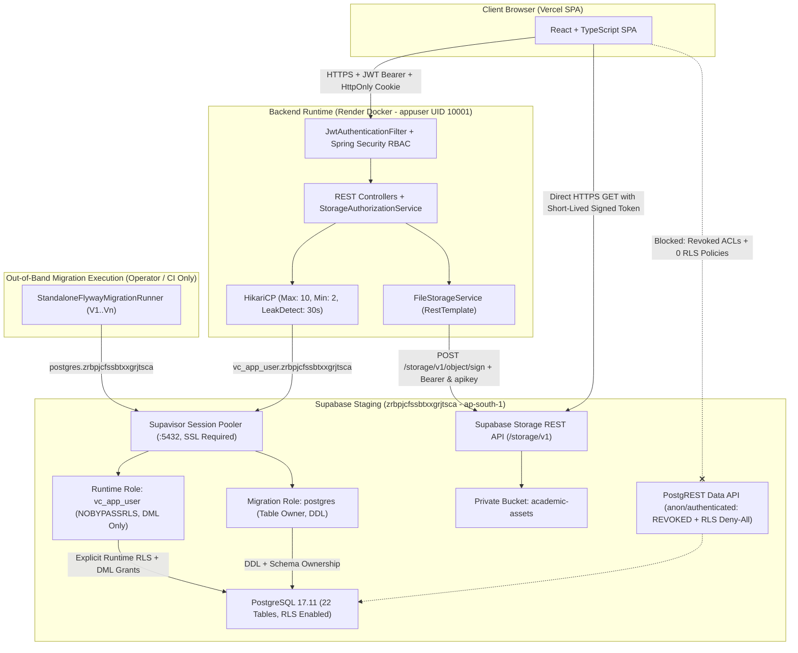
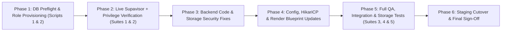

# MILESTONE 18.2 — COMPLETE SECURITY REMEDIATION DESIGN (VALIDATED & REVISED — M18.2.1)
## Virtual Classroom Platform — Staging & Production Hardening Architecture

**Document Status:** Validated & Corrected Design Specification (Milestone 18.2.1)  
**Target Environment:** Supabase Staging (`virtual-classroom-staging`, Ref: `zrbpjcfssbtxxgrjtsca`, Region: `ap-south-1`)  
**Production Boundary:** Production (`tzbjmxtmysvzxdmspiui`) strictly isolated and untouched  
**Execution Mode:** **DESIGN AND PLANNING ONLY** — Zero SQL executed, zero roles/grants/policies altered, zero source code modified, zero commits/deployments performed  

---

## 1. Executive Summary

### 1.1 Purpose and Revision Scope
Following the Milestone 18.1 Database Security and Backend Access Audit and the initial Milestone 18.2 design draft, **Milestone 18.2.1** performed an independent technical validation of every proposed security control before implementation.

This revised specification resolves all architectural, protocol, and database-level findings from Milestone 18.1 and corrects five critical design inaccuracies identified during Milestone 18.2.1 review:
1. **Honest RLS Architecture Decision (Section 5):** Explicitly acknowledges that permissive `USING (true) WITH CHECK (true)` policies for `vc_app_user` provide **zero per-user row-level isolation** at the database layer. Compares **Architecture A** (Trusted Backend Authorization + Restricted DB Role) against **Architecture B** (Transaction-Scoped Identity Context + Restrictive DB RLS), recommending Architecture A for Milestone 18.3 with Architecture B documented as an optional post-staging defense-in-depth upgrade.
2. **Official Supabase Storage REST API Design (Section 6):** Removes inaccurate references to custom HMAC URL signing and specifies the exact Supabase Storage REST API signed-URL mechanism (`POST /storage/v1/object/sign/{bucket}/{path}` with `Authorization: Bearer` and `apikey` headers), domain-table ownership authorization, path canonicalization, and fail-closed error handling across both `staging` and `prod` profiles.
3. **Code-Backed Least-Privilege Role & Grants (Sections 3 & 4):** Corrects the `courses` table privilege bug (the column is `archived`, not `is_active`, and Hibernate updates all mapped columns without `@DynamicUpdate`), trims `DELETE` grants strictly to the 5 tables where `delete()` is actually called in Java repositories, removes unnecessary grants on `flyway_schema_history` and `public.rls_auto_enable()`, scopes sequence grants strictly to the 15 runtime-writable sequences, and removes hardcoded passwords from SQL proposals.
4. **Object-by-Object Safe ACL Revocation (Section 8):** Replaces blanket `REVOKE ALL ON ALL ROUTINES` (which would target `supabase_admin`-owned `public.rls_auto_enable()`) with explicit object-by-object revocation strictly limited to the 22 application-owned tables and 18 application-owned sequences in `public`, preserving all Supabase-managed schemas, routines, and Storage API plumbing.
5. **PostgreSQL JDBC & Multi-Environment Configuration Accuracy (Section 7):** Fixes MySQL-style HikariCP properties (`prepStmtCacheSize`) to genuine PostgreSQL JDBC properties (`prepareThreshold`, `preparedStatementCacheQueries`, `preparedStatementCacheSizeMiB`), sets production `DATABASE_USERNAME` in `render.yaml` to `sync: false`, disables runtime Flyway in `staging` and `prod`, and validates Supavisor pooler authentication for custom `LOGIN` roles.

### 1.2 Summary of Audited Issues Addressed

| Severity | Issue (from M18.1) | Validated Remediation |
| :---: | :--- | :--- |
| **CRITICAL** | `render.yaml` uses unqualified `DATABASE_USERNAME: postgres` (rejected by Supavisor). | Set staging `DATABASE_USERNAME` to tenant-qualified `vc_app_user.zrbpjcfssbtxxgrjtsca`; set prod `DATABASE_USERNAME` to `sync: false`. |
| **HIGH** | Backend connects as privileged `postgres` role (`BYPASSRLS`, `CREATEROLE`, `CREATEDB`, table owner). | Provision dedicated unprivileged `vc_app_user` (`NOBYPASSRLS`, `NOSUPERUSER`, `NOCREATEROLE`, `NOCREATEDB`, `NOINHERIT`) with code-backed DML-only grants; reserve `postgres` strictly for out-of-band `StandaloneFlywayMigrationRunner`. |
| **HIGH** | `FileStorageService` returns `/storage/v1/object/public/` URLs for private bucket `academic-assets` and lacks download ownership checks. | Store canonical `storagePath`, issue short-lived (900s) Supabase Storage REST API signed URLs after domain-table ownership authorization, add `apikey` header, disable local fallback in `staging` & `prod`. |
| **MEDIUM** | Broad default table/sequence ACLs (`arwdDxtm`) granted to `anon` and `authenticated`. | Object-by-object `REVOKE` on the 22 named tables and 18 named sequences owned by `postgres` in `public`, plus `ALTER DEFAULT PRIVILEGES FOR ROLE postgres`. Preserve all Supabase-managed schemas/routines. |
| **MEDIUM** | `spring.flyway.baseline-on-migrate: true` and runtime Flyway remain enabled. | Disable runtime Flyway (`enabled: false`, `baseline-on-migrate: false`) in `staging` and `prod`; set `baseline-on-migrate: false` in base `application.yml` and `application-docker.yml`. |
| **LOW** | HikariCP lacks leak detection and PostgreSQL JDBC statement/SSL tuning. | Add `leak-detection-threshold: 30000`, enforce `sslmode=require`, and configure PostgreSQL JDBC prepared statement parameters. |
| **LOW** | Staging CORS permits insecure `http://localhost:5173`; dev JWT fallback secret only blocked in `prod`. | Remove `http://localhost:5173` from `render.yaml` staging CORS; extend `JwtTokenProvider` fallback secret rejection to `staging`. |

---

## 2. Current Architecture vs. Remediated Architecture

### 2.1 Current Architecture (Verified Baseline)
- **Frontend:** React 18 + TypeScript + Vite hosted on Vercel. Communicates exclusively with the Spring Boot REST API (`/api/v1/**`). Does **not** use Supabase PostgREST (`rest/v1`) or Supabase GoTrue Auth.
- **Backend:** Java 21 + Spring Boot `3.4.3` (`backend/pom.xml`), Spring Security 6 (stateless JWT + `BCryptPasswordEncoder(12)`), Spring Data JPA / Hibernate 6 (`ddl-auto: validate`), Spring `RestTemplate` (no Supabase Java SDK).
- **Database:** Supabase Staging PostgreSQL `17.11` (`zrbpjcfssbtxxgrjtsca`), accessed via Supavisor Session Pooler (`aws-0-ap-south-1.pooler.supabase.com:5432`).
  - All 22 tables (21 application + `flyway_schema_history`) and 18 sequences in `public` are owned by `postgres`.
  - RLS is enabled (`relrowsecurity = true`) on all 22 tables with 0 policies.
  - Default ACLs grant `arwdDxtm` on all 22 tables to `anon`, `authenticated`, and `service_role`.
  - One Supabase-managed routine exists in `public`: `public.rls_auto_enable()` (owned by `supabase_admin`).
- **Storage:** Private Supabase Storage bucket `academic-assets` (`public = false`, 50 MB cap, 14 allowed MIME types, 0 policies on `storage.objects`). Accessed server-side by `FileStorageService` using `SUPABASE_SERVICE_ROLE_KEY`.

### 2.2 Target Remediated Architecture



---

## 3. Proposed Database Roles (Validated Provisioning Design)

### 3.1 Distinction Between the Three Database Identities

| Dimension | 1. Supabase Tenant Admin (`postgres`) | 2. Dedicated Migration Role (`vc_migrator` — Optional Future) | 3. Runtime Application Role (`vc_app_user` — Milestone 18.3) |
| :--- | :--- | :--- | :--- |
| **Supavisor Username** | `postgres.zrbpjcfssbtxxgrjtsca` | `vc_migrator.zrbpjcfssbtxxgrjtsca` | `vc_app_user.zrbpjcfssbtxxgrjtsca` |
| **Execution Context** | Emergency DB administration, role/grant provisioning, and **Milestone 18.3 out-of-band `StandaloneFlywayMigrationRunner`**. Never placed in Render. | Optional future CI-only migration identity if strict separation from `CREATEROLE`/`CREATEDB` is required. | **Render Spring Boot backend exclusively** (HikariCP JDBC pool). |
| **PostgreSQL Attributes** | `LOGIN`, `NOSUPERUSER`, `BYPASSRLS`, `CREATEROLE`, `CREATEDB`, member of `supabase_privileged_role`. | `LOGIN`, `NOSUPERUSER`, `NOBYPASSRLS`, `NOCREATEROLE`, `NOCREATEDB`, `NOINHERIT`. | `LOGIN`, `NOSUPERUSER`, `NOBYPASSRLS`, `NOCREATEROLE`, `NOCREATEDB`, `NOINHERIT`, `CONNECTION LIMIT 20`. |
| **Object Ownership** | Currently owns all 22 tables and 18 sequences in `public`. | Would require transferring ownership of all 22 tables + 18 sequences (`ALTER ... OWNER TO vc_migrator`) + `GRANT vc_migrator TO postgres` + `GRANT CREATE ON SCHEMA public`. | **Owns ZERO objects.** (Critical: object owners bypass RLS and can run `DROP`/`ALTER`). |
| **Supabase Feasibility** | Native and verified in Milestones 17.8–17.9. | Feasible on PostgreSQL 17, but requires careful validation with Supabase's `supabase_admin`-owned `public.rls_auto_enable()` event trigger during DDL and Supabase Studio ownership expectations. | Feasible; **must verify live Supavisor pooler authentication** (`vc_app_user.zrbpjcfssbtxxgrjtsca`) before Render cutover (see Section 3.3). |

**Decision for Milestone 18.3:**
- **Migration Identity:** Retain `postgres` (`postgres.zrbpjcfssbtxxgrjtsca`) strictly for out-of-band `StandaloneFlywayMigrationRunner` execution and DBA provisioning. Keep `postgres` credentials completely out of Render.
- **Runtime Identity:** Provision `vc_app_user` (`vc_app_user.zrbpjcfssbtxxgrjtsca`) exclusively for Render Spring Boot runtime.
- **Future Hardening Option:** A dedicated `vc_migrator` role without `CREATEROLE`/`CREATEDB`/`BYPASSRLS` can be introduced in a subsequent milestone after verifying `rls_auto_enable()` event trigger execution under non-`postgres` table owners.

### 3.2 Complete `vc_app_user` Attribute Specification
Every role attribute is explicitly specified so no insecure PostgreSQL default is inherited:

| Attribute | Setting | Justification |
| :--- | :--- | :--- |
| `LOGIN` | Enabled | Required for Spring Boot JDBC authentication via Supavisor. |
| `NOSUPERUSER` | Enforced | Prevents bypassing all PostgreSQL access controls. |
| `NOCREATEDB` | Enforced | Prevents creating or dropping databases. |
| `NOCREATEROLE` | Enforced | Prevents creating, altering, or escalating database roles. |
| `NOBYPASSRLS` | Enforced | Ensures PostgreSQL evaluates RLS policies on every table (cannot bypass RLS). |
| `NOINHERIT` | Enforced | Prevents implicit privilege inheritance even if role membership is accidentally added later. |
| `CONNECTION LIMIT 20` | Enforced | Caps runtime connections (Render HikariCP max is 10; 20 permits zero-downtime rolling redeploys of 2 instances without starving administrative `postgres` sessions). |
| **Password Handling** | Injected at runtime via secret variable | Password MUST be >= 32 characters (cryptographically random, SCRAM-SHA-256), never hardcoded in SQL files or Git. |

### 3.3 Supavisor Connection Pooling Compatibility Check
On Supabase, Supavisor on port `5432` authenticates clients using `<role_name>.<project_ref>` (`vc_app_user.zrbpjcfssbtxxgrjtsca`) by querying PostgreSQL's authentication catalog via the internal `pgbouncer` auth lookup mechanism.
- **Pre-Cutover Gate (Mandatory in M18.3):** Before updating Render, an integration check MUST open a live SSL JDBC connection as `vc_app_user.zrbpjcfssbtxxgrjtsca` to `aws-0-ap-south-1.pooler.supabase.com:5432/postgres` and verify `SELECT current_user` returns `vc_app_user`. If Supavisor requires explicit SCRAM password refresh or pooler cache expiry (~30–60s), the gate confirms authentication before Render deployment.

---

## 4. Proposed Database Grants (Code-Backed Least-Privilege Analysis)

An exhaustive audit of all 13 controllers, all service classes, and all Spring Data JPA repositories in `backend/src/main/java/com/virtualclassroom/` was performed to verify the **exact SQL DML operations** emitted by Hibernate at runtime.

### 4.1 Why Previous Draft Grants Were Corrected
1. **`courses` Table (`Course.java`):** The initial draft proposed `GRANT UPDATE (is_active) ON public.courses`. Code inspection of `Course.java` and `STAGING_DATABASE_INVENTORY.md` proved two defects:
   - The actual column name is **`archived`**, not `is_active`.
   - `Course.java` does **not** carry `@DynamicUpdate`. When `CourseService.archiveCourse()` calls `courseRepository.save(course)`, Hibernate generates `UPDATE courses SET archived=?, code=?, degree_id=?, name=? WHERE id=?`. A column-level `UPDATE (archived)` grant would fail at runtime with `ERROR: permission denied for table courses`.
   - **Correction:** Grant table-level `SELECT, UPDATE` on `public.courses` (still withholding `INSERT`, `DELETE`, `TRUNCATE`). *(Optional code enhancement: convert `archiveCourse`/`unarchiveCourse` to `@Modifying @Query("UPDATE Course c SET c.archived = :archived WHERE c.id = :id")` if column-level `UPDATE (archived)` restriction is desired later.)*
2. **Code-Backed `DELETE` Minimization:** Searching every service and repository for `delete`/`remove` calls proved that **only 5 tables** currently execute `DELETE`:
   - `study_materials` (`FacultyService.deleteMaterial`)
   - `video_lectures` (`FacultyService.deleteLecture`)
   - `questions` (`ForumService.deleteQuestion`)
   - `answers` (`ForumService.deleteAnswer` + FK cascade from `questions`)
   - `refresh_tokens` (`RefreshTokenRepository.deleteByUserId`)
   - **Correction:** Withhold `DELETE` on all other 16 application tables (`assignments`, `assignment_submissions`, `examinations`, `examination_results`, `faculty_subject_assignments`, `live_sessions`, `notifications`, `password_reset_tokens`, `student_subject_enrollments`, `users`, `student_profiles`, `faculty_profiles`, `degrees`, `courses`, `subjects`, `audit_logs`).
3. **`flyway_schema_history`:** Because runtime Flyway is **disabled** (`spring.flyway.enabled: false`) in `staging` and `prod`, `vc_app_user` requires **ZERO privileges** on `public.flyway_schema_history`.
4. **Function Execution Privileges:** The **only** routine in `public` is `public.rls_auto_enable()`, an event trigger function owned by `supabase_admin`. `vc_app_user` cannot run DDL and never invokes it. Therefore, **no `GRANT EXECUTE ON ALL ROUTINES`** is needed for `vc_app_user`.
5. **Sequence Privileges:** `vc_app_user` only inserts into 15 tables backed by sequences. The 3 curriculum sequences (`degrees_id_seq`, `courses_id_seq`, `subjects_id_seq`) are **withheld**.
6. **Future Default Privileges:** Instead of automatically granting `SELECT, INSERT, UPDATE, DELETE` on every future table (which would break least-privilege for future append-only or reference tables), configure `ALTER DEFAULT PRIVILEGES FOR ROLE postgres IN SCHEMA public` to grant **no automatic `DELETE`** (or grant `SELECT` only and require each new Flyway migration to declare exact DML grants explicitly for `vc_app_user`).

### 4.2 Validated Table Privilege Matrix for `vc_app_user`

| # | Table (`public.*`) | Granted DML | Withheld / Denied | Verified Codebase Basis |
| :-: | :--- | :--- | :--- | :--- |
| 1 | `users` | `SELECT, INSERT, UPDATE` | `DELETE, TRUNCATE, DDL` | Registration, login, approve/reject/suspend/reactivate, password update (`AuthService`, `AdminService`, `UserProfileService`). |
| 2 | `student_profiles` | `SELECT, INSERT, UPDATE` | `DELETE, TRUNCATE, DDL` | Student registration & profile metadata update. |
| 3 | `faculty_profiles` | `SELECT, INSERT, UPDATE` | `DELETE, TRUNCATE, DDL` | Faculty registration & profile metadata update. |
| 4 | `degrees` | `SELECT` | `INSERT, UPDATE, DELETE, TRUNCATE` | Static academic catalog read by `CourseService`. |
| 5 | `courses` | `SELECT, UPDATE` | `INSERT, DELETE, TRUNCATE` | Read by `CourseService`; `archived` toggled via Hibernate `save()` by Admin. |
| 6 | `subjects` | `SELECT` | `INSERT, UPDATE, DELETE, TRUNCATE` | Static academic curriculum read by `CourseService`, `StudentService`, `FacultyService`. |
| 7 | `faculty_subject_assignments` | `SELECT, INSERT` | `UPDATE, DELETE, TRUNCATE` | Admin/registration assigns faculty to subjects (`AdminService`, `AuthService`). |
| 8 | `student_subject_enrollments` | `SELECT, INSERT, UPDATE` | `DELETE, TRUNCATE` | Student enrollment and status management (`EnrollmentService`). |
| 9 | `study_materials` | `SELECT, INSERT, UPDATE, DELETE` | `TRUNCATE` | Faculty uploads, edits, and deletes study materials (`FacultyService.deleteMaterial`). |
| 10 | `video_lectures` | `SELECT, INSERT, UPDATE, DELETE` | `TRUNCATE` | Faculty publishes and deletes lectures (`FacultyService.deleteLecture`). |
| 11 | `assignments` | `SELECT, INSERT, UPDATE` | `DELETE, TRUNCATE` | Faculty creates/updates assignments (`AssignmentService`). |
| 12 | `assignment_submissions` | `SELECT, INSERT, UPDATE` | `DELETE, TRUNCATE` | Students submit; faculty grades (`AssignmentService`). Preserved for academic integrity. |
| 13 | `examinations` | `SELECT, INSERT, UPDATE` | `DELETE, TRUNCATE` | Faculty schedules/updates exams (`ExaminationService`). |
| 14 | `examination_results` | `SELECT, INSERT, UPDATE` | `DELETE, TRUNCATE` | Official marks recorded/updated (`ExaminationService`). Preserved for audit. |
| 15 | `live_sessions` | `SELECT, INSERT, UPDATE` | `DELETE, TRUNCATE` | Faculty schedules and transitions status (`LiveSessionService`). |
| 16 | `questions` | `SELECT, INSERT, UPDATE, DELETE` | `TRUNCATE` | Forum CRUD (`ForumService.deleteQuestion`). |
| 17 | `answers` | `SELECT, INSERT, UPDATE, DELETE` | `TRUNCATE` | Forum CRUD + cascade delete (`ForumService.deleteAnswer`). |
| 18 | `notifications` | `SELECT, INSERT, UPDATE` | `DELETE, TRUNCATE` | System inserts alerts; users mark `is_read = true` (`NotificationService`). |
| 19 | `audit_logs` | `SELECT, INSERT` | **`UPDATE, DELETE, TRUNCATE`** | **Strictly append-only security audit trail** (`AuditLogService`). |
| 20 | `refresh_tokens` | `SELECT, INSERT, UPDATE, DELETE` | `TRUNCATE` | Token issuance, rotation/revocation, and `deleteByUserId` (`AuthService`). |
| 21 | `password_reset_tokens` | `SELECT, INSERT, UPDATE` | `DELETE, TRUNCATE` | Token issuance and marking `used = true` (`AuthService`). |
| 22 | `flyway_schema_history` | **NONE** | `SELECT, INSERT, UPDATE, DELETE, TRUNCATE` | Runtime Flyway disabled; app never queries migration metadata. |

### 4.3 Validated Sequence Privilege Matrix (15 of 18 Sequences)
- **Granted `USAGE, SELECT` (15 sequences):** `users_id_seq`, `refresh_tokens_id_seq`, `password_reset_tokens_id_seq`, `student_subject_enrollments_id_seq`, `study_materials_id_seq`, `video_lectures_id_seq`, `live_sessions_id_seq`, `questions_id_seq`, `answers_id_seq`, `assignments_id_seq`, `assignment_submissions_id_seq`, `examinations_id_seq`, `examination_results_id_seq`, `notifications_id_seq`, `audit_logs_id_seq`.
- **Withheld (3 sequences):** `degrees_id_seq`, `courses_id_seq`, `subjects_id_seq` (no runtime `INSERT` on reference tables).

### 4.4 Honest Assessment of "Least Privilege"
With these grants and zero object ownership, `vc_app_user` achieves **structural and table-level least privilege** (zero DDL, zero role/DB administration, zero access to `flyway_schema_history`, immutable `audit_logs`, read-only curriculum, minimal `DELETE` surface). However, as analyzed in Section 5, it does **not** enforce row-level (per-user) least privilege at the database engine layer under Architecture A.

---

## 5. Final Row-Level Security (RLS) Architecture Decision

### 5.1 Critical Analysis of `USING (true) WITH CHECK (true)` for `vc_app_user`
The Milestone 18.2 initial draft proposed creating policies of the form:
```sql
CREATE POLICY "vc_app_user_all" ON public.<table>
    FOR ALL TO vc_app_user USING (true) WITH CHECK (true);
```
A rigorous security validation establishes the following non-negotiable facts:
1. **No Row-Level Isolation:** `USING (true) WITH CHECK (true)` provides **ZERO per-user, per-student, or per-faculty row-level isolation**. Within PostgreSQL, `vc_app_user` can read every row of every table it has `SELECT` on and modify every row of every table it has `UPDATE`/`DELETE` on.
2. **Authorization Lives Exclusively in Spring Boot:** Student, Faculty, and Admin access boundaries remain **100% enforced by Spring Security (`SecurityConfig`, `JwtAuthenticationFilter`, `@PreAuthorize`) and service-layer ownership checks** (`verifyAccessToSubject`, `verifyStudentEnrolledInSubject`, author/uploader verification).
3. **Compromised Backend Connection Blast Radius:** If the Spring Boot runtime is compromised (e.g., remote code execution, leaked `vc_app_user` credentials, or an unparameterized SQL injection bug), an attacker holding a `vc_app_user` connection **can read all application records** (all users' emails, BCrypt hashes, grades, submissions, notifications) and modify rows within the table-level DML boundaries. What `vc_app_user` prevents compared to `postgres` is:
   - Schema destruction (`DROP TABLE`, `ALTER TABLE`, `TRUNCATE`, `CREATE FUNCTION`).
   - Account/infrastructure takeover (`CREATE ROLE`, `CREATE DATABASE`, policy tampering).
   - Audit trail erasure (`UPDATE`/`DELETE` on `audit_logs` rejected by PostgreSQL).
   - Hard deletion of users, grades, submissions, and curriculum records.
4. **Can Transaction-Local User Context + Restrictive RLS Provide Stronger Isolation?**
   - **Yes.** By setting transaction-scoped PostgreSQL custom parameters (`SELECT set_config('app.current_user_id', ?, true)` and `SELECT set_config('app.current_user_role', ?, true)`) at the start of every transaction and writing restrictive per-table RLS predicates, PostgreSQL can block **application-layer horizontal authorization bugs (IDOR)** — e.g., if a Java developer forgets `verifyStudentEnrolledInSubject()` on a new endpoint, PostgreSQL still filters out unauthorized rows.
   - **Important Security Caveat on SQL Injection:** Even with transaction-local `set_config`, if an attacker achieves arbitrary **SQL injection** within a transaction, they could execute `SELECT set_config('app.current_user_role', 'ROLE_ADMIN', true)` inside that transaction to elevate context unless SQLi is prevented (which JPA/Hibernate parameterized queries already prevent). Thus, transaction-local RLS primarily defends against **Java-layer logic/IDOR bugs**, not arbitrary SQL execution or stolen DB credentials (since anyone with `vc_app_user` credentials directly could call `set_config`).
5. **Can Pooled Connections Safely Use Transaction-Scoped Identity Context?**
   - **Yes, if and only if all 5 strict engineering invariants are guaranteed:**
     1. Use **transaction-local** `set_config(key, val, true)` (equivalent to `SET LOCAL`), **never** session-level `SET`.
     2. Disable JDBC auto-commit (`spring.datasource.hikari.auto-commit: false`) so every query executes inside a transaction; PostgreSQL automatically resets all `LOCAL` settings on `COMMIT` or `ROLLBACK` before the connection returns to HikariCP or Supavisor.
     3. Make every RLS policy **fail-closed**: when `current_setting('app.current_user_id', true)` is `NULL` or `''`, the policy evaluates to `FALSE` (zero rows returned).
     4. Never trust client headers; populate `set_config` strictly from the verified `SecurityContextHolder` `UserPrincipal` via `PreparedStatement`.
     5. Handle pre-authentication and public flows cleanly (`login`, `register`, `refresh`, `forgot-password`, `JwtAuthenticationFilter` loading `UserDetails`, and public `GET /api/v1/courses/**`) via narrow `SECURITY DEFINER` lookup functions or an explicit unauthenticated auth-lookup context.
   - Because `SET LOCAL` / `set_config(..., true)` is strictly transaction-scoped, it is compatible with both Supavisor **Session Pooler (port 5432)** and **Transaction Pooler (port 6543)**.

### 5.2 Architecture Comparison: Option A vs. Option B

| Evaluation Criterion | Architecture A: Trusted Backend + Restricted `vc_app_user` + Permissive Runtime RLS | Architecture B: Database-Enforced Row-Level Isolation (`set_config` + Restrictive RLS) |
| :--- | :--- | :--- |
| **Per-User Row Isolation in PostgreSQL** | **None.** Enforced strictly in Spring Boot (`SecurityConfig` + Service layer). | **Yes.** Enforced in both Spring Boot AND PostgreSQL RLS policies. |
| **Defense Against Java IDOR Bugs** | Relies on code review + integration tests in Spring Boot. | **Strong defense-in-depth:** PostgreSQL blocks unauthorized rows even if a Java controller misses an ownership check. |
| **Defense Against Stolen `vc_app_user` Credentials** | Attacker can read/write permitted DML tables; blocked from DDL, `audit_logs` tamper, role/DB creation, hard deletes. | Same as A if attacker has `vc_app_user` password directly (attacker can call `set_config('app.current_user_role', 'ROLE_ADMIN', true)`). |
| **Defense Against PostgREST (`anon` / `authenticated`)** | **100% Blocked** (table ACLs revoked + RLS enabled with 0 policies for `anon`/`authenticated`). | **100% Blocked** (same). |
| **Impact on Pre-Auth Flows (`login`, `JWT Filter`, `register`)** | **Zero impact.** Works immediately with existing `CustomUserDetailsService` and Hibernate. | **High refactor required:** Must build `SECURITY DEFINER` functions or special auth-context paths for `JwtAuthenticationFilter.loadUserById`, login, registration, and token refresh. |
| **Hibernate & Connection Pool Complexity** | **Low.** Standard HikariCP + Supavisor behavior; zero extra DB round-trips. | **High.** Requires `auto-commit: false`, custom `ConnectionPreparer`/AOP transaction aspect, multi-table RLS subqueries, and rigorous leak/null-context testing across all 21 entities. |
| **Staging Readiness & Regression Risk** | **Immediate / Very Low Risk.** Unblocks secure Render staging deployment in Milestone 18.3. | **High Regression Risk** for immediate staging launch; requires dedicated RLS policy test harness across every endpoint. |

### 5.3 Final Architecture Recommendation & Justification
**Selected Architecture for Milestone 18.3:** **Architecture A — Trusted Backend Authorization with Restricted `vc_app_user` Role, Code-Backed Table DML Grants, and Explicit Permissive Runtime-Role RLS Policies.**

**Justification:**
1. **Immediate High-Impact Risk Reduction:** Eliminates the CRITICAL `render.yaml` defect and removes `postgres` (`BYPASSRLS`, `CREATEROLE`, `CREATEDB`, table ownership, DDL capability) from the runtime backend immediately without introducing Hibernate/transaction regression risk to staging.
2. **Explicit Opt-In Table Access without `BYPASSRLS`:** Keeping `vc_app_user` on `NOBYPASSRLS` with per-table policies ensures that `vc_app_user` still cannot read any future table (or `flyway_schema_history`) unless both a `GRANT` and an explicit policy are created.
3. **Strong Verified Application Authorization:** Milestone 18.1 audited all 13 REST controllers and confirmed dual filter + `@PreAuthorize` protection, per-request account status checks (`APPROVED`/`SUSPENDED`), and service-layer horizontal ownership checks across Student, Faculty, and Admin endpoints.
4. **Clear Evolution Path to Architecture B:** Because `vc_app_user` is provisioned with `NOBYPASSRLS` from day one, the platform can later replace `USING (true)` policies table-by-table with restrictive `current_setting('app.current_user_id', true)` policies (starting with high-sensitivity tables like `examination_results`, `assignment_submissions`, and `refresh_tokens`) without ever changing database roles or connection strings.

**Role Access Enforcement Mapping under Architecture A:**
- **Student (`ROLE_STUDENT`):** Authenticated via JWT -> verified `APPROVED` -> restricted by `SecurityConfig` (`/api/v1/students/**`), `@PreAuthorize`, and service-layer enrollment/ownership checks (`verifyStudentEnrolledInSubject`, `AssignmentService.verifyAccessToSubject`, own submissions/results only).
- **Faculty (`ROLE_FACULTY`):** Restricted by `SecurityConfig` (`/api/v1/faculty/**`), `@PreAuthorize`, and `faculty_subject_assignments` checks; blocked from `/api/v1/admin/**`.
- **Admin (`ROLE_ADMIN`):** Restricted by `SecurityConfig` (`/api/v1/admin/**`) and class-level `@PreAuthorize("hasAuthority('ROLE_ADMIN')")`; all privileged actions recorded in PostgreSQL-enforced append-only `audit_logs`.

---

## 6. Corrected Supabase Storage Security Architecture

### 6.1 Dependency & Protocol Reality Check
Inspection of `backend/pom.xml` confirms:
- Spring Boot `3.4.3` with `spring-boot-starter-web` (`RestTemplate`).
- **No** external Supabase Java SDK or AWS S3 SDK is included.
- **No custom HMAC URL signing shall be implemented.** Supabase Storage does **not** expose a custom client-side HMAC signing algorithm for Storage URLs; instead, Supabase Storage generates **JWT-signed tokens server-side** via its official Storage REST API.

### 6.2 Official Supabase Storage REST API Specification
All server-to-Supabase Storage calls in `FileStorageService.java` must use the official Storage REST API over HTTPS with **both** required server-side authentication headers:
- `Authorization: Bearer ${SUPABASE_SERVICE_ROLE_KEY}`
- `apikey: ${SUPABASE_SERVICE_ROLE_KEY}` *(Required by Supabase's Kong API Gateway — currently missing in `FileStorageService.java` and must be added!)*

| Operation | HTTP Method & Official Supabase Endpoint | Request Headers & Body | Response & Usage |
| :--- | :--- | :--- | :--- |
| **Create Signed Download URL** | `POST {SUPABASE_URL}/storage/v1/object/sign/{bucket}/{objectPath}` | Headers: `Authorization`, `apikey`, `Content-Type: application/json`<br>Body: `{"expiresIn": 900}` *(optional `"download": true` to force download disposition)* | Returns `{"signedURL": "/object/sign/{bucket}/{objectPath}?token=<jwt>"}`.<br>Full URL: `{SUPABASE_URL}/storage/v1` + `signedURL`. |
| **Create Signed Upload URL** | `POST {SUPABASE_URL}/storage/v1/object/upload/sign/{bucket}/{objectPath}` | Headers: `Authorization`, `apikey`, `Content-Type: application/json`, `x-upsert: false`<br>Body: `{}` *(Note: Supabase sets a fixed 2-hour upload token TTL server-side; `expiresIn` in body is not used by this endpoint)* | Returns `{"url": "/object/upload/sign/{bucket}/{objectPath}?token=<jwt>", "token": "..."}`.<br>Client executes `PUT` to `{SUPABASE_URL}/storage/v1` + `url` with validated `Content-Type`. |
| **Server-Side Multipart Upload** | `POST {SUPABASE_URL}/storage/v1/object/{bucket}/{objectPath}` | Headers: `Authorization`, `apikey`, `Content-Type: {validatedMime}`, `x-upsert: false`<br>Body: raw file bytes | Persists object into private bucket `academic-assets`. |
| **Server-Side Object Delete** | `DELETE {SUPABASE_URL}/storage/v1/object/{bucket}/{objectPath}` | Headers: `Authorization`, `apikey` | Removes object from private bucket `academic-assets`. |

### 6.3 Delivery Architecture: Short-Lived Signed URLs vs. Authenticated Backend Proxy
- **Decision:** Return **short-lived Supabase-generated signed download URLs** from `GET /api/v1/storage/signed-download-url?path={storagePath}` rather than proxying binary payloads through Spring Boot.
- **Justification:**
  1. Render Starter containers have constrained RAM/CPU; streaming up to 50 MB PDFs/videos through Spring Boot servlet threads risks OOM and thread starvation.
  2. Directly matches the existing frontend contract in `frontend/src/core/services/storageService.ts` (`getSignedDownloadUrl`).
  3. The `SUPABASE_SERVICE_ROLE_KEY` remains strictly server-side; the frontend only receives a single-object, short-lived signed token.
- **Expiry Configuration:**
  - Default download signed URL expiry: **`900` seconds (15 minutes)**.
  - Allowed clamped range: **`60` to `3600` seconds** (reduced from the current 86,400s / 24-hour maximum to limit leaked-link exposure).
- **Eliminating Public-Style URLs:**
  - `uploadToSupabase()` (currently line 311) and `generateSignedUploadUrl()` (currently line 162) MUST **never** construct `{SUPABASE_URL}/storage/v1/object/public/...`.
  - Domain records (`study_materials.file_url`, `assignments.attachment_url`, `assignment_submissions.file_url`) should store the canonical **`storagePath`** (e.g., `study-materials/5/uuid-notes.pdf`), while `FileUploadResponse.fileUrl` returns a freshly generated 900-second signed download URL (or `/api/v1/storage/signed-download-url?path=...` reference) for immediate UI preview without exposing a broken `/object/public/` link.

### 6.4 Strict Path Validation, Upload Validation & Domain Ownership Authorization
1. **Path Validation & Canonicalization (`validateStoragePath`):**
   - Reject `null`, blank, leading `/`, `\\`, `..`, `%2e`, `%2f`, null bytes, whitespace, or query/fragment characters (`?`, `#`).
   - Enforce strict allowlist regex: `^(general|study-materials|submissions|assignments|profile-photos|course-documents)/[0-9]+/[a-zA-Z0-9._-]+$`.
   - Prevents path traversal against both local storage (in dev) and Supabase Storage REST API path resolution.
2. **Upload Validation:**
   - Align `FileStorageService.ALLOWED_MIME_TYPES` with the **14 allowed MIME types** configured on the staging `academic-assets` bucket (currently `FileStorageService` lists 17 types; reconcile exact parity so uploads never fail unexpectedly at Supabase).
   - Enforce `maxFileSizeBytes = 52428800` (50 MB) and validate filename/extension/folder in both `uploadFile()` and `generateSignedUploadUrl()`.
   - Enforce `x-upsert: false` to prevent overwriting existing objects.
3. **Domain-Table Resource Ownership Checks (`StorageAuthorizationService`):**
   - `StorageController.getSignedDownloadUrl()` currently only checks `@PreAuthorize("isAuthenticated()")`, allowing **any** authenticated student to obtain a signed URL for **any** file path!
   - **Required Fix:** Authorize every `getSignedDownloadUrl(storagePath, principal)` call against authoritative PostgreSQL domain tables (not just path prefixes):
     - **Admin (`ROLE_ADMIN`):** Permitted for all valid paths.
     - **Matched in `assignment_submissions` (`file_url` matches `storagePath`):** Permitted if (`ROLE_STUDENT` AND `submission.student_id == principal.id`) OR (`ROLE_FACULTY` AND faculty assigned to `submission.assignment.subject_id`).
     - **Matched in `study_materials` (`file_url` matches `storagePath`) or `assignments` (`attachment_url` matches `storagePath`):** Permitted if (`ROLE_STUDENT` AND enrolled in `subject_id`) OR (`ROLE_FACULTY` AND assigned to `subject_id`).
     - **Matched in `student_profiles.avatar_url` / `faculty_profiles.avatar_url` or folder `profile-photos/*`:** Permitted for any authenticated user.
     - **Unlinked freshly uploaded object (not yet saved to a domain table):** Permitted ONLY if the `{uploaderId}` segment in `storagePath` equals `principal.id`.
     - **All other paths:** **FAIL CLOSED — throw `AccessDeniedException` (HTTP 403 Forbidden).**
4. **Fail-Closed Error Handling & Local Endpoint Lockdown:**
   - Replace `isProductionProfile()` in `FileStorageService.java` with `isCloudStorageRequiredProfile()` covering **both `staging` and `prod` / `production`**.
   - In `staging` and `prod`:
     - If Supabase Storage REST API fails or returns non-2xx, **do NOT silently fall back** to local disk (`uploadToLocalStorage`) or `/api/v1/storage/files/...`. Throw a dedicated `StorageOperationException` mapped to HTTP `502 Bad Gateway` / `503 Service Unavailable`, ensuring `SUPABASE_SERVICE_ROLE_KEY` is never logged in exception details.
     - Disable `GET /api/v1/storage/files/**` (return HTTP `404` / `403` when `provider=supabase`) and remove `/api/v1/storage/files/**` from `SecurityConfig.permitAll()` for cloud profiles.

---

## 7. Environment-Specific Configuration & Deployment Separation

### 7.1 Migration vs. Runtime Separation Checklist
- **Standalone Flyway Runner (`StandaloneFlywayMigrationRunner.java`)**: Sole canonical migration mechanism for staging and production (`baselineOnMigrate(false)`, `validateOnMigrate(true)`, `cleanDisabled(true)`, staging identity guard).
- **Runtime Flyway Disabled in Cloud Profiles:** `spring.flyway.enabled: false` and `spring.flyway.baseline-on-migrate: false` in `application-staging.yml` and `application-prod.yml`.
- **Local / Docker / Test Profile Compatibility:**
  - `application.yml`: Change `spring.flyway.baseline-on-migrate` from `true` to `false` (retaining `enabled: true` default for local developer ergonomics in `application-local.yml`).
  - `application-docker.yml`: Change `baseline-on-migrate: false` (safe for fresh Docker Postgres CI containers).
  - `application-test.yml`: Already has `spring.flyway.enabled: false`.
- **Separate Credentials & Secret Hygiene:**
  - Staging migration identity (`postgres.zrbpjcfssbtxxgrjtsca` + `postgres` password) exists ONLY in operator/CI migration secrets — NEVER in Render.
  - Staging runtime identity (`vc_app_user.zrbpjcfssbtxxgrjtsca` + distinct `vc_app_user` password) exists in Render staging environment variables (`DATABASE_PASSWORD` marked `sync: false`).
  - Production configuration in `render.yaml` MUST NEVER contain staging project references, usernames, or credentials; production `DATABASE_USERNAME` is set to `sync: false`.

### 7.2 Validated `render.yaml` Changes

```yaml
  # Staging Backend Service
  - type: web
    name: virtual-classroom-backend-staging
    runtime: docker
    dockerfilePath: ./backend/Dockerfile
    dockerContext: ./backend
    region: oregon
    plan: starter
    branch: develop
    healthCheckPath: /actuator/health/liveness
    autoDeploy: false
    envVars:
      - key: SPRING_PROFILES_ACTIVE
        value: staging
      - key: PORT
        value: 8080
      - key: DATABASE_URL
        sync: false # jdbc:postgresql://aws-0-ap-south-1.pooler.supabase.com:5432/postgres?sslmode=require
      - key: DATABASE_USERNAME
        value: vc_app_user.zrbpjcfssbtxxgrjtsca
      - key: DATABASE_PASSWORD
        sync: false # Dedicated vc_app_user password stored as Render secret
      - key: JWT_SECRET
        sync: false
      - key: JWT_EXPIRATION_MS
        value: 86400000
      - key: COOKIE_SECURE
        value: true
      - key: CORS_ALLOWED_ORIGINS
        value: https://virtual-classroom-staging.vercel.app
      - key: STORAGE_PROVIDER
        value: supabase
      - key: SUPABASE_URL
        sync: false
      - key: SUPABASE_SERVICE_ROLE_KEY
        sync: false
      - key: SUPABASE_STORAGE_BUCKET
        value: academic-assets

  # Production Backend Service (Strictly isolated — NO staging values)
  - type: web
    name: virtual-classroom-backend-prod
    ...
    envVars:
      - key: DATABASE_URL
        sync: false
      - key: DATABASE_USERNAME
        sync: false # Set via Render Dashboard when prod is provisioned (never unqualified 'postgres')
      - key: DATABASE_PASSWORD
        sync: false
```

### 7.3 Validated PostgreSQL JDBC & HikariCP Configuration (`application-staging.yml` & `application-prod.yml`)
*(Corrected from MySQL properties in the earlier draft to genuine `org.postgresql.Driver` properties!)*

```yaml
spring:
  datasource:
    url: ${DATABASE_URL}
    username: ${DATABASE_USERNAME}
    password: ${DATABASE_PASSWORD}
    driver-class-name: org.postgresql.Driver
    hikari:
      maximum-pool-size: ${DB_POOL_MAX:10}       # Prod default: 15
      minimum-idle: ${DB_POOL_MIN:2}             # Prod default: 5
      idle-timeout: 300000
      max-lifetime: 1200000
      connection-timeout: 20000
      validation-timeout: 5000
      leak-detection-threshold: 30000            # Logs stack traces if a connection is held > 30s
      initialization-fail-timeout: 1             # Fail fast on startup if DB auth/SSL/schema fails
      pool-name: VirtualClassroomStagingPool     # Prod: VirtualClassroomProdPool
      data-source-properties:
        sslmode: require                         # Enforces TLS even if omitted from DATABASE_URL
        prepareThreshold: 5                      # PostgreSQL JDBC server-side prepared statements (safe on port 5432 session pooler)
        preparedStatementCacheQueries: 256
        preparedStatementCacheSizeMiB: 5
        ApplicationName: virtual-classroom-staging
  jpa:
    hibernate:
      ddl-auto: validate                         # Fails fast if entity mappings diverge from PostgreSQL 17 schema
    show-sql: false
  flyway:
    enabled: false                               # Solely managed by StandaloneFlywayMigrationRunner
    baseline-on-migrate: false
```

### 7.4 Additional Hardening Controls
- **Startup Failure Handling:** `initialization-fail-timeout: 1` + `ddl-auto: validate` ensures Render fails the deploy cleanly (keeping the previous healthy deployment live) if credentials, SSL, permissions, or schema drift occur.
- **Health Check Behavior:** Render probes `/actuator/health/liveness` (application process alive, does not restart container on transient DB blips); `/actuator/health/readiness` and `/actuator/health` verify DB connectivity with `show-details: when-authorized`.
- **JWT Fallback Secret Rejection:** Extend `JwtTokenProvider.java` (lines 40–46) so `LOCAL_DEV_FALLBACK_SECRET` is rejected for `staging`, `prod`, and `production` profiles.
- **Secure Logging & Error Exposure:** In `application.yml`, `server.error.include-message: always` should be overridden to `never` (or `on-param` disabled) in `application-staging.yml` and `application-prod.yml` so internal SQL/storage exception details are not leaked in HTTP 500 responses.

---

## 8. Object-by-Object Safe Default ACL Remediation

### 8.1 Separation of Application-Owned vs. Supabase-Managed Objects
Blanket revocation commands (such as `REVOKE ALL ON ALL ROUTINES IN SCHEMA public FROM anon`) are **unsafe** on managed Supabase because `public` contains `supabase_admin`-owned infrastructure objects (`public.rls_auto_enable()`). Every object category must be treated separately:

| Object Category | Owner | Exact Objects | Current `anon` / `authenticated` Access | Action | Justification & Impact Analysis |
| :--- | :--- | :--- | :--- | :--- | :--- |
| **Application-Owned Tables in `public`** | `postgres` | Exact **21 application tables** + **`flyway_schema_history`** (22 tables total, verified in `STAGING_DATABASE_INVENTORY.md`) | `arwdDxtm` (`ALL`) | **REVOKE ALL** from `anon`, `authenticated`, and `PUBLIC` | Neither frontend nor backend uses PostgREST. Eliminates single-point-of-failure exposure if a permissive RLS policy is ever misconfigured. Zero impact on Spring Boot JDBC or Supabase Storage. |
| **Application-Owned Sequences in `public`** | `postgres` | Exact **18 sequences** (`users_id_seq`, `questions_id_seq`, ..., `password_reset_tokens_id_seq`) | Granted via Supabase defaults | **REVOKE ALL** from `anon`, `authenticated`, and `PUBLIC` | Prevents unauthenticated sequence manipulation (`nextval`/`setval`). Zero impact on Spring Boot (`vc_app_user` receives explicit grants on the 15 writable sequences). |
| **Supabase-Managed Routine in `public`** | `supabase_admin` | `public.rls_auto_enable()` | `EXECUTE` | **PRESERVE UNTOUCHED** | Managed by Supabase event trigger (`ensure_rls`). `postgres` is not its owner; revoking routines in `public` is unnecessary and risks managed-platform warnings. |
| **Schema `public` (`USAGE`)** | `pg_database_owner` | Schema `public` | `USAGE` (`=U`, `anon=U`, `authenticated=U`) | **PRESERVE `USAGE`** (never grant `CREATE`) | Preserves PostgREST/Studio schema introspection and Supabase extension lookups without exposing any table or sequence data once object grants are revoked. |
| **Supabase-Managed Schemas** | `supabase_admin` / `supabase_storage_admin` / `supabase_auth_admin` | `auth`, `storage`, `realtime`, `extensions`, `graphql`, `graphql_public`, `vault`, `pgbouncer`, `supabase_functions` | Provider-managed | **PRESERVE 100% UNTOUCHED** | Critical for Supabase Storage (`academic-assets`), Supavisor pooler auth, and Dashboard operations. |
| **Default Privileges (`pg_default_acl`)** | `postgres` (`defaclrole`) | Future `TABLES` and `SEQUENCES` created by `postgres` in `public` | Grants `ALL` to `anon`, `authenticated` | **ALTER DEFAULT PRIVILEGES FOR ROLE `postgres` IN SCHEMA `public` REVOKE ALL ON TABLES/SEQUENCES FROM `anon`, `authenticated`** | Scoped strictly to `FOR ROLE postgres` (Flyway's migration role) and strictly to `TABLES` and `SEQUENCES`. Does NOT touch `supabase_admin` default privileges or `ROUTINES`. |
| **Data API (PostgREST)** | Managed Service | `https://zrbpjcfssbtxxgrjtsca.supabase.co/rest/v1/` | Enabled by default on `public` | **Recommended Optional Dashboard Hardening:** Remove `public` from Exposed Schemas in Supabase Dashboard -> Settings -> API | Completely disables PostgREST routing to `public` tables while keeping Supabase Storage API (`/storage/v1/`) fully operational. |
| **Storage API (`storage` schema)** | `supabase_storage_admin` | `storage.buckets`, `storage.objects` (`academic-assets`) | 0 policies, `public = false` | **PRESERVE UNTOUCHED** | Backend accesses Storage strictly via `SUPABASE_SERVICE_ROLE_KEY`; revoking `public` table ACLs has zero impact on Storage. |

*(Pre-Execution Check in M18.3: Run read-only query `SELECT defaclrole::regrole, defaclnamespace::regnamespace, defaclobjtype, defaclacl FROM pg_default_acl;` before executing Script 2 to confirm exact `defaclrole` entries.)*

---

## 9. Exact Source Files Requiring Changes

| File Path | Component | Exact Planned Modifications |
| :--- | :--- | :--- |
| `render.yaml` | Deployment Manifest | 1. Staging `DATABASE_USERNAME`: `vc_app_user.zrbpjcfssbtxxgrjtsca`.<br>2. Staging `CORS_ALLOWED_ORIGINS`: `https://virtual-classroom-staging.vercel.app` (remove `http://localhost:5173`).<br>3. Prod `DATABASE_USERNAME`: change from `postgres` to `sync: false`. |
| `backend/src/main/resources/application.yml` | Base Spring Config | Set `spring.flyway.baseline-on-migrate: false`. |
| `backend/src/main/resources/application-docker.yml` | Docker CI Profile | Set `spring.flyway.baseline-on-migrate: false`. |
| `backend/src/main/resources/application-staging.yml` | Staging Profile | 1. Disable Flyway (`enabled: false`, `baseline-on-migrate: false`).<br>2. Add HikariCP `leak-detection-threshold: 30000`, `validation-timeout: 5000`, `initialization-fail-timeout: 1`.<br>3. Add PostgreSQL JDBC properties (`sslmode: require`, `prepareThreshold: 5`, `preparedStatementCacheQueries: 256`, `preparedStatementCacheSizeMiB: 5`, `ApplicationName: virtual-classroom-staging`).<br>4. Set `server.error.include-message: never`. |
| `backend/src/main/resources/application-prod.yml` | Production Profile | Same HikariCP, PostgreSQL JDBC, Flyway-disabled, and error-message hardening as staging (with `DB_POOL_MAX:15`, `DB_POOL_MIN:5`, `ApplicationName: virtual-classroom-prod`). |
| `backend/src/main/java/com/virtualclassroom/service/FileStorageService.java` | Storage Service | 1. Add `apikey: supabaseKey` header alongside `Authorization: Bearer` on all 4 Supabase Storage REST calls.<br>2. Add `x-upsert: false` on upload & signed-upload requests.<br>3. Remove `/storage/v1/object/public/` URL construction in `uploadToSupabase()` (line 311) and `generateSignedUploadUrl()` (line 162); return signed download URL or canonical `storagePath`.<br>4. Change `generateSignedDownloadUrl()` default expiry to `900s`, clamp `60..3600s`.<br>5. Add `validateStoragePath()` canonicalization regex.<br>6. Extend `isProductionProfile()` -> `isCloudStorageRequiredProfile()` (covering `staging` + `prod`) and fail loudly (no local disk fallback on Supabase failure).<br>7. Reconcile `ALLOWED_MIME_TYPES` with the 14 staging bucket MIME types. |
| `backend/src/main/java/com/virtualclassroom/service/StorageAuthorizationService.java` *(New)* | Storage Authz | Authorize `storagePath` download requests against `assignment_submissions`, `study_materials`, `assignments`, `student_profiles`, `faculty_profiles`, enrollment/faculty-assignment tables, and uploader ID; fail closed (`AccessDeniedException`). |
| `backend/src/main/java/com/virtualclassroom/controller/StorageController.java` | Storage Controller | 1. Inject `StorageAuthorizationService` and enforce `authorizeDownload(storagePath, principal)` in `getSignedDownloadUrl()`.<br>2. Disable `getLocalFile()` (`GET /api/v1/storage/files/**`) when `provider=supabase` (return 404/403). |
| `backend/src/main/java/com/virtualclassroom/security/SecurityConfig.java` | Spring Security | Restrict `/api/v1/storage/files/**` so it is not `permitAll()` when cloud storage (`staging`/`prod`) is active. |
| `backend/src/main/java/com/virtualclassroom/security/JwtTokenProvider.java` | JWT Security | Extend `LOCAL_DEV_FALLBACK_SECRET` rejection (lines 40–46) to also reject `staging` profile. |
| `backend/src/main/java/com/virtualclassroom/dto/SignedUploadUrlResponse.java` | Storage DTO | Document / clarify `publicOrDownloadUrl` (or deprecate in favor of `storagePath` + signed download endpoint). |

---

## 10. Validated SQL Remediation Proposals (Review Only — Not Executed)

> [!CAUTION]
> **DO NOT HARDCODE PASSWORDS IN SQL FILES OR GIT.** In Milestone 18.3, pass `app_user_password` at execution time via `psql -v app_user_password="'...'"` or an operator-supplied environment variable.

### Script 1: Provision `vc_app_user`, Code-Backed DML Grants & Explicit Runtime RLS (`M18_3_1_provision_app_role.sql`)

```sql
-- =============================================================================
-- VIRTUAL CLASSROOM PLATFORM — MILESTONE 18.3 REMEDIATION SCRIPT 1
-- Purpose: Provision unprivileged runtime role (vc_app_user) with code-backed
--          DML grants, 15 writable sequence grants, and explicit runtime RLS.
-- Target:  Supabase Staging ONLY (zrbpjcfssbtxxgrjtsca / postgres)
-- Executor: postgres (migration/admin identity)
-- Usage:   psql ... -v app_user_password='...' -f M18_3_1_provision_app_role.sql
-- =============================================================================

BEGIN;

-- 1. Create unprivileged login role (idempotent; password supplied externally)
DO $$
BEGIN
    IF NOT EXISTS (SELECT 1 FROM pg_catalog.pg_roles WHERE rolname = 'vc_app_user') THEN
        EXECUTE format(
            'CREATE ROLE vc_app_user WITH LOGIN NOSUPERUSER NOCREATEDB NOCREATEROLE NOBYPASSRLS NOINHERIT CONNECTION LIMIT 20 PASSWORD %L',
            current_setting('vc.app_user_password')
        );
    END IF;
END $$;

-- 2. Schema privilege (USAGE only — strictly NO CREATE)
REVOKE ALL ON SCHEMA public FROM vc_app_user;
GRANT USAGE ON SCHEMA public TO vc_app_user;

-- 3. Explicitly revoke any residual access to Flyway metadata
REVOKE ALL ON TABLE public.flyway_schema_history FROM vc_app_user;

-- 4. Code-backed DML grants (exact operations verified across Java repositories)
-- 4a. Read-only academic catalog (2 tables)
GRANT SELECT ON
    public.degrees,
    public.subjects
TO vc_app_user;

-- 4b. Courses (SELECT + UPDATE for Hibernate Course.archived toggle; NO INSERT/DELETE)
GRANT SELECT, UPDATE ON
    public.courses
TO vc_app_user;

-- 4c. Append-only immutable audit trail (1 table — strictly NO UPDATE/DELETE)
GRANT SELECT, INSERT ON
    public.audit_logs
TO vc_app_user;

-- 4d. Faculty assignments (SELECT + INSERT — no update/delete in current services)
GRANT SELECT, INSERT ON
    public.faculty_subject_assignments
TO vc_app_user;

-- 4e. Operational tables without hard-delete (10 tables)
GRANT SELECT, INSERT, UPDATE ON
    public.users,
    public.student_profiles,
    public.faculty_profiles,
    public.student_subject_enrollments,
    public.assignments,
    public.assignment_submissions,
    public.examinations,
    public.examination_results,
    public.live_sessions,
    public.notifications,
    public.password_reset_tokens
TO vc_app_user;

-- 4f. Operational tables with verified repository delete() calls (5 tables)
GRANT SELECT, INSERT, UPDATE, DELETE ON
    public.study_materials,
    public.video_lectures,
    public.questions,
    public.answers,
    public.refresh_tokens
TO vc_app_user;

-- 5. Sequence grants — strictly the 15 runtime-writable sequences (3 catalog sequences withheld)
GRANT USAGE, SELECT ON SEQUENCE
    public.users_id_seq,
    public.refresh_tokens_id_seq,
    public.password_reset_tokens_id_seq,
    public.student_subject_enrollments_id_seq,
    public.study_materials_id_seq,
    public.video_lectures_id_seq,
    public.live_sessions_id_seq,
    public.questions_id_seq,
    public.answers_id_seq,
    public.assignments_id_seq,
    public.assignment_submissions_id_seq,
    public.examinations_id_seq,
    public.examination_results_id_seq,
    public.notifications_id_seq,
    public.audit_logs_id_seq
TO vc_app_user;

-- 6. Explicit runtime-role RLS policies (Architecture A: Trusted Backend + NOBYPASSRLS)
-- NOTE: These policies DO NOT provide per-user row isolation; they allow vc_app_user
-- to execute queries under NOBYPASSRLS while keeping RLS enabled and closed to anon/authenticated.
-- flyway_schema_history is intentionally EXCLUDED (no policy, no grant).
DO $$
DECLARE
    tbl text;
    app_tables text[] := ARRAY[
        'answers', 'assignment_submissions', 'assignments', 'audit_logs',
        'courses', 'degrees', 'examination_results', 'examinations',
        'faculty_profiles', 'faculty_subject_assignments',
        'live_sessions', 'notifications', 'password_reset_tokens', 'questions',
        'refresh_tokens', 'student_profiles', 'student_subject_enrollments',
        'study_materials', 'subjects', 'users', 'video_lectures'
    ];
BEGIN
    FOREACH tbl IN ARRAY app_tables LOOP
        EXECUTE format('DROP POLICY IF EXISTS "vc_app_user_runtime_access" ON public.%I', tbl);
        EXECUTE format(
            'CREATE POLICY "vc_app_user_runtime_access" ON public.%I FOR ALL TO vc_app_user USING (true) WITH CHECK (true)',
            tbl
        );
    END LOOP;
END $$;

-- 7. Conservative default privileges for future migrations run by postgres
-- Grants SELECT only by default; future migrations must explicitly grant INSERT/UPDATE/DELETE and RLS policies.
ALTER DEFAULT PRIVILEGES FOR ROLE postgres IN SCHEMA public
    GRANT SELECT ON TABLES TO vc_app_user;

ALTER DEFAULT PRIVILEGES FOR ROLE postgres IN SCHEMA public
    GRANT USAGE, SELECT ON SEQUENCES TO vc_app_user;

COMMIT;
```

### Script 2: Object-by-Object Safe ACL Revocation (`M18_3_2_revoke_app_object_acls.sql`)

```sql
-- =============================================================================
-- VIRTUAL CLASSROOM PLATFORM — MILESTONE 18.3 REMEDIATION SCRIPT 2
-- Purpose: Revoke broad anon/authenticated/PUBLIC grants ONLY on the 22 named
--          application tables and 18 named sequences owned by postgres in public.
--          Preserves ALL Supabase-managed schemas, storage, and public.rls_auto_enable().
-- Target:  Supabase Staging ONLY (zrbpjcfssbtxxgrjtsca / postgres)
-- Executor: postgres
-- =============================================================================

BEGIN;

-- 1. Object-by-object REVOKE on the 22 postgres-owned tables in public
REVOKE ALL ON TABLE
    public.answers,
    public.assignment_submissions,
    public.assignments,
    public.audit_logs,
    public.courses,
    public.degrees,
    public.examination_results,
    public.examinations,
    public.faculty_profiles,
    public.faculty_subject_assignments,
    public.flyway_schema_history,
    public.live_sessions,
    public.notifications,
    public.password_reset_tokens,
    public.questions,
    public.refresh_tokens,
    public.student_profiles,
    public.student_subject_enrollments,
    public.study_materials,
    public.subjects,
    public.users,
    public.video_lectures
FROM anon, authenticated, PUBLIC;

-- 2. Object-by-object REVOKE on the 18 postgres-owned sequences in public
REVOKE ALL ON SEQUENCE
    public.users_id_seq,
    public.questions_id_seq,
    public.degrees_id_seq,
    public.courses_id_seq,
    public.subjects_id_seq,
    public.study_materials_id_seq,
    public.video_lectures_id_seq,
    public.answers_id_seq,
    public.notifications_id_seq,
    public.audit_logs_id_seq,
    public.refresh_tokens_id_seq,
    public.student_subject_enrollments_id_seq,
    public.live_sessions_id_seq,
    public.assignments_id_seq,
    public.assignment_submissions_id_seq,
    public.examinations_id_seq,
    public.examination_results_id_seq,
    public.password_reset_tokens_id_seq
FROM anon, authenticated, PUBLIC;

-- 3. Prevent future postgres-owned migrations from granting table/sequence ACLs to anon/authenticated
-- NOTE: Scoped strictly to FOR ROLE postgres and TABLES/SEQUENCES. Does NOT alter ROUTINES or supabase_admin defaults.
ALTER DEFAULT PRIVILEGES FOR ROLE postgres IN SCHEMA public
    REVOKE ALL ON TABLES FROM anon, authenticated;

ALTER DEFAULT PRIVILEGES FOR ROLE postgres IN SCHEMA public
    REVOKE ALL ON SEQUENCES FROM anon, authenticated;

COMMIT;
```

---

## 11. Revised Test Plan

### Suite 1: Database Role & Privilege Negative/Positive Verification
| Test ID | Verification Target | Expected Outcome |
| :--- | :--- | :--- |
| **DB-01** | Supavisor login as `vc_app_user.zrbpjcfssbtxxgrjtsca` on port `5432` with `sslmode=require` | Connection succeeds; `SELECT current_user` returns `vc_app_user`; `pg_roles` confirms `rolsuper=false`, `rolbypassrls=false`, `rolcreaterole=false`, `rolcreatedb=false`, `rolinherit=false`, `rolconnlimit=20`. |
| **DB-02** | DDL prohibited (`CREATE TABLE`, `ALTER TABLE users`, `DROP TABLE users`, `TRUNCATE notifications`) as `vc_app_user` | All fail with `permission denied` / `must be owner of table`. |
| **DB-03** | Role/DB admin prohibited (`CREATE ROLE`, `CREATE DATABASE`, `ALTER POLICY`) as `vc_app_user` | All fail with `permission denied`. |
| **DB-04** | `audit_logs` immutability as `vc_app_user` | `INSERT` and `SELECT` succeed; `UPDATE` and `DELETE` fail with `permission denied for table audit_logs`. |
| **DB-05** | `flyway_schema_history` isolation as `vc_app_user` | `SELECT` fails with `permission denied for table flyway_schema_history`. |
| **DB-06** | Curriculum protection as `vc_app_user` | `SELECT` on `degrees`/`subjects`/`courses` and `UPDATE` on `courses` succeed; `INSERT`/`DELETE` on `degrees`/`courses`/`subjects` fail with `permission denied`. |
| **DB-07** | Hard-delete protection as `vc_app_user` | `DELETE` on `users`, `assignment_submissions`, `examination_results` fails with `permission denied`; `DELETE` on `study_materials`, `questions`, `answers`, `refresh_tokens` succeeds. |
| **DB-08** | RLS non-bypass verification | Create a temporary test table owned by `postgres` with RLS enabled and NO policy for `vc_app_user`; grant `SELECT` to `vc_app_user`; verify `SELECT` returns **0 rows** (proving `NOBYPASSRLS` is enforced). Drop test table afterward. |

### Suite 2: PostgREST & Managed-Object Preservation Verification
| Test ID | Verification Target | Expected Outcome |
| :--- | :--- | :--- |
| **ACL-01** | `pg_class.relacl` on all 22 tables in `public` | Zero grants for `anon` or `authenticated`. |
| **ACL-02** | Direct PostgREST `GET /rest/v1/users` with `anon` key | HTTP `401`/`403` (`permission denied for table users`). |
| **ACL-03** | Supabase-managed objects preserved | `public.rls_auto_enable()`, `storage.buckets` (`academic-assets`), and `storage.objects` remain intact and unmodified. |

### Suite 3: Application RBAC & Horizontal Isolation Verification
| Test ID | Verification Target | Expected Outcome |
| :--- | :--- | :--- |
| **RBAC-01** | Student A attempts to view Student B's enrolled-only subject materials or assignments | HTTP `403 Forbidden`. |
| **RBAC-02** | Faculty attempts `/api/v1/admin/**` (approve/suspend/audit-logs) | HTTP `403 Forbidden`. |
| **RBAC-03** | Admin executes approve, suspend, course archive (`courses.archived`), and audit log read under `vc_app_user` | HTTP `200 OK`; `courses.archived` persists cleanly via Hibernate `save()`; `audit_logs` entry written. |
| **RBAC-04** | Pooled connection isolation under concurrent Student, Faculty, and Admin requests (50 concurrent threads) | Zero cross-user data leakage, zero HikariCP `LeakDetectionThreshold` warnings. |

### Suite 4: Supabase Storage Signed-URL & Ownership Verification
| Test ID | Verification Target | Expected Outcome |
| :--- | :--- | :--- |
| **STR-01** | Direct unauthenticated HTTP `GET` to `/storage/v1/object/public/academic-assets/...` | HTTP `400`/`404` (private bucket enforced). |
| **STR-02** | Upload via `POST /api/v1/storage/upload` in `staging` profile | Response `fileUrl` does **not** contain `/object/public/`; `storagePath` matches canonical regex. |
| **STR-03** | Authorized student requests `/api/v1/storage/signed-download-url?path=...` for enrolled subject material | HTTP `200 OK` with Supabase `/object/sign/...token=...` URL; HTTP `GET` to that URL downloads file bytes. |
| **STR-04** | Student A requests signed download URL for Student B's submission | HTTP `403 Forbidden` (blocked by `StorageAuthorizationService`). |
| **STR-05** | Path traversal probe (`?path=../other/file.pdf` or `?path=submissions/../../etc/passwd`) | HTTP `400 Bad Request` (rejected by `validateStoragePath`). |
| **STR-06** | Signed URL expiration test (`expiresIn=5`) | HTTP `200` immediately; HTTP `400`/`403` after 8 seconds (`exp` claim expired). |
| **STR-07** | Local fallback endpoint `GET /api/v1/storage/files/...` under `staging` profile | HTTP `403`/`404` (disabled when `provider=supabase`). |

### Suite 5: Backend Boot, Flyway Separation & Render Staging Verification
| Test ID | Verification Target | Expected Outcome |
| :--- | :--- | :--- |
| **BOOT-01** | Spring Boot starts with `SPRING_PROFILES_ACTIVE=staging` and `vc_app_user.zrbpjcfssbtxxgrjtsca` | Boots cleanly; 0 Flyway migrations attempted; Hibernate `ddl-auto: validate` passes 100%; `/actuator/health/liveness` returns `UP`. |
| **BOOT-02** | `JwtTokenProvider` rejects `LOCAL_DEV_FALLBACK_SECRET` when `staging` profile is active | Startup fails fast with `IllegalStateException`. |
| **BOOT-03** | Complete Maven backend test suite (`./mvnw test`) | 100% pass with 0 regressions. |

---

## 12. Risks and Rollback Procedures

### 12.1 Key Risks & Mitigations
1. **Supavisor Custom Role Authentication Rejection:** If Supavisor rejects `vc_app_user.zrbpjcfssbtxxgrjtsca` on initial connection due to pooler auth cache propagation, wait 60 seconds and test via live JDBC before modifying Render. If Supabase tier restricts custom pooler roles, fallback immediately to `postgres.zrbpjcfssbtxxgrjtsca` for staging while opening a Supabase configuration ticket (never deploy broken credentials to Render).
2. **Missing DML Grant on an Edge-Case Entity:** Mitigated by the code-backed audit in Section 4.2 and full integration test execution under `vc_app_user` before Render cutover.
3. **Storage MIME Parity Mismatch:** Reconcile `FileStorageService.ALLOWED_MIME_TYPES` against the staging `academic-assets` bucket's 14 allowed MIME types during implementation so valid uploads are not rejected by Supabase.
4. **Frontend Expecting Direct `fileUrl`:** Audit frontend components displaying `fileUrl`/`attachmentUrl` to ensure they call `storageService.getSignedDownloadUrl(storagePath)` when opening private documents rather than binding raw `storagePath` into `<a href>`.

### 12.2 Deterministic Rollback Procedures

#### Rollback A — Immediate Render Connection Rollback (< 2 minutes)
If `vc_app_user` encounters an unforeseen runtime permission issue on staging:
1. Update `DATABASE_USERNAME` in Render Staging Dashboard to `postgres.zrbpjcfssbtxxgrjtsca` and `DATABASE_PASSWORD` to the staging `postgres` secret.
2. Trigger redeploy; verify `/actuator/health/liveness` returns `UP`.

#### Rollback B — SQL Rollback Script (`M18_3_ROLLBACK.sql`)
```sql
BEGIN;

-- 1. Drop vc_app_user RLS policies
DO $$
DECLARE
    tbl text;
    app_tables text[] := ARRAY[
        'answers', 'assignment_submissions', 'assignments', 'audit_logs',
        'courses', 'degrees', 'examination_results', 'examinations',
        'faculty_profiles', 'faculty_subject_assignments',
        'live_sessions', 'notifications', 'password_reset_tokens', 'questions',
        'refresh_tokens', 'student_profiles', 'student_subject_enrollments',
        'study_materials', 'subjects', 'users', 'video_lectures'
    ];
BEGIN
    FOREACH tbl IN ARRAY app_tables LOOP
        EXECUTE format('DROP POLICY IF EXISTS "vc_app_user_runtime_access" ON public.%I', tbl);
    END LOOP;
END $$;

-- 2. Restore default grants on the 22 postgres-owned tables & 18 sequences ONLY IF NEEDED
-- (Note: RLS remains enabled with 0 policies, so PostgREST stays deny-all even after rollback)
GRANT ALL ON TABLE
    public.answers, public.assignment_submissions, public.assignments, public.audit_logs,
    public.courses, public.degrees, public.examination_results, public.examinations,
    public.faculty_profiles, public.faculty_subject_assignments, public.flyway_schema_history,
    public.live_sessions, public.notifications, public.password_reset_tokens, public.questions,
    public.refresh_tokens, public.student_profiles, public.student_subject_enrollments,
    public.study_materials, public.subjects, public.users, public.video_lectures
TO anon, authenticated;

GRANT ALL ON SEQUENCE
    public.users_id_seq, public.questions_id_seq, public.degrees_id_seq, public.courses_id_seq,
    public.subjects_id_seq, public.study_materials_id_seq, public.video_lectures_id_seq,
    public.answers_id_seq, public.notifications_id_seq, public.audit_logs_id_seq,
    public.refresh_tokens_id_seq, public.student_subject_enrollments_id_seq,
    public.live_sessions_id_seq, public.assignments_id_seq, public.assignment_submissions_id_seq,
    public.examinations_id_seq, public.examination_results_id_seq, public.password_reset_tokens_id_seq
TO anon, authenticated;

COMMIT;
```

---

## 13. Exact Implementation Order (Milestone 18.3 Execution Sequence)



1. **Phase 1 — Database Role & Safe ACL Provisioning (Staging Only):**
   - Inspect live `pg_default_acl` in staging.
   - Generate a 32+ char cryptographically random password for `vc_app_user` (store in operator secret manager / local gitignored `.env`, never in Git).
   - Execute `M18_3_1_provision_app_role.sql` as `postgres`.
   - Execute `M18_3_2_revoke_app_object_acls.sql` as `postgres`.
2. **Phase 2 — Live Database & Pooler Gate (Before Any App Cutover):**
   - Execute Test Suites 1 (`DB-01`..`DB-08`) and 2 (`ACL-01`..`ACL-03`) against live Supabase staging to prove Supavisor authentication of `vc_app_user.zrbpjcfssbtxxgrjtsca`, `NOBYPASSRLS`, DDL rejection, `audit_logs` immutability, and preserved Supabase Storage objects.
3. **Phase 3 — Backend Security & Storage Implementation:**
   - Implement `StorageAuthorizationService.java` (domain-table resource ownership checks).
   - Update `FileStorageService.java` (official Supabase Storage REST API `apikey` + `Authorization` headers, remove `/object/public/` URLs, 900s default expiry, `validateStoragePath()`, fail-closed in `staging`/`prod`, MIME alignment).
   - Update `StorageController.java` and `SecurityConfig.java` (enforce download authorization; lock down `/api/v1/storage/files/**` in cloud profiles).
   - Update `JwtTokenProvider.java` (reject `LOCAL_DEV_FALLBACK_SECRET` in `staging`).
4. **Phase 4 — Configuration & Render Manifest Hardening:**
   - Update `application.yml`, `application-docker.yml`, `application-staging.yml`, `application-prod.yml` (Flyway disabled in `staging`/`prod`, `baseline-on-migrate: false`, HikariCP leak detection + PostgreSQL JDBC properties, `server.error.include-message: never`).
   - Update `render.yaml` (`vc_app_user.zrbpjcfssbtxxgrjtsca` for staging, `sync: false` for prod `DATABASE_USERNAME`, remove `http://localhost:5173` from staging CORS).
5. **Phase 5 — Automated Verification (Suites 3, 4, 5):**
   - Run full backend unit & integration test suite (`./mvnw test`).
   - Run Spring Boot locally against staging DB using `vc_app_user.zrbpjcfssbtxxgrjtsca` (`SPRING_PROFILES_ACTIVE=staging`) to verify Hibernate validation, RBAC, and private Storage signed URLs end-to-end.
6. **Phase 6 — Operator Review, Commit & Staging Deployment:**
   - Commit and push changes to `feature/staging-readiness-config` (verify GitHub Actions CI passes 100%).
   - Configure staging secrets (`DATABASE_URL`, `DATABASE_PASSWORD`, `JWT_SECRET`, `SUPABASE_URL`, `SUPABASE_SERVICE_ROLE_KEY`) in Render Dashboard and deploy staging backend.
   - Verify Render `/actuator/health/liveness` is `UP` and publish Milestone 18.3 completion report.

---

## 14. Acceptance Criteria

Milestone 18.3 remediation is accepted **only** when every criterion below is verified with recorded test evidence:
- [ ] `vc_app_user` exists in staging with `LOGIN`, `NOSUPERUSER`, `NOCREATEDB`, `NOCREATEROLE`, `NOBYPASSRLS`, `NOINHERIT`, `CONNECTION LIMIT 20`, and owns **0** database objects.
- [ ] `vc_app_user.zrbpjcfssbtxxgrjtsca` authenticates cleanly via SSL through Supavisor session pooler (`aws-0-ap-south-1.pooler.supabase.com:5432`).
- [ ] `vc_app_user` is proven unable to run DDL, create roles/DBs, bypass RLS, read `flyway_schema_history`, mutate `audit_logs`, or hard-delete `users`/`assignment_submissions`/`examination_results`.
- [ ] `anon` and `authenticated` hold zero privileges on the 22 postgres-owned tables and 18 postgres-owned sequences in `public`, while `public.rls_auto_enable()` and all Supabase-managed schemas (`storage`, `auth`, etc.) remain intact.
- [ ] `FileStorageService` uses official Supabase Storage REST API (`POST /storage/v1/object/sign/...` with `Authorization: Bearer` and `apikey` headers), never returns `/object/public/` URLs, enforces 900s default expiry (clamped 60..3600s), validates paths, and fails closed in `staging` and `prod`.
- [ ] `StorageAuthorizationService` blocks horizontal download access (Student A cannot obtain a signed URL for Student B's submission or unenrolled subject material).
- [ ] `SUPABASE_SERVICE_ROLE_KEY` is never exposed to clients or logged.
- [ ] Runtime Flyway is disabled in `staging` and `prod`; `StandaloneFlywayMigrationRunner` remains the sole migration mechanism using `postgres.zrbpjcfssbtxxgrjtsca`.
- [ ] `render.yaml` contains `vc_app_user.zrbpjcfssbtxxgrjtsca` for staging, `sync: false` for prod `DATABASE_USERNAME` and all secrets, and zero `localhost` CORS origins.
- [ ] Spring Boot starts cleanly under `vc_app_user`, passes Hibernate `ddl-auto: validate` across all 21 entities, passes all Maven tests, and reaches `UP` on `/actuator/health/liveness`.
- [ ] Production project `tzbjmxtmysvzxdmspiui` remains 100% untouched.

---

## 15. Sign-Off & Operator Decision Gate

This revised specification concludes **Milestone 18.2.1 (Security Design Validation and Correction)**. No SQL, code, credential, Git, or deployment modifications have been executed.

**Awaiting Operator Approval to proceed with Milestone 18.3 (Security Remediation Implementation & Staging Verification).**
