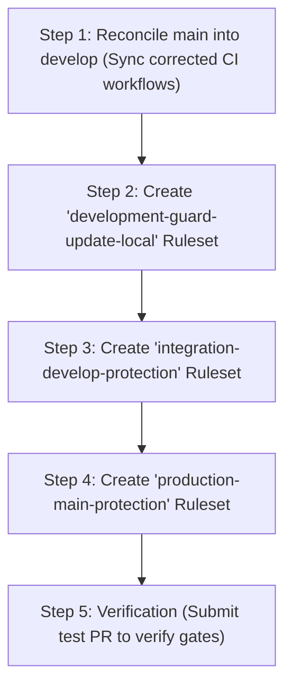

# Milestone 15 — GitHub Branch Protection and Ruleset Audit Report

**Repository:** [https://github.com/GreeshmanthSaiY/Virtual-Classroom-Platform](https://github.com/GreeshmanthSaiY/Virtual-Classroom-Platform)  
**Audit Date:** November 14, 2026  
**Auditor:** Antigravity Autonomous Verification Agent (Read-Only Audit)  
**Audit Scope:** `main`, `develop`, `update-local`  
**Current Enforcement Status:** **UNENFORCED (0 Active Rulesets, 0 Protected Branches)**

---

## 1. Executive Summary

Milestone 15 performed a comprehensive, read-only security and policy audit of the GitHub repository configuration for `GreeshmanthSaiY/Virtual-Classroom-Platform`. The audit evaluated whether the intended branch promotion model:

$$\text{Feature branches} \longrightarrow \text{update-local} \longrightarrow \text{develop} \longrightarrow \text{main}$$

is enforced via GitHub Rulesets or Classic Branch Protection.

**Key Finding:** Currently, **no branch protection rules or repository rulesets exist** on the repository. All branches (`main`, `develop`, and `update-local`) report `"protected": false`. While the continuous integration workflows are functional, any user with repository write access can push directly, force-push, or delete any branch without going through pull requests or CI validation.

This report documents the exact findings, maps out the verified GitHub Actions check names, evaluates branch-specific protection requirements, and provides an actionable implementation plan.

---

## 2. Existing GitHub Settings & Protection State

The GitHub REST API was audited for modern Repository Rulesets, Branch Evaluation Rules, and Classic Branch Protection across `main`, `develop`, and `update-local`.

### API Query Results

| Endpoint Probed | HTTP Status | Response Payload Summary | Audit Interpretation |
| :--- | :---: | :--- | :--- |
| `GET /repos/.../rulesets` | `200 OK` | `[]` (Empty array) | **Zero** repository rulesets are configured. |
| `GET /repos/.../rules/branches/main` | `200 OK` | `[]` (Empty array) | No rules apply to `main`. |
| `GET /repos/.../rules/branches/develop` | `200 OK` | `[]` (Empty array) | No rules apply to `develop`. |
| `GET /repos/.../rules/branches/update-local` | `200 OK` | `[]` (Empty array) | No rules apply to `update-local`. |
| `GET /repos/.../branches/main` | `200 OK` | `"protected": false` | `main` is completely unprotected. |
| `GET /repos/.../branches/develop` | `200 OK` | `"protected": false` | `develop` is completely unprotected. |
| `GET /repos/.../branches/update-local` | `200 OK` | `"protected": false` | `update-local` is completely unprotected. |
| `GET /repos/.../branches/{branch}/protection` | `401 Unauthorized` | `{"message": "Requires authentication"}` | Detailed classic protection API requires admin authorization; however, public branch metadata confirms protection is disabled. |

### Technical Verification Note
In GitHub's REST API, the public branch endpoint `GET /repos/{owner}/{repo}/branches/{branch}` returns `"protected": true` whenever any classic branch protection or active ruleset applies to the branch, even when queried without administrative credentials. Because all three branches return `"protected": false` and `GET /rulesets` returns `[]`, it is conclusively verified that **no rulesets or branch protection rules are active**.

---

## 3. Exact Branch Protection Matrix

The table below contrasts the **intended policy** against the **currently enforced state** for each branch:

| Security Control | `main` (Intended) | `main` (Actual) | `develop` (Intended) | `develop` (Actual) | `update-local` (Intended) | `update-local` (Actual) |
| :--- | :---: | :---: | :---: | :---: | :---: | :---: |
| **Branch Protected** | Yes | :x: **No** | Yes | :x: **No** | Appropriate | :x: **No** |
| **Direct Pushes Blocked** | Yes | :x: **No** | Yes | :x: **No** | No (Allow pushes) | :white_check_mark: Allowed |
| **Force Pushes Blocked** | Yes | :x: **No** | Yes | :x: **No** | Yes | :x: **No** |
| **Branch Deletion Blocked** | Yes | :x: **No** | Yes | :x: **No** | Yes | :x: **No** |
| **Pull Request Required** | Yes | :x: **No** | Yes | :x: **No** | No | :white_check_mark: Not required |
| **Required Approvals** | $\ge 1$ | :x: **0** | $\ge 1$ | :x: **0** | N/A | N/A |
| **Dismiss Stale Approvals** | Yes | :x: **No** | Yes | :x: **No** | N/A | N/A |
| **Conversation Resolution** | Yes | :x: **No** | Yes | :x: **No** | N/A | N/A |
| **Required Status Checks** | Yes | :x: **None** | Yes | :x: **None** | No | :white_check_mark: None |
| **Admin Enforcement** | Enforce | :x: **Unenforced** | Enforce | :x: **Unenforced** | N/A | N/A |

---

## 4. Actual GitHub Actions CI Check Names

To prevent configuring non-existent, misnamed, or perpetually pending status checks, the GitHub Actions Check Runs API was inspected on live commits.

### Workflow: `pr-validation.yml`
Emitted during Pull Request Validation (verified on commit `e2fee1ad84743942d4f99bac40278acae433de2f`, Run [`43474748815`](https://github.com/GreeshmanthSaiY/Virtual-Classroom-Platform/actions/runs/43474748815)):

| Exact Job / Check Name | Job Identifier | Scope & Quality Gate |
| :--- | :--- | :--- |
| `Backend QA (JUnit 5, Mockito, Spring Security, Package)` | `backend-validation` | Maven compile, test, JAR packaging |
| `Docker Image Build & Compose Orchestration` | `docker-validation` | Compose validation, multi-container build |
| `Frontend QA (TypeScript, Vitest, Build, Audit)` | `frontend-validation` | Node 20, Vite build, Vitest suite, npm audit |
| `PostgreSQL 16 Migration & Integrity Gate` | `postgres-migration-validation` | Flyway V1..V6 on real PostgreSQL 16 container |

### Workflow: `integration-validation.yml`
Emitted during Full-Stack Integration Verification on `develop` (verified on commit `a7c2126543be9adca0f0b40ded34acfdc8e4e389`, Run [`43461270851`](https://github.com/GreeshmanthSaiY/Virtual-Classroom-Platform/actions/runs/43461270851)):

| Exact Job / Check Name | Job Identifier | Scope & Quality Gate |
| :--- | :--- | :--- |
| `Full-Stack Integration Verification` | `integration-verification` | Monolithic end-to-end full stack verification |

### Critical Trigger Compatibility Findings
1. **Targeting `main`:**  
   - `pr-validation.yml` triggers on `pull_request: branches: [develop, main]`. All 4 checks run and report status.
   - `integration-validation.yml` triggers **only** on `push: branches: [develop]` and `pull_request: branches: [develop]`. It does **not** trigger on PRs targeting `main`.
   - **Crucial Rule:** `Full-Stack Integration Verification` must **not** be marked as a required check for `main`. Doing so will permanently block PRs targeting `main` because the check is never emitted.
2. **Targeting `develop`:**  
   - Both `pr-validation.yml` and `integration-validation.yml` trigger on PRs targeting `develop`.
   - All 5 checks are emitted and can safely be marked as required.
3. **Targeting `update-local`:**  
   - Neither workflow triggers on `update-local`. No status checks should be marked required for `update-local`.

---

## 5. Recommended Protection Configuration per Branch

We recommend modern **GitHub Repository Rulesets** over Classic Branch Protection for granular control, bypass actor lists, and clean audit trails.

```
                    +------------------------------------+
                    |       Repository Rulesets          |
                    +-----------------+------------------+
                                      |
         +----------------------------+---------------------------+
         |                            |                           |
         v                            v                           v
+------------------+         +------------------+        +------------------+
|   Ruleset: main  |         | Ruleset: develop |        |Ruleset: update-  |
|   (Production)   |         |  (Integration)   |        |      local       |
+------------------+         +------------------+        +------------------+
| - Block push     |         | - Block push     |        | - Allow direct   |
| - Block force-   |         | - Block force-   |        |   push           |
|   push           |         |   push           |        | - Block force-   |
| - Block deletion |         | - Block deletion |        |   push           |
| - PR required    |         | - PR required    |        | - Block deletion |
| - 4 PR checks    |         | - 5 CI checks    |        | - No PR required |
+------------------+         +------------------+        +------------------+
```

---

### 5.1. Ruleset 1: Production Branch Protection (`main`)

- **Ruleset Name:** `production-main-protection`
- **Enforcement Status:** `Active`
- **Target Branch:** `Include default branch` (or branch name pattern: `refs/heads/main`)
- **Bypass List:** Repository Admin (emergency break-glass only; default: none)

#### Rules Configuration:
1. **Restrict deletions:** `Enabled`
2. **Block force pushes:** `Enabled`
3. **Require a pull request before merging:** `Enabled`
   - **Required approvals:** `1` *(Note: For solo maintainer environments, see Risk 1 below)*
   - **Dismiss stale pull request approvals when new commits are pushed:** `Enabled`
   - **Require review from Code Owners:** `Optional`
   - **Require conversation resolution before merging:** `Enabled`
4. **Require status checks to pass before merging:** `Enabled`
   - **Require branches to be up to date before merging:** `Enabled` (Strict mode)
   - **Required Status Checks:**
     - `Backend QA (JUnit 5, Mockito, Spring Security, Package)`
     - `Docker Image Build & Compose Orchestration`
     - `Frontend QA (TypeScript, Vitest, Build, Audit)`
     - `PostgreSQL 16 Migration & Integrity Gate`

---

### 5.2. Ruleset 2: Integration Branch Protection (`develop`)

- **Ruleset Name:** `integration-develop-protection`
- **Enforcement Status:** `Active`
- **Target Branch:** `refs/heads/develop`
- **Bypass List:** None

#### Rules Configuration:
1. **Restrict deletions:** `Enabled`
2. **Block force pushes:** `Enabled`
3. **Require a pull request before merging:** `Enabled`
   - **Required approvals:** `1`
   - **Dismiss stale pull request approvals when new commits are pushed:** `Enabled`
   - **Require conversation resolution before merging:** `Enabled`
4. **Require status checks to pass before merging:** `Enabled`
   - **Require branches to be up to date before merging:** `Enabled`
   - **Required Status Checks:**
     - `Full-Stack Integration Verification`
     - `Backend QA (JUnit 5, Mockito, Spring Security, Package)`
     - `Docker Image Build & Compose Orchestration`
     - `Frontend QA (TypeScript, Vitest, Build, Audit)`
     - `PostgreSQL 16 Migration & Integrity Gate`

---

### 5.3. Ruleset 3: Development Hygiene Guard (`update-local`)

- **Ruleset Name:** `development-guard-update-local`
- **Enforcement Status:** `Active`
- **Target Branch:** `refs/heads/update-local`
- **Bypass List:** None

#### Rules Configuration:
1. **Restrict deletions:** `Enabled` (Prevents accidental branch loss)
2. **Block force pushes:** `Enabled` (Prevents overwriting team history)
3. **Require a pull request before merging:** `Disabled` (Preserves developer agility to push normal commits)
4. **Require status checks to pass:** `Disabled` (No workflows trigger on this branch)

---

## 6. Potential Risks & Compatibility Issues

| Risk | Description | Mitigation Strategy |
| :--- | :--- | :--- |
| **Risk 1: Solo Maintainer Approval Deadlock** | GitHub does not permit PR authors to approve their own PRs. If the repository has only one active contributor (`@GreeshmanthSaiY`), requiring 1 approval will block all merges. | If operating as a solo developer, set **Required Approvals = 0** while keeping **Require Status Checks to pass** enabled. This enforces CI verification without requiring a phantom second reviewer. |
| **Risk 2: Trigger Mismatch on `main`** | Requiring `Full-Stack Integration Verification` on `main` will permanently freeze PRs because that workflow only triggers on `develop`. | Only require the 4 checks from `pr-validation.yml` on `main`. |
| **Risk 3: Unreconciled `develop` Workflow** | The `develop` branch currently holds an older commit (`37586a2`) of `pr-validation.yml` containing unsupported job-level expressions. | Reconcile `main` into `develop` before activating strict status check rules on `develop`. |
| **Risk 4: Over-Constraining `update-local`** | Imposing PR requirements on `update-local` would disrupt daily iterative development and rapid prototyping. | Keep PR requirements disabled on `update-local`; only enforce deletion and force-push guards. |

---

## 7. Required GitHub Permissions

To implement the recommended rulesets, the executing identity must possess:
- **GitHub Role:** `Repository Administrator` or `Repository Owner` on `GreeshmanthSaiY/Virtual-Classroom-Platform`.
- **API Token Scopes (if configuring via API/CLI):**
  - Classic Token: `repo` (Full control of private/public repositories)
  - Fine-Grained Personal Access Token (PAT):
    - `Repository rules: Read and write`
    - `Administration: Read and write`

---

## 8. Implementation Plan



### Step 1: Reconcile Workflows on `develop`
Before enforcing rules on `develop`, merge `main` into `develop` so that `develop` inherits the corrected step-level component guards from `e2fee1a`.

### Step 2: Configure Ruleset for `update-local`
In GitHub Web UI:
1. Navigate to **Settings** $\rightarrow$ **Rules** $\rightarrow$ **Rulesets** $\rightarrow$ **New ruleset** $\rightarrow$ **New branch ruleset**.
2. Name: `development-guard-update-local`, Enforcement: `Active`.
3. Target: `Include by pattern` $\rightarrow$ `refs/heads/update-local`.
4. Rules: Check **Restrict deletions** and **Block force pushes**.
5. Save changes.

### Step 3: Configure Ruleset for `develop`
1. Navigate to **Rulesets** $\rightarrow$ **New branch ruleset**.
2. Name: `integration-develop-protection`, Enforcement: `Active`.
3. Target: `Include by pattern` $\rightarrow$ `refs/heads/develop`.
4. Rules:
   - Check **Restrict deletions** and **Block force pushes**.
   - Check **Require a pull request before merging** (Approvals: `1` or `0` for solo, check dismiss stale approvals and conversation resolution).
   - Check **Require status checks to pass**:
     - Add `Full-Stack Integration Verification`
     - Add `Backend QA (JUnit 5, Mockito, Spring Security, Package)`
     - Add `Docker Image Build & Compose Orchestration`
     - Add `Frontend QA (TypeScript, Vitest, Build, Audit)`
     - Add `PostgreSQL 16 Migration & Integrity Gate`
5. Save changes.

### Step 4: Configure Ruleset for `main`
1. Navigate to **Rulesets** $\rightarrow$ **New branch ruleset**.
2. Name: `production-main-protection`, Enforcement: `Active`.
3. Target: `Include default branch` (`main`).
4. Rules:
   - Check **Restrict deletions** and **Block force pushes**.
   - Check **Require a pull request before merging** (Approvals: `1` or `0` for solo, check dismiss stale approvals and conversation resolution).
   - Check **Require status checks to pass**:
     - Add `Backend QA (JUnit 5, Mockito, Spring Security, Package)`
     - Add `Docker Image Build & Compose Orchestration`
     - Add `Frontend QA (TypeScript, Vitest, Build, Audit)`
     - Add `PostgreSQL 16 Migration & Integrity Gate`
5. Save changes.

### Step 5: Verification
Create a test branch off `update-local`, submit a PR to `develop`, and verify that direct push to `develop` is rejected while the PR triggers all 5 required checks.

---

*Note: In accordance with the strict audit-only instructions of Milestone 15, no repository settings, rulesets, or branch protection configurations were modified.*
