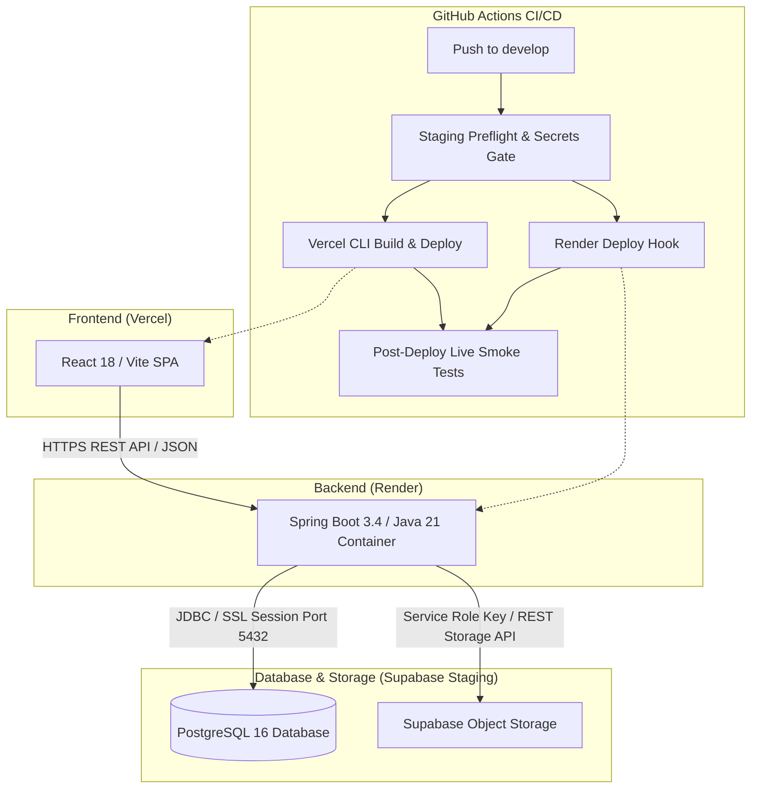
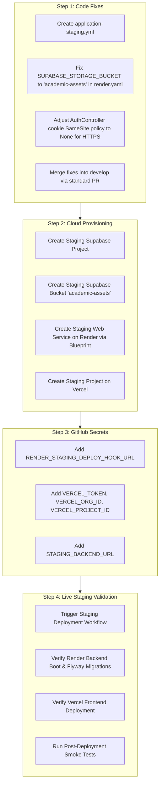

# Milestone 16 — Staging Infrastructure Readiness Audit

**Repository:** `https://github.com/GreeshmanthSaiY/Virtual-Classroom-Platform`  
**Audit Target:** Staging Deployment Architecture (Vercel + Render + Supabase + GitHub Actions)  
**Audit Date:** November 14, 2026  
**Milestone Mode:** Audit-Only (Read-Only Verification)  

---

## 1. Architecture Assessment

The staging deployment architecture is designed as a modern decoupled full-stack platform:

### Architectural Strengths
1. **Decoupled Lifecycle:** Independent scaling and deployment of frontend (Vercel CDN edge) and backend (Render containerized service).
2. **Automated Smoke Gate:** Post-deployment integration verification script (`scripts/staging_smoke_tests.js`) systematically validates routes, actuator health, 401 barriers, and CORS preflight.
3. **Fail-Safe Preflight:** In the absence of required secrets, the GitHub Actions preflight gate fails early, terminating execution before any external mutation occurs.

---

## 2. Vercel Readiness (Frontend)

| Component | Status | Finding & Audit Evaluation |
|---|---|---|
| **Vercel Project Config** | **READY** | Both root `vercel.json` and `frontend/vercel.json` exist with valid version 2 schemas. |
| **Build & Output Config** | **READY** | Root `vercel.json` specifies `cd frontend && npm ci && npm run build` with `frontend/dist`. `frontend/package.json` includes `vite build` and `tsc -b`. |
| **SPA Routing & Fallback** | **READY** | Rewrites `[{"source": "/(.*)", "destination": "/index.html"}]` ensure client-side React Router routing operates seamlessly on direct deep links. |
| **Security Headers** | **READY** | Configures `X-Content-Type-Options: nosniff`, `X-Frame-Options: DENY`, and `Referrer-Policy: strict-origin-when-cross-origin`. |
| **API Base URL Binding** | **MISCONFIGURED** | In `frontend/src/core/api/client.ts:4`, `API_BASE_URL` defaults to `/api/v1`. On Vercel, requests to `/api/v1` are rewritten by SPA fallback to `index.html` unless `VITE_API_BASE_URL` is explicitly defined during build or reverse-proxy rewrites are added. |
| **Zero Embedded Secrets** | **READY** | `frontend/src` contains zero hardcoded API keys, database credentials, or service role secrets. |

---

## 3. Render Readiness (Backend)

| Component | Status | Finding & Audit Evaluation |
|---|---|---|
| **Dockerfile & Runtime** | **READY** | Multi-stage `backend/Dockerfile` with Temurin JDK 21 builder and JRE 21 alpine runner. Hardened unprivileged user `appuser` (UID 10001). |
| **Startup Command & Health**| **READY** | Uses `exec java $JAVA_OPTS -jar app.jar`. Actuator endpoint `/actuator/health/liveness` is enabled via `management.endpoint.health.probes.enabled=true`. |
| **Blueprint Specification** | **READY** | `render.yaml` and `infrastructure/render/render-staging.yaml` define service `virtual-classroom-backend-staging` with Docker runtime, region `oregon`, plan `starter`, branch `develop`. |
| **Spring Profiles Config** | **MISCONFIGURED** | `render.yaml` sets `SPRING_PROFILES_ACTIVE=staging`. However, **`application-staging.yml` does not exist** in `backend/src/main/resources/`. Furthermore, `application.yml` contains no `spring.datasource` block. The application will fail to initialize a DataSource on startup under the `staging` profile. |
| **Storage Bucket Allowlist** | **MISCONFIGURED** | `render.yaml` sets `SUPABASE_STORAGE_BUCKET=academic-assets-staging`. However, `FileStorageService.java:43` defines a strict allowlist (`ALLOWED_BUCKETS`), which rejects `academic-assets-staging` with an `IllegalArgumentException` on startup. |
| **Cookie & CORS Isolation** | **MISCONFIGURED** | `AuthController.java:175` sets `SameSite="Strict"` on the `refreshToken` cookie. Because Vercel (`*.vercel.app`) and Render (`*.onrender.com`) are cross-site, modern browsers will block the cookie on cross-site requests, breaking token rotation. Furthermore, `SecurityConfig.java` uses exact string matching for `CORS_ALLOWED_ORIGINS`, which rejects dynamic Vercel preview URLs. |

---

## 4. Supabase Readiness (Database & Storage)

| Component | Status | Finding & Audit Evaluation |
|---|---|---|
| **Environment Isolation** | **REQUIRES USER ACTION** | A dedicated Staging Supabase project must be provisioned. Staging must never connect to the production Supabase database. |
| **Datasource & Flyway Port**| **MISCONFIGURED** | `.env.example` documents Supavisor Transaction Pooler port `6543`. **Flyway cannot execute DDL migrations over transaction pooling** due to advisory lock and prepared statement limitations. Connections must use Session Mode (port `5432`). |
| **Pooler User Syntax** | **READY** | Supavisor pooler requires `postgres.<project-ref>` format, properly documented in `.env.example`. |
| **Storage Bucket Provisioning** | **REQUIRES USER ACTION** | The bucket named `academic-assets` must be created in the Staging Supabase project with private access. |
| **Service Role Key Security** | **READY** | Backend accesses Supabase Storage via `SUPABASE_SERVICE_ROLE_KEY` using backend-only environment injection. Key is never exposed to frontend. |

---

## 5. GitHub Actions Deployment Workflow Assessment

| Inspection Criterion | Finding | Evaluation |
|---|---|---|
| **Workflow File** | `.github/workflows/staging-deployment.yml` | Present on `develop` |
| **Environment Binding** | Binds to GitHub Environment `staging` | **READY** (Environment ID `27213345925` exists) |
| **Environment Secrets** | Evaluates 5 secrets in `staging-preflight` | **MISSING** (0 secrets currently configured) |
| **Trigger Conditions** | `push` to `develop`, plus manual `workflow_dispatch` | **READY** |
| **Preflight Gate Fail-Safe** | Halts with exit 1 if any required secret is missing | **VERIFIED** (Successfully aborted run `43591476517`) |
| **Deployment Order** | Preflight $\rightarrow$ Render Hook + Vercel CLI $\rightarrow$ Smoke Tests | **READY** |
| **Rollback Behavior** | No automated rollback in workflow | **LIMITATION** (Requires manual re-trigger or fix-forward) |
| **Branch Safety** | Only triggers on `develop` branch pushes | **READY** |

---

## 6. Environment Variable Inventory by Name Only

### A. GitHub Environment `staging` Secrets (Required for CI/CD)
* `RENDER_STAGING_DEPLOY_HOOK_URL` — Deploy hook URL generated by Render for the staging service.
* `VERCEL_TOKEN` — Vercel personal access token with project deployment rights.
* `VERCEL_ORG_ID` — Vercel team/account ID.
* `VERCEL_PROJECT_ID` — Vercel project ID for frontend staging.
* `STAGING_BACKEND_URL` — Fully qualified staging backend URL (e.g. `https://virtual-classroom-backend-staging.onrender.com`).
* `STAGING_FRONTEND_URL` — Canonical frontend staging URL (optional fallback for smoke tests).

### B. Render Staging Service Environment Variables (Runtime Backend)
* `SPRING_PROFILES_ACTIVE` (currently `staging`, recommend `staging,prod` or `prod` until `application-staging.yml` is added)
* `PORT` (`8080`)
* `DATABASE_URL` (JDBC URL with `sslmode=require` targeting Staging Supabase pooler on port `5432`)
* `DATABASE_USERNAME` (`postgres.<staging-project-ref>`)
* `DATABASE_PASSWORD` (Staging Supabase database password)
* `JWT_SECRET` (Cryptographically random 256-bit Base64-encoded string, min 32 bytes)
* `JWT_EXPIRATION_MS` (`86400000`)
* `COOKIE_SECURE` (`true`)
* `CORS_ALLOWED_ORIGINS` (Allowed frontend URLs, e.g. `https://virtual-classroom-staging.vercel.app`)
* `STORAGE_PROVIDER` (`supabase`)
* `SUPABASE_URL` (Staging Supabase project API URL)
* `SUPABASE_SERVICE_ROLE_KEY` (Staging Supabase service role secret)
* `SUPABASE_STORAGE_BUCKET` (Must be `academic-assets` to comply with Java code allowlist)

### C. Vercel Staging Environment Variables (Build-time Frontend)
* `VITE_API_BASE_URL` (Staging backend API URL, e.g. `https://virtual-classroom-backend-staging.onrender.com/api/v1`)
* `VITE_APP_NAME` (`Virtual Classroom`)
* `VITE_APP_DESCRIPTION` (`Enterprise Modern LMS & Virtual Classroom Platform`)
* `VITE_ENABLE_DEMO_CREDENTIALS` (`false`)

---

## 7. Security and Isolation Risks

1. **Shared Database Catastrophe Risk:**
   * If Staging were mistakenly pointed to the Production Supabase instance, automated Flyway migrations or staging API testing could irreversibly alter or drop production academic records.
   * *Mitigation:* Staging MUST use an entirely distinct Supabase project with its own database ref, credentials, and storage buckets.
2. **Cross-Site Cookie Blocking (Silent Authentication Breakdown):**
   * Staging frontend (`.vercel.app`) and backend (`.onrender.com`) are separate registrable domains. `SameSite="Strict"` on the `refreshToken` cookie will prevent browsers from sending refresh cookies on cross-origin API calls, resulting in premature session logout.
   * *Mitigation:* Update `AuthController.java` cookie policy to `SameSite="None"` when `cookieSecure=true`, or configure Vercel path rewrites to proxy `/api/*` requests directly to Render.
3. **Storage Bucket Crash on Startup:**
   * If `SUPABASE_STORAGE_BUCKET` is configured as `academic-assets-staging`, `FileStorageService.java` will fail fast and crash the container on startup.
   * *Mitigation:* Use `academic-assets` within the dedicated Staging Supabase project, or amend `ALLOWED_BUCKETS` in application code.
4. **Flyway Lockup on Transaction Pooler:**
   * Using Supabase transaction pooler port `6543` will cause Flyway migration failure during startup.
   * *Mitigation:* Always configure port `5432` (Session Mode) in JDBC `DATABASE_URL`.

---

## 8. Missing Prerequisites

The following components are currently missing and block staging deployment:

1. **GitHub Environment Secrets:**
   All 5 secrets in GitHub Environment `staging` (`RENDER_STAGING_DEPLOY_HOOK_URL`, `VERCEL_TOKEN`, `VERCEL_ORG_ID`, `VERCEL_PROJECT_ID`, `STAGING_BACKEND_URL`) are missing.
2. **Staging Supabase Project:**
   A dedicated staging project has not yet been provisioned or linked.
3. **Application Staging Profile:**
   `backend/src/main/resources/application-staging.yml` does not exist in the repository.
4. **Render Staging Service Instance:**
   The Web Service `virtual-classroom-backend-staging` has not yet been provisioned on Render via Blueprint.
5. **Vercel Project Linkage:**
   The frontend project has not yet been initialized or linked in Vercel.

---

## 9. Itemized Readiness Classification

| Area | Component | Classification | Action Required |
|---|---|---|---|
| **Architecture** | Decoupled Vercel/Render/Supabase Model | **READY** | None |
| **CI/CD** | `staging-deployment.yml` workflow triggers & guards | **READY** | None |
| **CI/CD** | GitHub Environment `staging` presence | **READY** | None |
| **CI/CD** | GitHub Environment `staging` secrets | **MISSING** | User must configure the 5 deployment secrets in GitHub. |
| **Backend** | `backend/Dockerfile` & Java 21 runtime | **READY** | None |
| **Backend** | Actuator liveness and health endpoints | **READY** | None |
| **Backend** | Spring Boot `staging` profile definition | **MISCONFIGURED** | Create `application-staging.yml` or use `staging,prod`. |
| **Backend** | `FileStorageService.java` bucket allowlist mismatch | **MISCONFIGURED** | Use `academic-assets` in `render.yaml` or add bucket to allowlist. |
| **Backend** | `AuthController.java` `SameSite=Strict` cross-origin cookie | **MISCONFIGURED** | Change to `SameSite=None` for HTTPS cross-site or proxy `/api`. |
| **Frontend** | React 18 / Vite build scripts & TypeScript compile | **READY** | None |
| **Frontend** | SPA routing rewrites (`vercel.json`) | **READY** | None |
| **Frontend** | `VITE_API_BASE_URL` build-time configuration | **REQUIRES USER ACTION** | Must be set in Vercel project environment variables. |
| **Supabase** | Dedicated Staging project instance | **REQUIRES USER ACTION** | Provision separate project on Supabase. |
| **Supabase** | Database JDBC port selection (5432 vs 6543) | **MISCONFIGURED** | Use port 5432 (Session mode) for Flyway compatibility. |
| **Supabase** | Storage bucket `academic-assets` | **REQUIRES USER ACTION** | Create bucket in Staging Supabase project. |

---

## 10. Prioritized Remediation Plan

---

## 11. Final Readiness Decision

### **Current Decision: NOT READY (BLOCKED ON CONFIGURATION & SECRETS)**

* **Summary:** The repository's foundational architecture (Docker packaging, build pipelines, smoke test suite, preflight gates) is technically sound. However, live staging deployment is blocked by:
  1. Missing external cloud provisioning (Staging Supabase project, Render service, Vercel project).
  2. Missing GitHub Environment secrets in `staging`.
  3. Three internal configuration discrepancies (`application-staging.yml` absence, `academic-assets-staging` bucket allowlist rejection, and `SameSite="Strict"` cross-site cookie isolation).

Resolving the three internal configuration items and populating the staging environment credentials will bring the platform to **100% READY** for automated staging deployment.
